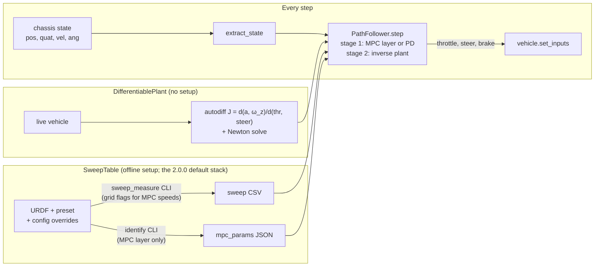
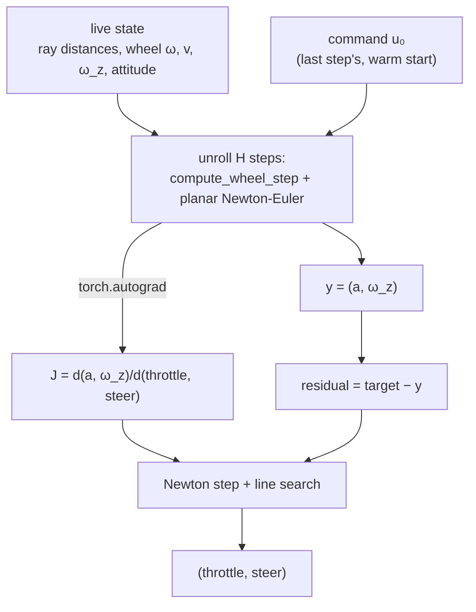
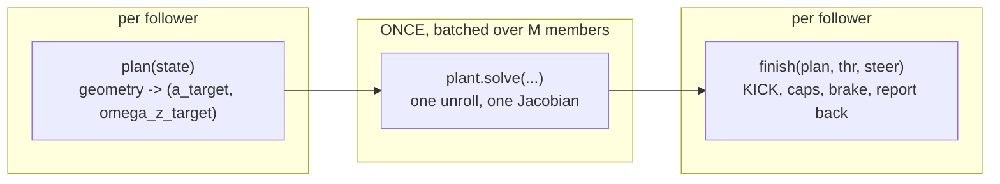
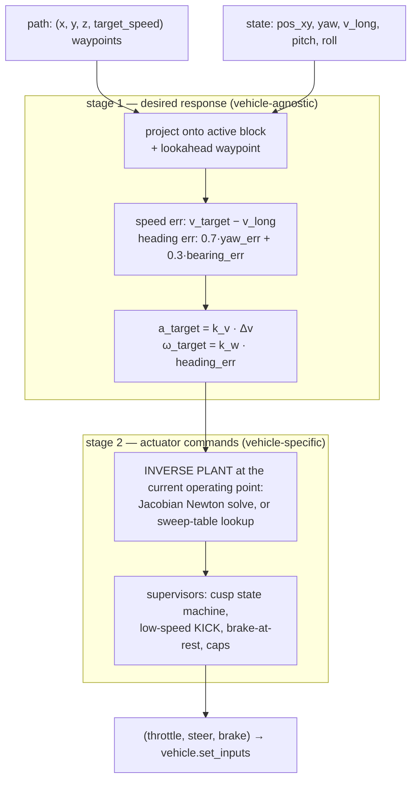
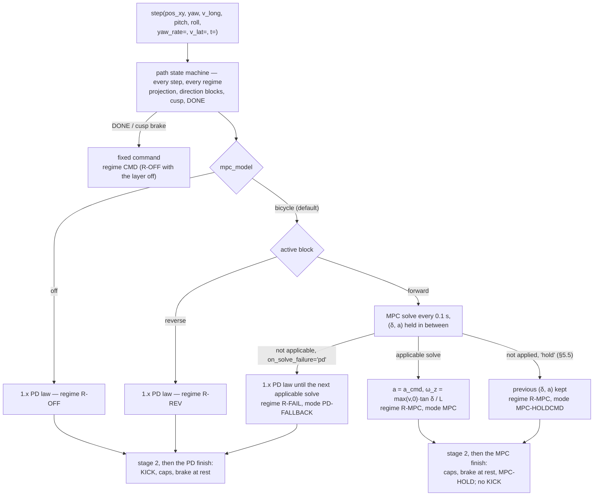

# Path following — `genesis_vehicle.control`

| abbr | meaning |
|---|---|
| S/T | Steer / Throttle command |
| inverse plant | whatever turns a desired `(a, ω_z)` into a `(throttle, steer)` command |
| Jacobian plant | `DifferentiablePlant` — the inverse from autodiff through the vehicle's own force model (the no-measurement plant; this row said "**default since v1.3.0**", which is stale since 2.0.0 — see "Which follower") |
| sweep table | `SweepTable` — the inverse from a measured (v, throttle, steer, pitch, roll) → (a, ω_z) grid |
| J | 2×2 Jacobian `d(a, ω_z) / d(throttle, steer)` |
| autodiff | automatic differentiation (`torch.autograd`) |
| cusp | sign flip of `target_speed` along the path = gear change (stop, then reverse) |
| block | maximal run of waypoints with one speed sign (the unit the follower drives) |
| ω_z | chassis yaw rate (rad/s) |
| ω | wheel spin rate (rad/s) |
| P control | proportional feedback (`u = K · error`) |
| MOI | moment of inertia |
| member | one (vehicle, env) pair a plant serves |
| M | number of members |
| L2 / L3 | batching axes: K interacting vehicles / `n_envs` parallel scenarios |
| kind | vehicles sharing a URDF + resolved config |
| h | `DifferentiablePlant` horizon (steps) |
| E0 / E1 / E2 | envelope rule used to judge a release's closed-loop change: every run passes its own criterion / worst run ≤ the previous release's worst / median ≤ the previous release's third quartile |
| DONE | the follower's final state: within `arrival_goal` of the last waypoint |
| MPC | Model Predictive Control — the 2.0.0 stage-1 layer (§5) |
| NMPC / LMPC | nonlinear MPC (do_mpc + IPOPT, `mpc_impl="nonlinear"`, default) / linear MPC (OSQP quadratic program, `mpc_impl="linear"`) |
| IPOPT / OSQP | the nonlinear-program solver bundled with casadi / the quadratic-program solver of the `osqp` package |
| PD | the 1.x stage-1 law (P control on the path, below); `mpc_model="off"` runs it alone |
| R-OFF / R-MPC / R-REV / R-FAIL / CMD | `PathFollower.regime`: MPC layer off / MPC on a forward block / PD on a reverse block / PD after a failed solve / DONE or cusp brake with the layer on |
| CTE | cross-track error: distance to the dense course polyline (m) |
| tot>25 | share of control steps (first 20 excluded) whose control + simulation time exceeds 25 ms |
| U1 | the `ValueError` a default (MPC) follower raises without `mpc_params` |
| δ, a | front-wheel steering angle (rad) / longitudinal acceleration (m/s²) the MPC commands |
| L | wheelbase (m) |
| p50 | median (50th percentile) of a per-step time within one run |
| U5 / RT-1 | the implementation's session-1 screening harness (`u5_bench.py`) / its session-2 paired field-vs-SDK timing harness (`run_rt1.py`); both outside the repo, not shipped |
| WSL2 | Windows Subsystem for Linux 2 (the measurement machine's environment) |

Give a path — a list of `(x, y, z, target_speed)` waypoints — and get
per-step `(throttle, steer, brake)` for any URDF + preset vehicle. A step has
two stages. **Stage 1** decides what physical response the vehicle should
produce, `(a, ω_z)`. **Stage 2**, the **inverse plant**, finds the commands
that produce it. Everything vehicle-specific in stage 2 lives in that one
object, so the same PD controller drives a skid-steer tank and an Ackermann
car.

### Which follower (2.0.0)

Since 2.0.0 stage 1 is an **MPC layer by default** (§5) on the forward blocks
of a path, with the 1.x PD law on reverse blocks and after a failed solve; it
needs the vehicle's measured MPC parameters, and **a follower constructed the
1.x way, `PathFollower(path, plant)`, raises `ValueError` (U1)**. Choose:

| | `mpc_model="off"` | default MPC layer (`mpc_params=`) |
|---|---|---|
| stage 1 | the 1.x PD law everywhere — bit-identical to 1.8.0 on every scenario measured (§6) | MPC on forward blocks, PD on reverse blocks and after a failed solve |
| vehicles | any (tank, truck, car) | two-axle Ackermann only |
| needs | nothing new | `requirements-mpc.txt`; a sweep table on a grid reaching the driving speeds + an identified params JSON (§5.2) |
| `FleetFollower` | yes | no (`TypeError`) |
| real time on the measured machine | PD + sweep table: 0 % of steps over 25 ms, 0.27 ms control mean (§5.6); with a `DifferentiablePlant` the plant decides (§1 "Tuning knobs") | NMPC: NOT guaranteed — 5-24 % of steps over 25 ms depending on the session; LMPC: 0 % median (§5.6) |

The documented **default stack is a sweep table + the MPC layer**;
`DifferentiablePlant` remains the no-measurement inverse plant and works under
both stage-1 choices. Through 1.8.0 this page called `DifferentiablePlant`
"the default"; that is stale since 2.0.0.

Two inverse plants ship with the SDK, interchangeable in the same argument:

| | `DifferentiablePlant` (no measurement, v1.3.0+) | `SweepTable` |
|---|---|---|
| where the vehicle knowledge comes from | autodiff through the SDK's own ray-wheel force model, every step | a 5-D response grid measured offline |
| setup per vehicle | **none** | a batched sweep run → CSV |
| survives a plant change (mass, friction, `i_wheel`, dt) | yes, automatically | no — silently stale until re-measured |
| operating point | the LIVE state: per-wheel normal loads, wheel speeds, attitude | grid interpolation on (v, pitch, roll) |
| needs a live simulator | yes | no — numpy only |
| cost per control step | v1.8.0: 25.5 ms median `solve` for one 10-wheel tank (Genesis-free, idle CPU, `horizon=4`; 1.7.0: 14.3 ms; measured before the last two 1.8.0 fix rounds, not re-measured on the final tree) — over a 25 ms control step; about 2 ms each across a fleet of 30 in a noisy session (see "Tuning knobs") | 0.16 ms for both channels, per vehicle (pre-1.8.0 measurement, not repeated; a table lookup that does not run the pipeline) |

Use the sweep table when the controller runs in a process with no
simulator (a game client driving the vehicle over OSC), when the control loop
has a hard real-time budget it cannot spare, and with the MPC layer (an MPC
follower on a `DifferentiablePlant` warns once: the solve and the inversion
both run inside every control step). The Jacobian plant is the option that
needs no measurement.



## Quick start

```python
from genesis_vehicle import PathFollower
from genesis_vehicle.control import extract_state

# (x, y, z, target_speed[, yaw]): z ignored; speed sign = direction
# (+forward / -backward); a sign flip = cusp (auto stop-and-reverse).
# Optional 5th element = desired chassis yaw (rad, world +X = 0, CCW
# positive); omit or None -> tangential default.
# Spawn the vehicle at the first waypoint FACING ALONG THE FIRST SEGMENT —
# here the path leaves (0, 0) along +X, the default spawn orientation. An MPC
# follower started facing away from its path can stall and never move
# (§5.3 "Known limitation"). Run as written (reference car spawned at
# (0, 0, 0.5), dt 0.025 x 4, CPU, 2026-11-21): "off" DONE at 30.55 s, the CSV
# variant DONE at 30.55 s, the MPC variant DONE at 30.075 s with 301/301
# converged solves and no MPC-HOLD — details after this block.
path = [
    (0.0,   0.0, 0.0, +2.0),
    (20.0,  0.0, 0.0, +2.0),
    (40.0, -8.0, 0.0, +2.0),
    (60.0, -8.0, 0.0, +2.0),
]

# The second argument is the inverse plant. The 1.x PD follower: hand it the
# vehicle and you get the Jacobian plant with no measurement step at all.
# (`PathFollower(path, vehicle)` without mpc_model="off" raises on 2.0.0.)
follower = PathFollower(path, vehicle, mpc_model="off")

# ...or a sweep CSV, for a controller that must run without a simulator:
#   follower = PathFollower(path, "my_vehicle_sweep.csv", mpc_model="off")

# ...or the 2.0.0 default stack, a two-axle Ackermann car with the MPC layer
# (two measurements first, §5.2). Start ALIGNED with the first forward block:
# misaligned, the MPC can stall — the vehicle never moves — with every solve
# "converged", no warning and no fallback (§5.3).
#   follower = PathFollower(path, "my_car_sweep.csv",
#                           mpc_params="my_car_mpc_params.json")

for step in range(n_steps):
    st = extract_state(vehicle)          # Genesis entity or Vehicle wrapper
    thr, steer, brake = follower.step(
        st["pos_xy"], st["yaw"], st["v_long"], st["pitch"], st["roll"],
        yaw_rate=st.get("yaw_rate"), v_lat=st.get("v_lat"))  # required by the MPC layer
    if follower.last_mode == "DONE":
        break
    vehicle.set_inputs(throttle=thr, brake=brake, steer=steer)
    vs.step()
```

Quick start, run as written (2026-11-21; reference car
`samples/urdf/car_4w.urdf` + `car_4w_rwd_ackermann` spawned at (0, 0, 0.5) in
the default orientation, `VehicleScene(dt=0.025, substeps=4, n_envs=1)`, plane
friction 1.0, CPU/WSL2, genesis-world 1.4.5): `mpc_model="off"` with the live
vehicle DONE at 30.55 s (1222 steps), end (58.965, -6.922); the CSV variant
DONE at 30.55 s, end (58.964, -6.928); the MPC variant (default NMPC, `"pd"`,
the `mpc_follow_demo` cache's table and params) DONE at 30.075 s (1203 steps),
end (58.528, -7.999), 301/301 solves converged, no `MPC-HOLD`.

Outside Genesis (UE / Unity / replay), build the state dict with
`extract_state_from_arrays(pos_xyz, quat_wxyz, vel_xyz[, ang_xyz])` (pass the
world angular velocity `ang_xyz` to get `yaw_rate` / `v_lat`) — the PD
controller itself is numpy-only and simulator-agnostic. That end-to-end
property holds with a `SweepTable`; the Jacobian plant reads the live vehicle,
so that combination is Genesis-bound by construction. The MPC layer needs no
simulator either, but it needs the optional solver packages (§5.1).

**Driving over the OSC server (velocity estimation).** The state stream
(`/Genesis/Vehicle/TargetBulk`) carries pos + quat but NO velocity, so a
server-side client must finite-difference positions — and it must do so
in the server's **simulation time base**, not wall-clock: every
TargetBulk is preceded by `/Genesis/State/SimTime [t]` (the sim time the
state corresponds to, interpolation-fractional). FD over a ~0.3 s window
of `(sim_t, pos)` pairs is robust to the wire's realities — the send
cadence is not 1:1 with sim steps (catch-up bursts, lerped/duplicate
sends; and since v1.6.7 the server's `--send-hz` can downsample the send
to a wall-clock rate, which widens the cadence further — the `SimTime`
stamp stays paired with its TargetBulk because both sit inside the same
gate, so sim-time FD keeps working), and under load (e.g. the server viewer on) the server runs in
SLOW MOTION, where wall-clock FD under-reads speed, the KICK
over-throttles, and the vehicle overshoots the course in sim terms
(measured: a 157 m miss that sim-time FD turns back into a normal PASS).
Sample #14 (`path_follow_osc_demo.py`) is the reference implementation,
including the UE-frame decode (`docs/server.md` §4).

Runnable end-to-end demos (bundled 10-wheel tank, `mpc_model="off"` since
2.0.0; both default to the Jacobian plant, and `--plant sweep` switches them to
the measured table):

```bash
# forward course around a wall — PASS = final error < 3 m
python -m genesis_vehicle.samples.path_follow_demo [--viewer]

# drive past a bay, cusp, reverse in on an explicit-yaw arc
python -m genesis_vehicle.samples.path_follow_reverse_demo [--viewer]
```

The MPC layer on the reference car (measures and caches the table and the
params on its first run, §5.2):

```bash
python -m genesis_vehicle.samples.mpc_follow_demo                    # NMPC + table
python -m genesis_vehicle.samples.mpc_follow_demo --mpc-impl linear  # LMPC
python -m genesis_vehicle.samples.mpc_follow_demo --mpc-model off    # PD, same course
python -m genesis_vehicle.samples.mpc_follow_demo --course cusp      # forward MPC, reverse PD
```

## 1. The Jacobian plant (`DifferentiablePlant`)

```python
from genesis_vehicle import DifferentiablePlant, PathFollower

plant = DifferentiablePlant(vehicle)          # no CSV, no measurement
follower = PathFollower(path, plant, mpc_model="off")   # or PathFollower(path, vehicle, mpc_model="off")
```

Every knob is a constructor kwarg, so there are three equivalent ways to set
one (`horizon` here — see the table further down for the rest):

```python
# 1. build the plant yourself
follower = PathFollower(path, DifferentiablePlant(vehicle, horizon=6), mpc_model="off")

# 2. let the follower build it, and forward the kwargs
follower = PathFollower(path, vehicle, plant_kwargs={"horizon": 6}, mpc_model="off")

# 3. from the demos' CLI
#    python -m genesis_vehicle.samples.path_follow_demo --horizon 6
```

The plant is a live object, so it also answers questions directly — useful for
tuning, logging, or driving something other than a `PathFollower`:

```python
a, omega_z = plant.predict(throttle=0.4, steer=0.1)   # forward: what would happen
J, y = plant.jacobian()                               # 2x2 d(a, omega_z)/d(thr, steer)
thr, steer = plant.solve(v_long, a_target, omega_target)   # inverse

# after the step is applied, diagnostics of the solve that produced it
plant.last_jacobian, plant.last_response, plant.last_target, plant.last_singular
plant.last_restarted   # v1.7.0: answer came from the zero restart of a saturated warm start
```

`predict` takes sequences too, evaluating every candidate command in one
batched unroll — that is how the internal line search costs one pass, and it
is the cheap way to sweep a response curve:

```python
a, omega_z = plant.predict([0.0, 0.25, 0.5, 0.75, 1.0], [0.0] * 5)
```

If you post-process the plant's command before applying it — clamping,
overriding, a supervisor of your own — tell the plant what the vehicle
actually got, or the next Jacobian linearises a state the vehicle was never
in (this is what `PathFollower` does internally):

```python
vehicle.set_inputs(throttle=thr, steer=steer, brake=brk)
plant.set_applied(thr, steer)
```

### How it gets the inverse

The SDK's ray-wheel physics lives in one pure-`torch` function,
`_pipeline.compute_wheel_step` — suspension load, slip, Pacejka tyre, the
wheel-ω update, and the chassis wrench that comes out. Nothing in it does
I/O, so it is differentiable exactly as written.

Every control step the plant:

1. **snapshots the live state** — per-wheel ray distances (hence normal
   loads), wheel speeds, body velocity, yaw rate, attitude;
2. **unrolls `horizon` steps** of that same force model against a planar
   (surge / sway / yaw) rigid-body integrator built from the vehicle's real
   composite mass and yaw MOI, and reads off the two quantities the sweep
   table tabulates:
   `a = (v_long(H) − v_long(0)) / (H·dt)` and the mean yaw rate;
3. **differentiates** them with respect to `(throttle, steer)` →
   `J`, one vmapped backward pass;
4. **inverts** `J` — a Newton step warm-started from last step's command,
   then chord iterations with a backtracking line search.



Because the unroll starts from what the vehicle is actually doing, the
inverse is local to the real operating point — load transfer already in the
normal loads, the actual wheel speeds, the actual slope — rather than an
interpolation between grid nodes measured from a clean flat-ground start.

### Why not the Genesis differentiable solver

Genesis does ship a differentiable rigid solver
(`SimOptions(requires_grad=True)`), and the obvious plan is to backpropagate
through `scene.step()`. **It cannot work for this SDK.** The solver's taped
input set is exactly `set_pos` / `set_quat` / `set_dofs_velocity` /
`control_dofs_force` (see `RigidEntity.process_input_grad`); the external
wrench API is not on the tape (`apply_links_external_wrench` on genesis
>= 1.4.0, `apply_links_external_force` / `_torque` on <= 1.3.3) — and it is
the *only* way a ray-wheel vehicle touches the solver, because the SDK
deliberately has no wheel joints to motor.

Measured on genesis-world 1.3.3, and unchanged on 1.4.0, which only renamed
the call: a leaf tensor passed to the external-wrench API comes back from
`scene.backward()` with `grad is None`, while the same probe through
`control_dofs_force` returns a finite gradient. So Genesis autodiff can differentiate a joint-motor
vehicle, not a ray-wheel one.

Differentiating the SDK's own force model instead gets the same Jacobian and
costs less: no `requires_grad` scene, so no hibernation ban, no integrator
restriction, no dense-Hessian solve, and it runs on CPU.

### Accuracy

The unroll is the real force model driven by a reduced chassis model: exact
in the wheel forces, approximate in the body motion. Surge / sway / yaw only
— heave, pitch and roll rates are frozen and the measured ray distances are
held over the horizon, so the normal loads are this step's (no in-horizon
load transfer). Gravity enters through the live attitude, which is what the
sweep grid's pitch/roll axes bought. Terrain is assumed locally flat over
the horizon (0.1 s at the default `horizon=4` and 40 Hz).

Measured against the actual simulator (command held for `horizon` steps
from the live state, `horizon=4`, reference 10-wheel tank and 4-wheel car;
**measured before v1.8.0 and not re-measured since** — v1.8.0 changed the force
model on both sides of this comparison):

| vehicle | max \|Δa\| | max \|Δω_z\| | autodiff vs finite difference |
|---|---|---|---|
| `tank_ref` (10 wheels, 58.7 t) | 0.18 m/s² | 0.0014 rad/s | ≤ 6e-4 relative |
| `car_4w` (4 wheels, 1.33 t) | 0.10 m/s² | 0.0029 rad/s | ≤ 8e-4 relative |

The composite mass properties the planar model uses reproduce the entity's
own 6×6 mass matrix to six digits.

**A `swept_envelope` vehicle is still predicted as a point contact (v1.6.0).**
The frozen snapshot above is the whole story: the plant captures `distances`
once per control step and holds them over the horizon, so it never re-runs the
raycast — and therefore never runs the swept-envelope reduction either. The
SIMULATED vehicle gets the envelope; the controller's internal model does not.
Over flat or gently varying ground the two agree, because the envelope reduces
to the point contact there (it reads the same distance to 7 decimals). Over a
kerb or a step they do not: the plant predicts the wheel teleporting onto the
obstacle in one `dt` — the very behaviour `wheel_contact="swept_envelope"` was
added to remove — while the vehicle climbs it.

That is a real limitation for `PathFollower` on rough terrain, not a footnote.
It does not make the follower unstable (the plant is re-linearised from the live
state every step, so the error is corrected on the next one), but the *predicted*
normal loads across an obstacle are wrong in the same direction the point
contact was always wrong. Nothing in the plant's API exposes M, and closing this
would mean carrying the fan geometry into the snapshot and re-reducing inside
the unroll. Not attempted in v1.6.0.

### Closed-loop, against the sweep table

Same course, same vehicle, same tuning — `path_follow_demo` (10-wheel tank
around a wall) and `path_follow_reverse_demo` (drive past a bay, cusp,
reverse in on an explicit-yaw arc):

| plant | forward course, path deviation | reverse-into-bay |
|---|---|---|
| `SweepTable` (78,302 measured rollouts) | mean 0.384 m, max 1.034 m | 1.50 m / 0.33 rad, PASS |
| `DifferentiablePlant` (no measurement) | mean 0.370 m, max 0.917 m | 1.50 m / 0.32 rad, PASS |

```bash
python -m genesis_vehicle.samples.path_follow_demo --plant jacobian   # default
python -m genesis_vehicle.samples.path_follow_demo --plant sweep
```

The table above predates v1.7.0 and is kept as the original comparison. Re-run
on v1.7.0 (CPU/WSL2, genesis-world 1.4.5, headless, default args, demos run 3
or 4 at a time in parallel): forward course mean deviation 0.352 m (jacobian) /
0.314 m (sweep, with the re-measured tank table); reverse-into-bay PASS
1.49 m / 0.33 rad (jacobian) and 1.49 m / 0.30 rad (sweep). Max deviation was
not recorded in that run. **On v1.6.10 with genesis-world 1.4.5 the
reverse-into-bay jacobian run FAILED** (1.50 m / 0.43 rad against the 0.4 rad
limit, deterministic), so the PASS in the table above did not hold on that
engine. v1.7.0 passes it with a 0.07 rad margin; the cause of the v1.6.10
failure is not established, and v1.7.0 is not claimed to have fixed it.
v1.7.0 also makes rolling resistance take effect, so holding 2 m/s on the
forward course now takes throttle +0.13 (v1.6.10: -0.00), and **any sweep table
measured before v1.7.0 is stale** for the default `"control"` profile;
`samples/data/tank_sweep_signed.csv` is re-measured.

**v1.8.0** changed the brake, the drive-torque order and the friction ellipse
(CHANGELOG 1.8.0), so **every sweep table measured before v1.8.0 is stale
again**; the bundled tank table is re-measured. Closed-loop results on v1.8.0
(CPU/WSL2, genesis-world 1.4.5, headless, default batched solver), judged
against 1.7.0 by an envelope rule fixed before measuring (horizon {3, 4, 5} ×
spawn shifts (0,0) / (0,±0.3) m for the jacobian demos, the 3 shifts for the
sweep demos, each tree with its own table; E0 / E1 / E2):

| demo, metric | 1.7.0 [min, median, Q3, max] | 1.8.0 [min, median, max] | rule |
|---|---|---|---|
| forward jacobian, mean deviation (m) | [0.314, 0.451, 0.478, 0.562] | [0.322, 0.376, 0.448] | pass |
| forward jacobian, final error (m) | [1.46, 1.47, 1.48, 1.49] | [1.45, 1.49, 1.50] | **E1 and E2 not met, by 0.01 m** |
| reverse jacobian, yaw error (rad) | [0.31, 0.33, 0.34, 0.38] | [0.17, 0.21, 0.23] | pass |
| forward sweep, mean deviation (m) | [0.273, 0.314, 0.350, 0.386] | [0.289, 0.334, 0.396] | **E1 not met, by 0.010 m** (deterministic: a repeat reproduced it to the digit) |
| forward sweep, final error (m) | median 1.48, Q3 1.485 | [1.46, 1.49, 1.49] | E2 not met |
| every run's own PASS criterion (sweep demos) | 5 of 6 (reverse, shift (0,-0.3): position error 69.35 m) | 6 of 6 | — |

The user accepted both results; the rule is not changed and no PathFollower
retune is in v1.8.0. **The "final error" is the distance to the goal AT THE
DONE STEP**: the demo stops on the first DONE and reads the pose without
stepping again, and DONE fires inside `arrival_goal` = 1.5 m, so the value is
1.5 m minus the depth of the step that crossed the radius (< 0.05 m at 2 m/s).
It is not a stopping distance — a project reading that attributed the 0.01 m to
v1.8.0's shorter stop was wrong. At the DONE step, horizon 3 / 4 / 5: 1.8.0
1.4971 / 1.4982 / 1.4607 m, 1.7.0 1.4694 / 1.4666 / 1.4927 m. With the speed
and yaw gains varied ±25% the final error spans [1.45, 1.50] on both trees.
The plant's prediction error against the realised motion (forward demo,
(0,0)) improved in yaw rate at every horizon (RMS 0.0023 / 0.0028 / 0.0034 vs
0.0094 / 0.0061 / 0.0092 rad/s) and in acceleration bias; acceleration RMS is
better at h 3 / h 5 but slightly worse at h 4 (0.317 vs 0.306 m/s²), and the
acceleration |max| is worse at h 3 / h 4 (5.82 / 4.41 vs 3.43 / 3.98 m/s²).
`fleet_follow_demo`: PASS in both modes; mean cross-track deviation 0.581 m
(jacobian), 0.366 m (sweep, with the re-measured table).

### Tuning knobs

| kwarg | default | effect |
|---|---|---|
| `horizon` | 4 steps | how far ahead the unroll looks — at 40 Hz, 4 steps is 0.1 s of predicted future. Also the cost knob (see below). Longer is not better: 8 measured both slower AND looser than 4 on the reference course (mean deviation 0.433 m vs 0.370 m), because a controller running every step wants the near-term response and a long horizon drifts further from the frozen-normal-load assumption. |
| `newton_iters` | 2 | chord iterations after the Jacobian; each is one forward unroll |
| `coupled` | `False` | solve the full 2×2 instead of channel-diagonal (see below) |
| `damping` | 1e-2 | Levenberg damping of the coupled solve |
| `probe_delta` | 0.2 | secant step used when a channel's derivative degenerates (see below) |
| `saturation_restart` | `True` | v1.7.0. A warm start at a range limit is also solved from 0 in the same batch; the lower residual wins (see below). `False` = the pre-1.7.0 single-start solve |
| `line_search_steps` | 3 | backtracking halvings, all evaluated in one batched unroll |
| `scale_a` / `scale_w` | 1.0 / 0.2 | what counts as "one unit of error" in each channel |
| `mass` / `izz` / `com` | read off the entity | override the planar mass properties |

`horizon` is what the plant's cost buys, and it buys it roughly linearly.

**v1.8.0 cost (accepted by the user).** v1.8.0 applies the drive and brake torques
before the tyre, takes the friction ellipse at the transmitted force and adds
the low-speed deadbeats (CHANGELOG 1.8.0 §1–§6), and every one of those runs in
the plant's unroll. Fail-closed, idle CPU, Genesis-free fake tank of
`tests/test_differentiable_plant.py`, `horizon=4`, one `solve()` on a fresh
plant: **14.25 ms on 1.7.0 → 25.49 ms on 1.8.0, ratio 1.811 [1.676 .. 1.897]**
(6 alternating repeats; car `solve` 21.65 → 29.54 ms, ratio not published,
interval [1.343 .. 1.444]). This was measured on the tree before the last two
1.8.0 fix rounds (the Pacejka Newton-divisor floor changed afterwards) and was
not re-measured on the final tree. **A 10-wheel tank at `horizon=4` therefore
does not fit a 25 ms (40 Hz) control step on the measured machine** — the
Genesis-free solve alone exceeds it, before the live-state snapshot a real
vehicle adds. Smaller horizons were not measured on an idle machine (the noisy
table below is no evidence for a 25 ms budget), so no horizon is recommended
for that loop; the measured option is a `SweepTable`. A horizon sweep re-run for
v1.8.0 on the same fake tank (median of 25 fresh plants per point, 4
alternating repeats, one CPU; a noisier session whose absolute times were about
twice the idle figures, so read the ratios, not the milliseconds):

| `horizon` | 1.7.0 median | 1.8.0 median | 1.8.0 / 1.7.0, range over repeats |
|---|---|---|---|
| 2 | 16.7 ms | 24.9 ms | 0.92 .. 2.15 |
| 3 | 21.9 ms | 35.9 ms | 1.02 .. 2.21 |
| 4 | 28.5 ms | 59.7 ms | 1.51 .. 2.52 (published 1.918) |
| 6 | 53.0 ms | 86.4 ms | 1.09 .. 2.03 |
| 8 | 92.7 ms | 128.1 ms | 0.97 .. 1.51 |
| 12 | 120.2 ms | 161.1 ms | 1.30 .. 1.76 |

A 30-member fleet at `horizon=4` measured 1.62 → 2.17 ms per member in the same
session (the "~0.9 ms each" this page quoted before was not reproduced on
either tree in it).

**The table below is the pre-v1.7.0 measurement** (reference 10-wheel tank,
real vehicle, CPU, one `solve()` call; harness not in the repo) and was kept
as this page's original figure. It is NOT the v1.8.0 cost; through v1.7.0 this
page presented it as current. Measured then:

| `horizon` | predicted ahead | per solve | vs a 25 ms control step |
|---|---|---|---|
| 2 | 0.05 s | 9.7 ms | 39 % |
| 3 | 0.075 s | 15.3 ms | 61 % |
| **4** (default) | **0.1 s** | **20.1 ms** | **80 %** |
| 6 | 0.15 s | 29.6 ms | 118 % |
| 8 | 0.2 s | 39.1 ms | 156 % |
| 12 | 0.3 s | 56.1 ms | 224 % |

For scale: the simulation step itself is ~10 ms on the same machine, and a
`SweepTable` inversion of both channels is 0.16 ms.

### Two things that go wrong without care

**A least-squares 2×2 solve will spin the vehicle to make it go faster.**
The coupled inverse is free to spend whichever command reduces the residual
most, and near rest `|∂a/∂steer|` on a skid-steer exceeds
`|∂a/∂throttle|` — so a speed error gets "fixed" by throwing the vehicle
into a spin. Path following wants the opposite priority, so the default is
channel-diagonal: throttle answers for `a`, steer for `ω_z`. The cross terms
are not discarded — the chord iterations re-evaluate the full coupled
response at the updated command, which is the useful half of the coupling
without the pathology.

**The plant has dead zones where the derivative is honestly zero.** Through
v1.7.0 the drive torque went through the `F_long` overshoot clamp, which pinned
the tyre force to exactly zero whenever friction could not carry the wheel past
rolling within one step, and a zero Jacobian reads as "no authority, do not
move" — which froze the controller mid-manoeuvre on the reverse course. Since
v1.8.0 the drive torque acts before the tyre, and the dead zones known are a
wheel the brake HOLDS (its spin is pinned at 0 for any small command change)
and the clamp's zero end where a hook's force opposes the wheel's slip (on a
240-state grid including brake 0.5, the count of all-zero d a / d throttle
columns went from 9 car / 6 tank on 1.7.0 to 0 / 0; CHANGELOG 1.8.0 §7.2). Where a whole Jacobian column
vanishes, the plant re-estimates it with a one-sided **secant** over
`probe_delta` of command, large enough to step out of the dead zone. The
derivative is a local object; the secant over a control-sized step is not.

**A saturated warm start can trap the solve (fixed in v1.7.0).** `solve()`
linearises at the previous command. At a range limit the local Jacobian can
point back into the limit, and through v1.6.10 the chord iterations never left
it: on a field team's harness the reference car at +2 m/s, asked for -3 m/s²
with a previous command of +1, got throttle +1.00, the wrong direction. Since
v1.7.0, with `saturation_restart=True` (the default), if any member's warm
start is within 1% of the half-range of a limit in either channel (throttle
≤ -0.99 or ≥ +0.99 on the default range), every member also starts from a copy
with its saturated channels set to 0. Both starts ride the same batched unroll
and line search, and per member the lower final weighted residual wins (the
warm start on a tie, and always for a member whose own warm start was not
saturated). `last_restarted` says which members took the restart. The same
field case now returns -1.00.

| `saturation_restart` | warm start | throttle | residual | `last_restarted` |
|---|---|---|---|---|
| False | -1 | -1.0000 | 5.5905 | False |
| False | 0 | +0.7384 | 0.4086 | False |
| True | -1 | +0.7384 | 0.4086 | True |
| True | 0 | +0.7384 | 0.4086 | False |

Reference tank, Genesis-free fake state of `tests/test_differentiable_plant.py`,
target +3 m/s² at -2 m/s. Exactness: a solve in which no member is saturated
runs the single-start code path unchanged. In a mixed fleet every member runs
two starts, and an unsaturated member is NOT bit-identical to its solo solve; it
agrees within rel 1e-4 / abs 1e-5
(`test_a_mixed_fleet_restarts_each_member_as_it_would_alone`). The cost, two
starts per member in one batch on steps where some member is saturated, was not
timed.

**`jacobian()` returns NaN at a standstill (v = 0, ω = 0), and that is not
fixed.** Measured on v1.6.10 and v1.7.0 with the same fake state,
`jacobian(0, 0)`: the reference car's throttle column is NaN, the reference
tank's whole 2×2 is NaN. Removing `StaticFrictionLock` from the hook list makes
both finite, which points at the `sqrt` of the friction-ellipse norm in its
post-tire path (gradient undefined at zero); that line is suspected, not
proven. A controller starting from rest should not rely on the Jacobian of that
exact state.

### Fleets: one plant, many vehicles

One plant serves **M members** — (vehicle, env) pairs of a single kind, the
granularity `MultiVehicleKindPhysics` already groups by. Pass a sequence of
vehicles, a sequence of `env_idx`, or both (members are their cartesian
product, env-major):

```python
from genesis_vehicle import DifferentiablePlant, FleetFollower, PathFollower

plant = DifferentiablePlant(tanks)                 # M = len(tanks)
followers = [PathFollower(path, plant, mpc_model="off") for path in paths]   # PD only
fleet = FleetFollower(followers, plant)

cmds = fleet.step([extract_state(t) for t in tanks])   # one solve for the lot
for t, (thr, steer, brake) in zip(tanks, cmds):
    t.set_inputs(throttle=thr, steer=steer, brake=brake)
```

Runnable, with both plants on the same fleet for comparison:

```bash
python -m genesis_vehicle.samples.fleet_follow_demo --k 8            # both
python -m genesis_vehicle.samples.fleet_follow_demo --k 8 --plant jacobian
```

`M == 1` keeps the scalar surface exactly as it was; `M > 1` makes `predict` /
`jacobian` / `solve` / `set_applied` take and return arrays of length M, and
the diagnostics per-member.

**Why it is nearly free.** The unroll was already batch-shape-agnostic
(`compute_wheel_step` is); that axis simply carried candidate commands, and
now carries `M x candidates`. At these tensor sizes the unroll is dominated by
torch's per-op dispatch rather than arithmetic, so widening it barely costs
anything — measured forward unroll, 10-wheel tank, `horizon=4` (before
v1.8.0; absolute times rose with v1.8.0, see "Tuning knobs"):

| batch | ms/call | ms per item |
|---|---|---|
| 1 | 6.83 | 6.83 |
| 8 | 6.93 | 0.87 |
| 32 | 8.34 | 0.26 |
| 128 | 8.57 | 0.067 |

The Jacobian rides the same trick: batch members are independent in the
unroll, so `d(sum_i a_i)/d(thr_j)` IS member j's own gradient, and one
backward per row covers the whole fleet.

End to end, control cost per step against one plant per vehicle:

| K tanks | K separate plants | 1 batched plant | per vehicle |
|---|---|---|---|
| 8 | 200.7 ms | 26.2 ms (**7.7x**) | 25.1 -> 3.27 ms |
| 30 | 743.9 ms | 28.1 ms (**26.5x**) | 24.8 -> 0.94 ms |

with the command streams agreeing to float32 noise (at K=30, max
`|d throttle|` 3.3e-05, max `|d steer|` 1.8e-04, final position spread
1.5e-05 m over 40 steps).

**How the follower splits.** A `PathFollower` is per-vehicle by nature — its
path, its block, its cusp state machine — but the expensive half of a step is
the inversion. So `step()` is two halves that a fleet runs around one solve:



A plan whose `command` is already set (arrived, braking into a cusp) needs no
inversion at all; it still occupies a batch slot, which costs nothing.
`PathFollower.step()` is exactly this composition for one vehicle, so
single-vehicle behaviour is unchanged.

**PD followers only (2.0.0).** `FleetFollower` raises `TypeError` if any
follower has the MPC layer on: its step passes no `yaw_rate` / `v_lat`, and N
NMPC solves per step do not fit a control period. The check runs before any
follower is modified.

All members of a plant must share one kind — they share the force model, the
wheel meta and the mass properties, which is what a kind means. Mixed kinds
are refused; give them one plant each and one `FleetFollower` each.

**What this does NOT change.** The simulation path is untouched: L2/L3
batching, `MultiVehiclePhysics` and `n_envs` are the same code, and a plant
reads a batched scene through the kind's own single batched solver call
however many members it serves.

### Feeding it a non-Genesis state

`DifferentiablePlant` accepts any object providing the state-source surface
(`genesis_vehicle.control.plant.STATE_SOURCE_SURFACE`) in place of a
vehicle — the resolved config, the wheel meta, and callables returning the
chassis pose/velocity, wheel ω, previous compression and ray distances.
That is how the Genesis-free unit tests drive it, and it is the hook for
wiring the plant to an external state feed.

## 2. Measuring a sweep table (only for `SweepTable`)

```bash
python -m genesis_vehicle.control.sweep_measure \
    --urdf my_vehicle.urdf \
    --preset tank_skid_belt \
    --top-speed 18.6 --mu-lat 0.5 \
    --output my_vehicle_sweep.csv --gpu
```

- `--preset`: any SDK preset name (`tank_skid_belt`,
  `car_4w_rwd_ackermann`, ...).
- **Plant overrides (v1.2.2)** — parameterise the plant on the command line,
  no config file needed: `--top-speed` (m/s, radius-independent — sets the
  drive omega cap to `top_speed / mean_wheel_radius`), `--omega-max-drive`
  (rad/s, direct), `--i-wheel`, `--mu-long`, `--mu-lat`, `--k-susp`,
  `--rest-stroke`, `--brake-max`. Only the flags you pass are applied;
  everything else keeps the preset value (a tracked preset's suspension stays
  mass-derived unless you pass `--k-susp`). CLI flags win over `--config`.
  > Presets carry a realistic `top_speed` default since v1.2.3 (tank 18.6 m/s ≈
  > 67 km/h, car 55.6 ≈ 200 km/h); `--top-speed` here re-pins it for the
  > measurement (e.g. 13.3 ≈ 48 km/h off-road for an MBT). It sets the drive
  > omega cap to `top_speed / mean_wheel_radius`.
- `--config` (optional): Python file defining `apply_config(cfg)` (before
  `build`) and/or `apply_runtime_config(physics)` (after) — the same
  overrides you use when driving. Use this when the overrides are more than the
  CLI flags cover.
- `--gpu`: recommended when CUDA is available — the measurement is a
  ~500-env L3 batch, past the CPU/GPU crossover (see
  [`backends.md`](backends.md)). Measured full grid: **GPU ~3.6 min vs
  CPU ~20 min**.
- `--quick`: 81-combo smoke grid to check wiring (not usable for control).
- **Grid flags (v2.0.0)**: `--v-list`, `--throttle-list`, `--steer-list`,
  `--pitch-list`, `--roll-list` replace one axis each (comma-separated). **The
  default grid stops at |v| = 4 m/s** and a `SweepTable` clamps outside its
  grid, so a table for the MPC layer at 8-10 m/s needs `--v-list`. A list that
  starts with a minus sign must use the `=` form — `--v-list=-2,0,2,4,6,8,10,12,14,16`
  (argparse reads `--v-list -2,...` as two options). The throttle and steer
  lists must contain 0 (checked before measuring). With no grid flag the grid
  is the default below, unchanged.
- `--dt` / `--substeps` (default **0.025 × 4** — the SDK-wide default shared
  by `VehicleScene` and the OSC server, internal 6.25 ms): **measure at the dt
  AND substeps you will drive at.** Discrete per-step effects (brake, stability
  hooks) are baked into
  the measured response, so dt/substeps are part of the table's validity
  contract alongside the (URDF, preset, config) triple.

Each grid combination runs in its own env: gravity is set per env in one
batched call to emulate a (pitch, roll) slope on flat ground, the chassis
is launched at `v_init` with wheels pre-spun (per-wheel resolved radius),
inputs are held, and the response is averaged over 2 s. **`a_measured` is
taken in the body-longitudinal frame** (world velocity projected through
yaw) — the same definition `extract_state` feeds the follower, so the
table is produced and consumed in one frame. (v1.1.12, from the
deliverables_v3 revision: a world-x measurement under-reads by cos(yaw)
once steer ≠ 0 rotates the vehicle during the window — up to ~12 m/s² off
at high speed + full steer. The scene is also built once and reused across
chunks via reset, with the last chunk padded so nothing re-JITs.)

| column | meaning | grid (default) |
|---|---|---|
| `v_init` | initial longitudinal speed (m/s) | −4 … +4, 11 levels |
| `throttle` / `steer` | held input | −1 … +1, 5 levels each |
| `pitch` / `roll` | emulated slope (deg) | ±35 / ±30 |
| `a_measured` | mean longitudinal acceleration (m/s²) | output |
| `omega_z_measured` | mean yaw rate (rad/s) | output |

**Re-measure whenever the URDF, the preset, the config overrides, or
dt/substeps change** — the table is only valid for that exact quadruple. The
same holds for an MPC params JSON (§5.2), and **nothing checks that a table and
a params file describe the same vehicle**.
**Also re-measure after upgrading to v1.7.0:** rolling resistance took effect
in that release, so a table measured on v1.6.10 or earlier describes a vehicle
that coasted with no rolling resistance (the bundled tank table's flat coast
cells went from about 0 to -0.44 m/s² at 4 m/s).

> **Override-ordering trap (VehicleScene).** Apply cfg overrides
> (`apply_config(cfg)`) **BEFORE `vs.build()`** — with the default batched
> solver, cfg mutations after build are silently ignored unless you call
> `vs.mark_config_dirty()`. Post-build (runtime) overrides go on the
> RESOLVED config via `vehicle.resolved` (works in both solver modes;
> `vehicle.physics` is `None` under the batched solver, so guarding on it
> silently skips your overrides). The bundled demo shows the correct
> sequence.
>
> **`mark_config_dirty()` under a live follower.** That call replaces the
> batched driver on the next `step()`. From **v1.6.2** the replacement carries
> the vehicle's runtime state (`omega`, suspension history, spin, ray state,
> the wheel rest pose — `docs/physics-contracts.md` §7.12), and the plant
> behind the follower re-binds itself to the new driver at the entry of
> `predict` / `jacobian` / `solve`. A **structural** change (wheel count, K,
> `n_envs`, member count) raises `RuntimeError` naming `mark_config_dirty`
> instead — the unroll's tensors and the warm start are sized for the old
> shape, so build a new `DifferentiablePlant` and a new `PathFollower` /
> `FleetFollower` around it. Re-binding happens only at those entry points, so
> calling `mark_config_dirty()` from another thread while the controller is
> solving is outside the contract (you get a `RuntimeError` from the unroll's
> freshness assertion, not a defined result).
>
> **On ≤ 1.6.1 this flow was broken in two ways at once**: the rebuild zeroed
> the integrator state (measured: wheel `omega` `[-17.4207, -16.7303,
> -17.3659, -14.2479]` → `[-8.5504, -8.1484, -6.2335, -5.8315]` in one step,
> reference car, CPU, `dt` 0.02), and the plant kept reading the DISCARDED
> driver, which is never stepped again — so the follower steered off a frozen
> state. If you are pinned to an older SDK, make every cfg change before
> `vs.build()`.

## 3. How the follower works

### The concept: a two-stage controller around a forward map

This section describes the PD stage 1 (`mpc_model="off"`, and with the MPC
layer on: reverse blocks and fallbacks). The MPC stage 1 is §5; stage 2 is the
same for both.

Both plants answer the same question — "at this state, what response does
this command produce?" — and are read BACKWARD. The sweep table gets that
map by measuring it; the Jacobian plant gets it by differentiating the
force model. Either way the controller itself never models the vehicle, and
each step it does two things:

1. **Decide WHAT physical response it wants** (plain geometry + P control,
   vehicle-agnostic): from the current state and the path it computes a
   speed error and a heading error, and turns them into a desired
   acceleration `a_target` and a desired yaw rate `ω_target` — physical
   quantities, no actuator knowledge.
2. **Read the forward map BACKWARD** (all vehicle specifics live here):
   find the throttle whose acceleration equals `a_target` and the steer
   whose yaw rate equals `ω_target`, at the current operating point.
   Unachievable targets saturate to the actuator limit.

So "current state in → (S, T, B) out to match the path" is exactly right,
with the state used TWICE: once to compute the errors (pos, yaw, v_long),
and once as the operating point of the inverse. Swapping the vehicle only
swaps the plant; the controller code is untouched.



### The mechanics, step by step

The path is split into **direction blocks** (runs of same-sign
`target_speed`). Within a block, per step:

1. project the position onto the block's segments (search window
   `lookahead + 2 m`, ≤ 5 segments advance per step);
2. take the waypoint `lookahead` (default 3.5 m) ahead, capped at the
   block end;
3. `v_target` = that waypoint's speed; when a cusp is inside the lookahead
   window, taper `|v_target| ≤ k_approach · d_cusp + 0.3` so the vehicle
   arrives slow;
4. `heading_err = 0.7·yaw_err + 0.3·position_err` (backward blocks store
   chassis yaw flipped by π — the chassis faces away from travel);
5. P control: `a_target = k_v·(v_target − v_long)`,
   `ω_target = k_w·heading_err`;
6. plant inversion: one `plant.solve(v, a_target, ω_target, pitch, roll)`
   for a `DifferentiablePlant` (Newton on the autodiff Jacobian), or two
   independent grid lookups `table⁻¹(...)` for a `SweepTable` (4-D
   multilinear interpolation + bisection; out-of-grid states clamp to the
   boundary);
7. low-speed KICK: if the along-direction speed is below 40 % of
   `|v_target|`, saturate throttle toward the target direction;
8. near-zero throttle at near-zero speed ⇒ `brake = 1`.

At a block boundary the cusp state machine takes over: brake until
`|v_long| < v_stop`, then continue into the next block with the flipped
direction. `last_mode` exposes the state: `INIT` / `DRV+1` / `DRV-1` /
`STOP` / `BRAKE_TRANS` / `DONE`, and with the MPC layer on also `MPC` /
`MPC-HOLD` / `MPC-HOLDCMD` / `PD-FALLBACK` (§5.3). The cusp state machine runs
on every step under both stage-1 choices.

Projection and lookahead **never cross the active block's boundary** — the
pre-SDK deliverable let the lookahead leak across the cusp, which applied
backward-driving geometry while still moving forward and only behaved on
collinear forward/backward paths (see CHANGELOG 1.1.11 for the two bugs
fixed during adoption).

### Tuning knobs (constructor kwargs)

| kwarg | default | effect |
|---|---|---|
| `lookahead` | 3.5 m | pursuit distance; larger = smoother, cuts corners more |
| `arrival_goal` | 1.5 m | DONE radius around the final waypoint (final block only) |
| `cusp_goal` | 1.0 m | distance to a cusp that starts the stop-and-reverse |
| `k_v` / `k_w` | 2.0 / 1.5 | speed / heading P gains |
| `k_approach` | 1.0 /s | cusp deceleration taper slope |
| `v_stop` | 0.05 m/s | "stopped" threshold for the gear change |
| `steer_cap` | 0.5 | steer command cap |

These are the PD stage-1 knobs; they stay valid with the MPC layer on (they
drive reverse blocks and fallbacks). The MPC-layer arguments are in §5.4.

Cusp overshoot depends on the vehicle's brake authority at low speed (the
bundled tank with its `T_BRAKE_MAX` override stops essentially on the
spot). If a vehicle rolls past the cusp, raise `v_stop` (accept the flip
at a slow roll), increase `k_approach` tapering, or give it a stronger
low-speed brake.

## 4. Path requirements

- ≥ 2 waypoints; adjacent spacing 0.3–1 m recommended (densify long
  straights — see the demo's `build_path`).
- **Waypoint heading (yaw)**: by default derived from the direction to the
  next waypoint (+π-flipped on backward waypoints) — nothing to specify.
  For maneuvers where that default is wrong (typically reversing: "back up
  while facing THERE"), give an explicit yaw as an optional 5th tuple
  element — radians, **world +X is ψ = 0, CCW about +Z positive** (the
  same convention `extract_state` returns) — and it is used VERBATIM as
  the desired chassis heading (no backward flip; the heading loop, and
  through it the sweep steer inversion, tracks it). `None` / a 4-tuple
  falls back to the tangential default; 4- and 5-tuples can be mixed.
  An explicit yaw on a cusp waypoint also defines the arrival heading for
  the approach. Keep it drivable: a nonholonomic vehicle only moves along
  its chassis axis, so yaw far from the travel (or travel+π) direction
  cannot be tracked.
- Backward driving = negative `target_speed`; `0` marks an explicit stop
  point and inherits the running direction (does not split a block).
- DONE = within `arrival_goal` of the FINAL waypoint while driving the
  final block; don't route the final block within `arrival_goal` of its
  own end point early, or it will finish there.
- Skid-steer is the tuned reference; for Ackermann re-measure the sweep so
  the backward steer sign is baked in from the actual drivetrain.
- **With the MPC layer on (2.0.0)**: forward blocks are planned by the MPC
  against a TIME-based reference (§5.3); reverse blocks are always the PD law.
  A path with no forward block warns that the MPC never runs. An explicit yaw
  reaches the MPC reference only when every waypoint of the forward block
  has one. A forward block's reference speeds are floored at 0, so its last
  waypoint before a cusp is a stop.
- **Replacing the path (`set_path`, v2.0.0)**: `follower.set_path(path,
  pos_xy=None, t=None)` validates the PATH first, so a path error (length,
  waypoint shape) changes nothing — but a bad `pos_xy` or `t` raises AFTER the
  new path has been installed. It keeps the plant, its warm start and the MPC problem (no rebuild), restarts the PD
  state on the new path's first block (a cusp transition in progress is
  cancelled), and with `pos_xy` snaps the projection to that block's globally
  nearest segment. With the MPC layer on and a forward first block, the new
  reference is timed so that point is due at `t` (default: the internal
  clock), and the MPC restarts.

## 5. The MPC layer (v2.0.0)

The MPC layer is the field team's `PathFollower_MPC` controller ported into
the SDK, itself derived from NVlabs AlpaSim (Apache-2.0; attribution, file
mapping and modifications in [`../NOTICE`](../NOTICE)). It replaces the PD
stage 1 on FORWARD blocks of a path; stage 2 (the inverse plant) is unchanged.
It is on by default (`mpc_model="bicycle"`) and needs `mpc_params`.

**Every number in this section** was measured on CPU/WSL2 (Intel Core Ultra 9
285H, 8 logical CPUs), genesis-world 1.4.5, dt 0.025 × 4 substeps, casadi
3.8.2 / do_mpc 5.1.2 / osqp 1.1.3, on 2026-11-21, one process at a time, on
**the demo course** of `samples/mpc_follow_demo.py`: the reference car
(`samples/urdf/car_4w.urdf`, `car_4w_rwd_ackermann`, `"control"` profile) from
rest, straight 20 m, a 90° left turn of 30 m radius, straight 15 m, speed
ramped at 1 m/s² to 8 m/s, `steer_cap` 0.5, plane and tyre friction 1.0, a
sweep table on the grid of §5.2 in stage 2. Nothing else was measured: treat it
as the whole validated envelope.

### 5.1 Install

The MPC layer needs packages the SDK does not otherwise use. The NMPC needs
casadi + do_mpc; the LMPC needs osqp, scipy and threadpoolctl.
[`../requirements-mpc.txt`](../requirements-mpc.txt) pins the tested versions
(`casadi==3.8.2`, `do-mpc==5.1.2`, `osqp==1.1.3`; `threadpoolctl>=3` is a lower
bound, tested 3.6.0; scipy is not listed — genesis-world already brings it,
tested 1.17.1). They pull in more (do-mpc → matplotlib, pandas; osqp → jinja2,
joblib, setuptools), and pip may change packages you already have, so look
first:

```bash
pip install --dry-run --report - -r requirements-mpc.txt
# if an installed package would change version:
pip install --no-deps -r requirements-mpc.txt && pip check
# otherwise:
pip install -r requirements-mpc.txt
```

- `import genesis_vehicle` (and `.control`, `.control.mpc`) loads none of
  them; `mpc_model="off"` never needs them. A missing package raises
  `ImportError` naming it — after the U1 check, so a call without
  `mpc_params` reports U1 either way.
- Constructing an NMPC follower imports do_mpc, which imports
  `matplotlib.pyplot`, `pandas` and `scipy` into the process (2.4 s,
  Genesis-free probe); its two import-time `UserWarning`s (ONNX, opcua) are
  silenced for that import only.
- Licences, as facts (not legal advice): casadi LGPL-3.0-or-later (bundles
  Ipopt EPL-2.0, MUMPS CeCILL-C, METIS glue EPL-1.0, OpenBLAS BSD-style),
  do-mpc LGPL-3.0, osqp Apache-2.0, threadpoolctl BSD-3-Clause. They are
  installed by you and not redistributed with the SDK.

### 5.2 Measure the vehicle: a table and a params file

Two measurements, with the SAME URDF, preset, `--config` / plant overrides,
`--dt` and `--substeps` — the code does not check that the two files describe
the same vehicle:

```bash
# 1. a sweep table whose speed axis reaches the driving speeds (the default grid stops at 4 m/s)
python -m genesis_vehicle.control.sweep_measure --urdf my_car.urdf --preset car_4w_rwd_ackermann \
    --v-list=-2,0,2,4,6,8,10,12,14,16 --throttle-list=-1,-0.5,0,0.5,1 \
    --steer-list=-1,-0.5,0,0.5,1 --pitch-list=-10,-5,0,5,10 --roll-list=0 \
    --dt 0.025 --substeps 4 --output my_car_sweep.csv
# 2. the MPC parameters
python -m genesis_vehicle.control.identify --urdf my_car.urdf --preset car_4w_rwd_ackermann \
    --dt 0.025 --substeps 4 --output my_car_mpc_params.json
```

The grid above is 1250 combinations; the command as printed (default
`--n-envs` 500) took 22 s on CPU in impl-review's run. Write a
list that starts with a minus sign with `=`; the throttle and steer lists must
contain 0.

`identify` (`identify_mpc_params` in code; needs Genesis) refuses anything but
a two-axle Ackermann vehicle before measuring, with a `ValueError` naming
`mpc_model="off"`. It measures the cornering stiffnesses, the acceleration and
steering-to-yaw time constants, the acceleration and throttle-off deceleration
limits per speed, and records mass, yaw inertia, a per-axle tyre block,
static axle loads (after a 1.5 s braked settle), the 1.8.0 deadbeat `s` and
`v*`, the drivetrain, the fit residual (a `UserWarning` above 3 % yaw-rate
residual) and the sampled envelope. Reference car: `C_αf` / `C_αr` 33204 /
32555 N/rad, acceleration τ 0.0152 s, steering-to-yaw τ 0.0805 s, residual
0.97 %. It agrees with the field `tools/identify.py` to a relative 1.6e-7 on
the stiffnesses and exactly on mass, yaw inertia, wheelbase, rig offset, the
time constants, `l_rig_to_cg`, `max_steer_rad`, `wheel_radius` and every
acceleration table (impl-review; nothing else was compared). The tyre block is
recorded but not used by the 2.0.0 model.

**The params record.** JSON with `schema` = `genesis_vehicle.mpc_params/1`,
read by `MPCVehicleParams.from_json` / `load_mpc_params`. Every 2.x reader keeps
accepting `/1`; any other or a missing `schema` is a `ValueError` — which
rejects a field `PathFollower_MPC` JSON (no `schema` key): re-run identify. The
steering limit comes from the follower's `steer_cap` (`steer_cap ×
max_steer_rad`), not from the JSON. The record carries the `sdk_version` and
`genesis_version` it was measured with and is SDK-version-bound like a sweep
table; `samples/mpc_follow_demo.py` caches both files in
`samples/data/mpc_cache/` (git-ignored), and a cached file keeps the version
string it was written with.

```python
from genesis_vehicle import PathFollower
from genesis_vehicle.control import extract_state

follower = PathFollower(path, "my_car_sweep.csv", mpc_params="my_car_mpc_params.json")
st = extract_state(vehicle)
thr, steer, brake = follower.step(st["pos_xy"], st["yaw"], st["v_long"], st["pitch"],
                                  st["roll"], yaw_rate=st["yaw_rate"], v_lat=st["v_lat"])
```

### 5.3 Regimes: what runs where

The path state machine (projection, blocks, cusp, DONE) runs on every step in
every regime; the regime decides who fills stage 1 and which finish applies.



| regime (`.regime`) | when | stage 1 | finish | `last_mode` |
|---|---|---|---|---|
| `R-OFF` | `mpc_model="off"` | 1.x PD | 1.x (KICK, caps, brake at rest) | `INIT` / `DRV±1` / `STOP` / `BRAKE_TRANS` / `DONE` |
| `R-MPC` | layer on, forward block, solve applicable (or held under `"hold"`) | MPC: `a = a_cmd` clipped to the identified limits, `ω_z = max(v,0)·tan(δ_cmd)/L` | caps, brake at rest, `MPC-HOLD` (brake instead of a negative throttle when `v < -0.1`, or `v < 0.1` with the clipped `a ≤ 0`); no KICK | `MPC` / `MPC-HOLD` / `MPC-HOLDCMD` |
| `R-REV` | layer on, reverse block | 1.x PD, same gains | 1.x | `DRV-1`, ... |
| `R-FAIL` | layer on, forward block, solve not applicable under `"pd"` | 1.x PD until the next applicable solve | 1.x | `PD-FALLBACK` |
| `CMD` | layer on, DONE or cusp brake | fixed command | — | `DONE` / `BRAKE_TRANS` |

- **The MPC**: the AlpaSim bicycle model, 8 states (rig position, yaw,
  centre-of-gravity (CG) velocities, yaw rate, steering angle, acceleration), commands `(δ_cmd,
  a_cmd)`, 20 horizon nodes at 0.1 s (2 s), re-solved every 0.1 s (every 4th
  step at dt 0.025), IPOPT capped at 30 iterations (the field setting).
- **The reference is TIME-based**, per forward block: the block's waypoints,
  shifted to the rear-axle centre, are timed at their target speeds (each
  floored at `mpc_v_floor`, default 0.5 m/s) from the block-entry time. A
  vehicle that falls behind is chased by a reference that runs ahead — the PD
  instead looks a fixed distance ahead of where the vehicle is.
- **Restarts**: at a forward-block entry (the path start included), on the
  first solve after a fallback and after `set_path`, do_mpc's previous-input
  cost parameter is reset to the vehicle's measured steering angle and
  acceleration (AlpaSim rule `atan(ω_z·L/v)` above 0.25 m/s, else 0). From
  rest that equals do_mpc's own initial value.
- **Inputs**: `yaw_rate=` and `v_lat=` on every step of a forward block,
  `TypeError` otherwise (raised before any follower state moves, so a retry
  starts from the same state); `t=` optional (an internal clock advances by
  `dt_ctrl` per call; `dt_ctrl` defaults to the params file's `dt`, and a
  different explicit value warns).
- **Not thread-safe**: casadi's NumPy mode, casadi's OpenBLAS thread count and
  warning filters are process-global. Several followers in one thread are
  fine (interleaved vs alone: max |diff| 0.0, one Genesis-free probe).

**Known limitation: a misaligned start can stall (inherited from the field
code).** With the reference car spawned at (30, 0) facing +X (the default spawn
orientation) at the start of the path (30, 0) → (10, -8) → (-10, -8) →
(-30, 0) at 2 m/s, the MPC follower (`mpc_follow_demo` cache table and params)
never moved: over 1600 steps (40 s) the vehicle stayed at (30.0, -0.0),
`last_mode` alternated between `MPC` (476 steps) and `MPC-HOLD` (1124 steps) —
starting MPC ×4, MPC-HOLD ×8, MPC ×12, MPC-HOLD ×4, … — and all 400 solves
converged. No warning and no fallback (a converged solve never triggers
`on_solve_failure`). On the same path `mpc_model="off"` turned and drove the
course, and the MPC drove to `DONE` (309 converged solves) when the car was
spawned facing along the path. The unmodified field follower, from the same
start pose on the same path, behaved identically (same end pose, same 476 /
1124 mode counts, 400 solves all `solved`), so this is inherited, not
introduced by the port. The mechanism is not established; the forward-only
model and its ±π/2 horizon yaw bound are suspected. Conditions: impl-review's
runs (harness outside the repo), CPU/WSL2, genesis-world 1.4.5, 2026-11-21.
2.0.0 ships with this limitation documented; establishing the root cause and a
fix are planned for 2.1.0 (a plan, not a promised behaviour). Start aligned
with the first forward block, or use `mpc_model="off"`. Detect it by the
vehicle not moving while far from the goal — `last_mode` alone is not enough
(about 30 % of the stalled steps report `MPC`). Nothing in the code detects it.

**What the prediction model does not model.** Linear tyres (lateral force
proportional to slip angle, one lumped tyre per axle, no saturation and no
combined slip), planar motion (no load transfer, pitch, roll, slope or
terrain), no wheel spin; below 5.0 m/s (the AlpaSim kinematic threshold) a
kinematic bicycle. The stage-2 inverse plant, not the MPC, carries the
vehicle's real response. The steering lag is modelled twice (the measured
steering-to-yaw τ on top of the response the table already contains) — a known
limitation of the field model, kept for parity. A Pacejka prediction model is
planned for 2.1.0 and a PD correction on the MPC's predicted trajectory for
2.2.0; neither exists in 2.0.0 (`mpc_model="pacejka"` raises `ValueError`,
`mpc_feedforward=` / `mpc_correction=` are `TypeError`).

### 5.4 Constructor arguments and checks

| argument | default | meaning |
|---|---|---|
| `mpc_params` | — (required unless `"off"`) | path to the identify JSON, or an `MPCVehicleParams` (`TypeError` for anything else) |
| `mpc_model` | `"bicycle"` | `"bicycle"` or `"off"` |
| `mpc_impl` | `"nonlinear"` | `"nonlinear"` (NMPC) or `"linear"` (LMPC) |
| `on_solve_failure` | `"pd"` | `"pd"` or `"hold"` (§5.5) |
| `mpc_gains` | AlpaSim weights | `control.MPCGains` |
| `mpc_v_floor` | 0.5 m/s | speed floor for timing the reference (`None` also means 0.5) |
| `dt_ctrl` | the params file's `dt` | control period (s) |

Every MPC-only argument raises `ValueError` together with `mpc_model="off"`.
The checks, in order — each raises before the follower is built, but the
dependency check imports do_mpc (with its process-wide side effects, §5.1)
before the params file is read: path length; plant present;
`mpc_model` value; with `"off"`, no MPC-only argument; a live vehicle or
`DifferentiablePlant` must be a two-axle Ackermann (`ValueError` naming
`mpc_model="off"`; a `SweepTable` cannot be checked); U1 if `mpc_params` is
missing; `mpc_impl` / `on_solve_failure` values; optional packages
(`ImportError`); the params file (`TypeError` for an `mpc_params` that is
neither a path nor an `MPCVehicleParams`; `FileNotFoundError` for a missing
file; `ValueError` for a wrong or missing schema, missing keys, or a JSON
steering that is not a two-axle Ackermann). Then the 1.x plant coercion
(`TypeError` for an unusable plant object; `FileNotFoundError` for a sweep-CSV
path that does not exist) and the waypoint parsing run. Then a path with no forward block warns;
a live plant warns (cost) and is cross-checked against the params (mass,
wheelbase, per-axle tyre coefficients, relative 1e-6: a mismatch warns, a check
that cannot run warns once naming it). A sweep table and a params file are
never cross-checked: the tank's table with the car's params was accepted
silently in review. Construction: 0.64 s (NMPC, the problem is set up here; the
first `step` builds nothing), about 20 ms (LMPC).

`mpc_stats` → `{n_solve, status: {converged, capped, capped_infeasible,
"failed:<status>", exception, nan}, last_status, last_solve_ms, plan_age_s}`
(`None` with `"off"`). `last_plan` → `(times, states (N+1, 8))` of the last
applied solve — NMPC only; always `None` with `mpc_impl="linear"` and `"off"`.

### 5.5 When a solve fails

Each solve is classified; order: the solver raised (EXC), then a non-finite
command (NAN), then the status. "Feasible" = largest bound/constraint violation
of the returned iterate ≤ 1e-4 (IPOPT's default `constr_viol_tol`), in the
solver's own scaled space; a non-finite iterate counts as infinitely
violated.

NMPC (IPOPT `return_status`):

| class | statuses | `"pd"` (default) | `"hold"` (field parity) |
|---|---|---|---|
| CONV | `Solve_Succeeded`, `Solved_To_Acceptable_Level`, `Feasible_Point_Found` | apply | apply |
| CAP | `Maximum_Iterations_Exceeded`, `Maximum_CpuTime_Exceeded`, `Maximum_WallTime_Exceeded`, `Search_Direction_Becomes_Too_Small` | apply if feasible, else fall back | apply |
| INFEAS | `Infeasible_Problem_Detected`, `Restoration_Failed`, `Error_In_Step_Computation`, `Invalid_Number_Detected`, `Diverging_Iterates`, `Not_Enough_Degrees_Of_Freedom` | fall back | apply |
| OTHER | any other status | fall back | apply |
| EXC | the solver raised | fall back | keep the previous command |
| NAN | non-finite command | fall back | keep the previous command |

LMPC (OSQP `osqp.SolverStatus`):

| class | statuses | `"pd"` | `"hold"` |
|---|---|---|---|
| CONV | `OSQP_SOLVED` | apply | apply |
| CAP | `OSQP_SOLVED_INACCURATE`, `OSQP_MAX_ITER_REACHED`, `OSQP_TIME_LIMIT_REACHED` | apply if feasible (`l <= A x <= u` within 1e-4), else fall back | apply `SOLVED_INACCURATE` only |
| INFEAS | the four (in)feasibility statuses, `OSQP_NON_CVX` | fall back | keep the previous command |
| OTHER / EXC / NAN | — | fall back | keep the previous command |

- **A capped solve applied under `"pd"` is feasible, not optimal** (one OSQP
  iteration: steer 0.14 where the converged answer was 0.28).
- **`"hold"` applies infeasible NMPC solutions** — every solve that did not
  raise — exactly as the field controller did; with the LMPC it applies only
  `SOLVED` / `SOLVED_INACCURATE` (the field rule). The two differ.
- **Non-finite values**: a non-finite command keeps the previous command under
  `"hold"` — where the SDK differs from the field, which applied it. A NaN in
  the NMPC's state gives `Invalid_Number_Detected` with a finite, stale
  command: `"pd"` falls back, `"hold"` applies it (as the field did).
- `PD-FALLBACK` hands the step to the PD law; the MPC restarts on the next
  applicable solve (§5.3).
- On the demo course every solve converged in every run (135/135 for the
  NMPC); the `PD-FALLBACK` and `MPC-HOLDCMD` branches were exercised by
  fake-solver tests and real-solver unit tests only, never in a Genesis run.
- **A converged solve is never a failure**, whatever it makes the vehicle do:
  `on_solve_failure` does not fire on the misaligned-start stall of §5.3,
  where every one of 400 solves converged.

### 5.6 Real time: the NMPC is NOT guaranteed to fit 25 ms

```bash
python -m genesis_vehicle.samples.bench_path_follower                 # nonlinear,linear x 5
python -m genesis_vehicle.samples.bench_path_follower --arms nonlinear,linear,pd --repeats 5
```

The bench measures tot>25 on the demo course in one fresh process per run,
alternating the arm order between rounds, and prints a per-arm median only when
the two order groups agree (a disclosure heuristic, not a statistical test). It
ALWAYS prints every run. Three sessions on the same machine, the same day:

| session | harness | NMPC tot>25 per run | summary |
|---|---|---|---|
| 1 — implementation screening | U5 screening harness (`u5_bench.py`, **outside the repo, not shipped**), 5 runs, default threads | 24.13 / 19.31 / 20.08 / 16.22 / 20.66 % | median 20.08 % |
| 2 — implementation | `bench_path_follower --arms nonlinear,linear,pd --repeats 5` | 6.37 / 5.21 / 6.18 / 5.98 / 6.37 % | 5.2-6.4 %, median NOT published by the bench |
| 2 — implementation | RT-1, the paired field-vs-SDK timing harness (`run_rt1.py`, **outside the repo, not shipped**), SDK `PathFollower` arm, 5 rounds × {default, 1 thread} | 10 runs from 5.02 to 9.65 % | 5.0-9.7 %, no median published |
| 3 — impl-review | `bench_path_follower --arms nonlinear,linear --repeats 4` + 2 `mpc_follow_demo` runs | 9.46 / 8.88 / 9.46 / 8.11 % (+ 7.53 / 9.46 %) | 7.5-9.5 %, median NOT published by the bench |

The cause of the spread is not established. The structure: a solve runs every
4th step with a median (p50) of 15-17 ms, and the simulation step adds its own
time — median 7.4-8 ms per run in session 1, about 5.8 ms in sessions 2 and 3 —
so most solve steps exceed 25 ms of control + simulation. Session 3, both order groups
agreeing: NMPC control-time mean 4.82 ms [4.76 .. 4.85], solve p50 15.9 ms
[15.6 .. 16.0], solve max 31.7 ms [30 .. 33.4]. The PD arm (session 2): 0 %
over 25 ms, control mean 0.27 ms.

**LMPC (`mpc_impl="linear"`) on this machine**: control time alone 0 % over
25 ms (median) in every session; control + simulation over 25 ms in one of five
session-1 runs at default threads (0.58 %) and one of five at 1 thread
(0.77 %), medians 0 %, and in no run of sessions 2 and 3. Solve p50: 3.1 ms in
session 1 as the median over runs (per-run 3.0-4.7 ms), 2.4-2.6 ms in session 2,
2.64 ms in session 3. It tracks less tightly on average
(§5.7). For a loop that must fit the period, measure the LMPC on your machine.

Options screened in session 1 that did NOT bring the NMPC near 1 % (median
tot>25): shifted warm start 19.11 % (output changes); IPOPT
`warm_start_init_point=yes` 13.71 % (output changes); IPOPT `max_wall_time`
20 ms 20.85 % (and capped / capped-infeasible solves); casadi jit 23.94 % (13 s
construction); casadi OpenBLAS at 1 thread 20.27 %. The first three and the
thread cap are options of `genesis_vehicle.control.mpc.NonlinearMPC`
(`shift_warm_start`, `nlpsol_opts`, `openblas_threads`), off by default and not
exposed by `PathFollower`. The OpenBLAS thread cap is Linux-only; elsewhere it
reports "not applied" (untested).

**Solve spikes**, per-run solve maxima (the SDK clears do_mpc's per-solve
history after every solve in every SDK run; the field controller never does):

| session | harness | field controller | SDK arms |
|---|---|---|---|
| 1 | U5 (outside the repo) | > 150 ms in 10 / 10 runs, up to 313.0 ms | > 150 ms in 40 / 70 runs (seven SDK arms, S0-S5 and S4+S5 of U5, × two thread settings × 5 runs), up to 311.6 ms |
| 2 | RT-1 (outside the repo) | 167-277 ms in 10 / 10 runs | ≤ 34.4 ms in all 10 runs |
| 3 | `bench_path_follower` | not run | ≤ 33.4 ms |

**The cause is not established.** Session 2 is consistent with do_mpc's
history growth as the cause; session 1 contradicts it as the sole cause
(clearing was on in all 70 SDK runs, and 40 spiked).

### 5.7 What it was measured to do

| follower (demo course) | CTE mean | CTE max | notes |
|---|---|---|---|
| NMPC (default) | 0.0670 m | 0.682 m | DONE 13.45 s, 135/135 converged; CTE mean and max identical across runs |
| PD (`mpc_model="off"`, same table) | 0.1068 m | 0.297 m | |
| LMPC | 0.112 m | 0.242 m | |
| NMPC, cusp course (forward 20 m ≤ 4 m/s, cusp, reverse 10 m at -2 m/s) | 0.020 m | 0.050 m | DONE 11.12 s; the reverse block driven by the PD |

The release criterion "NMPC mean CTE ≤ 0.6 × PD mean CTE" was **not met**
(NMPC 0.0670 m vs the limit 0.6 × 0.1068 = 0.0641 m; ratio 0.628), and the NMPC's MAXIMUM deviation is 2.3×
the PD's. Accepted by the user; the criterion stands. The 0.6 factor had been
set against a PD of 0.197-0.222 m measured on the 1.7.0 plant with an older
table.

**Field parity.** The SDK `PathFollower` reproduces the unmodified field
`MPCFollower` in a Genesis closed loop on the demo course, maximum difference
0.0 over the commands, the pose and the solver's held `(δ, a)`, in exactly
these measured arms (impl-review's script, outside the repo): NMPC under
`"hold"` at 1 thread and at default threads (538 steps); NMPC under the
shipping `"pd"` at default threads (538 steps); LMPC under `"hold"` (539
steps). The LMPC under `"pd"` and the LMPC at 1 thread were not compared. That comparison needs the field folder and is not in
the suite; the suite's `test_mpc_field_replay.py` replays a 200-step synthetic
fixture and skips on any machine other than its capture platform
(linux-x86_64, casadi 3.8.2, do_mpc 5.1.2, Intel Core Ultra 9 285H). It proves
the port on one course where every solve converged; it says nothing about the
fallback branches.

## 6. Migrating from 1.x

1. **`PathFollower(path, plant)` raises `ValueError` (U1) in 2.0.0** for every
   plant type. Either:
   - keep the 1.x follower: add `mpc_model="off"`. Same commands — enforced on
     every tree by `tests/test_pd_golden.py` (38 synthetic runs, 8928 steps,
     captured on 1.8.0), and measured once for the release on a 300-path
     law-level fuzz (~148k steps), the four `path_follow_demo` /
     `path_follow_reverse_demo` command sequences and `fleet_follow_demo`; or
   - use the MPC layer (two-axle Ackermann only): install §5.1, measure §5.2,
     pass `mpc_params=`, and pass `yaw_rate=` / `v_lat=` to `step`.
2. Under the default `mpc_model`, constructor errors come in a new order
   (§5.4): path length, plant missing, the `mpc_model` value and the
   two-axle-Ackermann check on a live vehicle still come first; then U1; then
   only after the dependency and params-file checks the 1.x plant coercion and
   waypoint parsing. So a call without `mpc_params` reports U1 even if the
   plant OBJECT or a waypoint's SHAPE is also wrong (1.x: `TypeError` / the
   waypoint `ValueError`).
3. `FleetFollower` members must be `mpc_model="off"` (`TypeError` otherwise).
4. Code that switches on `last_mode` meets `MPC`, `MPC-HOLD`, `MPC-HOLDCMD`,
   `PD-FALLBACK` with the layer on.
5. `extract_state` returns `yaw_rate` and `v_lat` too (when the object has
   `get_ang()`); dict-equality code changes.
6. A params JSON from the field `PathFollower_MPC/tools/identify.py` is
   rejected: re-run `python -m genesis_vehicle.control.identify`.
7. A tank or a three-axle vehicle built with the default raises with a message
   naming `mpc_model="off"`; there is no automatic downgrade.
8. In a process that also uses casadi: the SDK changes casadi's NumPy mode only
   around its own calls and restores it (not thread-safe).
9. **Start an MPC follower aligned with its first forward block.** Started
   facing away, it can stall — never move, `last_mode` alternating `MPC` /
   `MPC-HOLD` — with every solve converged, no warning and no fallback (§5.3);
   the field controller does the same, `mpc_model="off"` does not. Detect it
   by the vehicle not moving while far from the goal; `last_mode` alone is not
   enough. Root cause and fix are planned for 2.1.0.
10. `genesis_vehicle.dynamics.brake_torque_signed` is removed (CHANGELOG 2.0.0
   §4); copy its 1.8.0 body if you need the formula — `brake_projection` is not
   a drop-in replacement.

## See also

- [`samples/path_follow_demo.py`](../samples/path_follow_demo.py) — bundled
  end-to-end demo (tank + reference sweep + wall detour).
- [`samples/path_follow_osc_demo.py`](../samples/path_follow_osc_demo.py) —
  the same controller ON THE CLIENT SIDE of the OSC server wire (state in
  via TargetBulk with UE-frame decode + window-FD velocity, commands out
  via `/Genesis/Vehicle/Control`) — the reference for putting trajectory
  following into a game client.
- [`backends.md`](backends.md) — why `--gpu` for the measurement.
- [`samples/mpc_follow_demo.py`](../samples/mpc_follow_demo.py) — the MPC layer
  end to end (measures and caches the table and params; NMPC / LMPC / PD;
  table or `DifferentiablePlant`; demo or cusp course), and
  [`samples/bench_path_follower.py`](../samples/bench_path_follower.py) — the
  fail-closed 25 ms overrun bench of §5.6.
- [`physics-contracts.md`](physics-contracts.md) §7.18 — what the MPC layer's
  constructor and regime selection enforce, and what nothing enforces.
- [`api-reference.md`](api-reference.md) §11 — `control` API surface.
