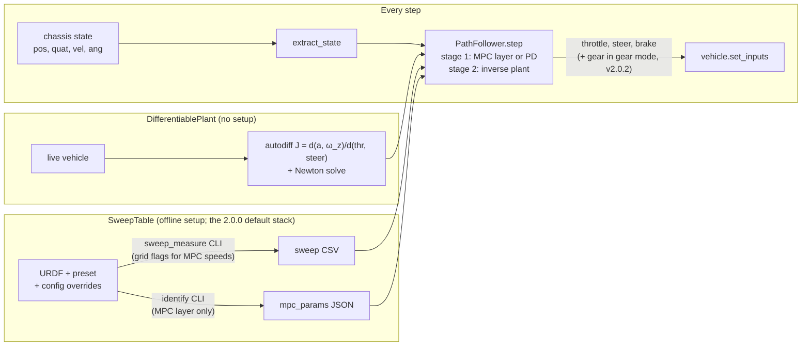
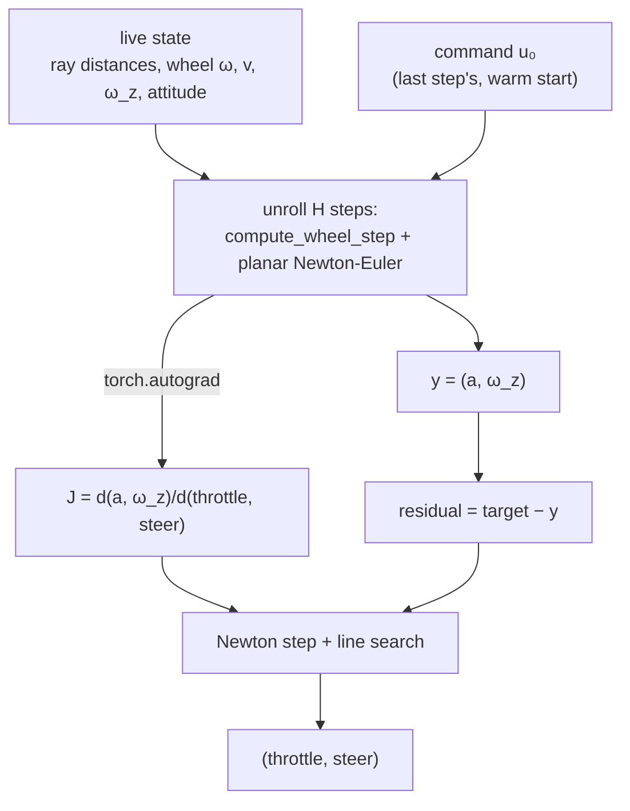
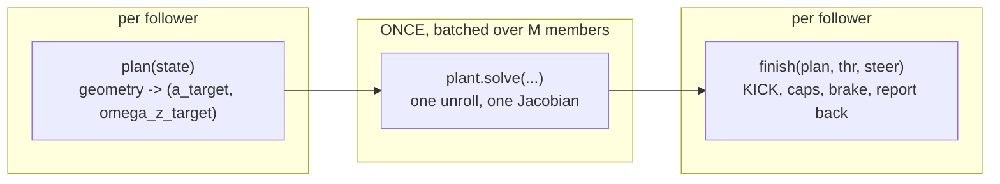
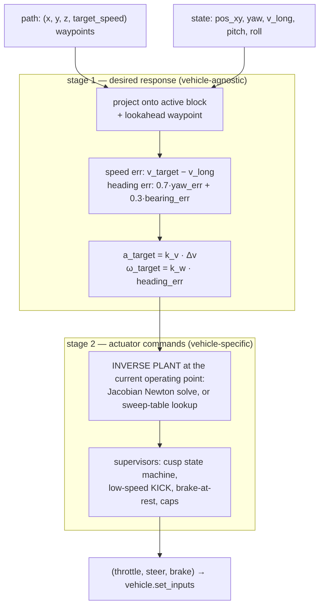
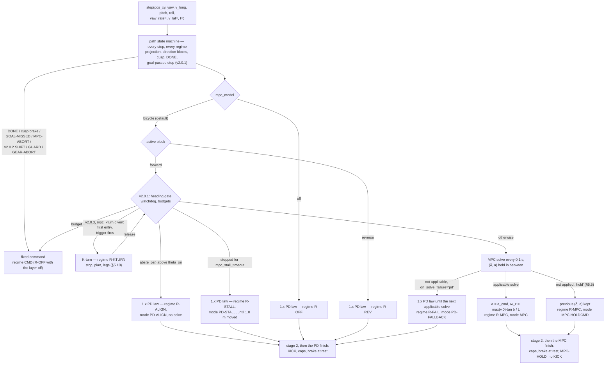
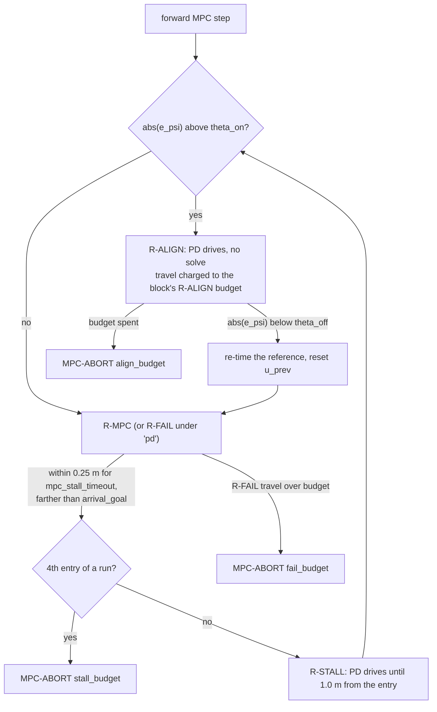
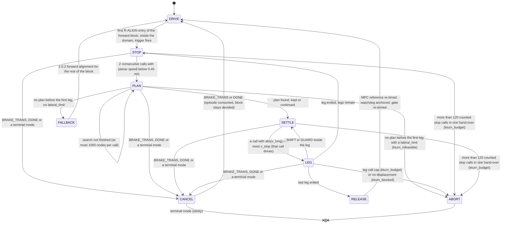

# Path following — `genesis_vehicle.control`

| abbr | meaning |
|---|---|
| S/T | Steer / Throttle command |
| inverse plant | whatever turns a desired `(a, ω_z)` into a `(throttle, steer)` command |
| Jacobian plant | `DifferentiablePlant` — the inverse from autodiff through the vehicle's own force model (the no-measurement plant; this row said "**default since v1.3.0**", which is stale since 2.0.0 — see "Which follower") |
| sweep table | `SweepTable` — the inverse from a measured (v, throttle, steer, pitch, roll) → (a, ω_z) grid |
| J | 2×2 Jacobian `d(a, ω_z) / d(throttle, steer)` |
| autodiff | automatic differentiation (`torch.autograd`) |
| cusp | sign flip of `target_speed` along the path = gear change (stop, then reverse) |
| block | maximal run of waypoints with one speed sign (the unit the follower drives) |
| ω_z | chassis yaw rate (rad/s) |
| ω | wheel spin rate (rad/s) |
| P control | proportional feedback (`u = K · error`) |
| MOI | moment of inertia |
| member | one (vehicle, env) pair a plant serves |
| M | number of members |
| L2 / L3 | batching axes: K interacting vehicles / `n_envs` parallel scenarios |
| kind | vehicles sharing a URDF + resolved config |
| h | `DifferentiablePlant` horizon (steps) |
| E0 / E1 / E2 | envelope rule used to judge a release's closed-loop change: every run passes its own criterion / worst run ≤ the previous release's worst / median ≤ the previous release's third quartile |
| DONE | the follower's final state: within `arrival_goal` of the last waypoint |
| MPC | Model Predictive Control — the 2.0.0 stage-1 layer (§5) |
| NMPC / LMPC | nonlinear MPC (do_mpc + IPOPT, `mpc_impl="nonlinear"`, default) / linear MPC (OSQP quadratic program, `mpc_impl="linear"`) |
| IPOPT / OSQP | the nonlinear-program solver bundled with casadi / the quadratic-program solver of the `osqp` package |
| PD | the 1.x stage-1 law (P control on the path, below); `mpc_model="off"` runs it alone |
| R-OFF / R-MPC / R-REV / R-FAIL / CMD | `PathFollower.regime`: MPC layer off / MPC on a forward block / PD on a reverse block / PD after a failed solve / a fixed command with the layer on (DONE, cusp brake, and since v2.0.1 `GOAL-MISSED` / `MPC-ABORT`) |
| R-ALIGN / R-STALL | (v2.0.1) `PathFollower.regime`: PD on a forward block while the heading gate holds / PD after the no-progress watchdog fired (§5.8) |
| e_psi | (v2.0.1) heading error: wrap(per-waypoint path yaw at the projection − chassis yaw), rad |
| R_min | (v2.0.1) minimum turn radius `wheelbase / tan(steer_cap · max_steer_rad)`; 7.397 m for the reference car, π·R_min = 23.24 m |
| C-vNNN Lk | (v2.0.1) test course: straight 20 m, a vertex with heading change NNN°, a second leg of k m; 0.5 m spacing, 4 m/s, start from rest |
| straight N m behind | (v2.0.1) test course: a straight path of N m from the car's spawn point along -X at 2 m/s, the car facing +X (e_psi π) |
| ray-wheel | the SDK's Genesis vehicle, as opposed to the kinematic bicycle of Genesis-free probes |
| CTE | cross-track error: distance to the dense course polyline (m) |
| tot>25 | share of control steps (first 20 excluded) whose control + simulation time exceeds 25 ms |
| U1 | the `ValueError` a default (MPC) follower raises without `mpc_params` |
| δ, a | front-wheel steering angle (rad) / longitudinal acceleration (m/s²) the MPC commands |
| L | wheelbase (m) |
| p50 | median (50th percentile) of a per-step time within one run |
| U5 / RT-1 | the implementation's session-1 screening harness (`u5_bench.py`) / its session-2 paired field-vs-SDK timing harness (`run_rt1.py`); both outside the repo, not shipped |
| WSL2 | Windows Subsystem for Linux 2 (the measurement machine's environment) |
| g | (v2.0.2) gear: +1 forward, -1 reverse |
| `GearCommand` | (v2.0.2) what a gear-mode follower returns: `(throttle ≥ 0, steer, brake, gear)` (§5.9) |
| k_b | (v2.0.2) brake gain: modelled deceleration per unit brake (m/s² per unit brake) |
| a_coast | (v2.0.2) modelled acceleration at throttle 0, brake 0 (m/s²) |
| u_g | (v2.0.2) `g * u`: the plant's signed throttle seen in the gear's direction |
| v_h | (v2.0.2) a sweep table's grid speed nearest 0, excluding 0, on the side used (±2 m/s on the reference table) |
| SHIFT / GUARD / GEAR-ABORT | (v2.0.2) gear-mode `last_mode` values: brake for a gear change / brake while moving against the wanted gear / terminal, more than 120 consecutive `SHIFT` / `GUARD` calls (§5.9) |
| K-turn | (v2.0.3, opt-in) multi-point turn the follower drives itself: stop, plan, legs in forward and reverse gear, hand back to the MPC (§5.10) |
| leg | (v2.0.3) one K-turn arc driven in one gear at full steering lock |
| R-KTURN | (v2.0.3) `PathFollower.regime` of a K-turn call; only with `mpc_kturn` given (§5.10) |
| r_plan | (v2.0.3) the K-turn planner's arc radius, 1.2 · R_min (8.876 m for the reference car) |

Give a path — a list of `(x, y, z, target_speed)` waypoints — and get
per-step `(throttle, steer, brake)` for any URDF + preset vehicle — or, since
v2.0.2 by default with the MPC layer, a `GearCommand` `(throttle, steer, brake,
gear)` for a vehicle driven in gear mode (§5.9). A step has
two stages. **Stage 1** decides what physical response the vehicle should
produce, `(a, ω_z)`. **Stage 2**, the **inverse plant**, finds the commands
that produce it. Everything vehicle-specific in stage 2 lives in that one
object, so the same PD controller drives a skid-steer tank and an Ackermann
car.

### Which follower (2.0.0)

Since 2.0.0 stage 1 is an **MPC layer by default** (§5) on the forward blocks
of a path, with the 1.x PD law on reverse blocks and after a failed solve; it
needs the vehicle's measured MPC parameters, and **a follower constructed the
1.x way, `PathFollower(path, plant)`, raises `ValueError` (U1)**. Choose:

| | `mpc_model="off"` | default MPC layer (`mpc_params=`) |
|---|---|---|
| stage 1 | the 1.x PD law everywhere, plus the v2.0.1 goal-passed stop and block-end speed sign (§5.8); for the same inputs identical to 1.8.0 before the first `GOAL-MISSED` step and away from block-end sign steps (§6). Through 2.0.0 this cell said "bit-identical to 1.8.0 on every scenario measured" — true then | MPC on forward blocks, PD on reverse blocks, after a failed solve, and (v2.0.1) while misaligned or stalled |
| vehicles | any (tank, truck, car) | two-axle Ackermann only |
| command (v2.0.2) | `command_mode="signed"` by default: the 2.0.1 `(throttle, steer, brake)`, decelerating with a negative throttle; `command_mode="gear"` opt-in (not on a tank) | `command_mode="gear"` by default: a `GearCommand`, decelerating with the brake, reverse only on reverse blocks — unless `mpc_kturn` is given (v2.0.3, opt-in: a K-turn drives reverse legs on a forward block, §5.10); `command_mode="signed"` gives the 2.0.1 3-tuple (§5.9) |
| needs | nothing new | `requirements-mpc.txt`; a sweep table on a grid reaching the driving speeds + an identified params JSON (§5.2) |
| `FleetFollower` | yes | no (`TypeError`) |
| real time on the measured machine | PD + sweep table: 0 % of steps over 25 ms, 0.27 ms control mean (§5.6); with a `DifferentiablePlant` the plant decides (§1 "Tuning knobs") | NMPC: NOT guaranteed — 5-24 % of steps over 25 ms depending on the session; LMPC: 0 % median (§5.6) |

The documented **default stack is a sweep table + the MPC layer**;
`DifferentiablePlant` remains the no-measurement inverse plant and works under
both stage-1 choices. Through 1.8.0 this page called `DifferentiablePlant`
"the default"; that is stale since 2.0.0.

Two inverse plants ship with the SDK, interchangeable in the same argument:

| | `DifferentiablePlant` (no measurement, v1.3.0+) | `SweepTable` |
|---|---|---|
| where the vehicle knowledge comes from | autodiff through the SDK's own ray-wheel force model, every step | a 5-D response grid measured offline |
| setup per vehicle | **none** | a batched sweep run → CSV |
| survives a plant change (mass, friction, `i_wheel`, dt) | yes, automatically | no — silently stale until re-measured |
| operating point | the LIVE state: per-wheel normal loads, wheel speeds, attitude | grid interpolation on (v, pitch, roll) |
| needs a live simulator | yes | no — numpy only |
| cost per control step | v1.8.0: 25.5 ms median `solve` for one 10-wheel tank (Genesis-free, idle CPU, `horizon=4`; 1.7.0: 14.3 ms; measured before the last two 1.8.0 fix rounds, not re-measured on the final tree) — over a 25 ms control step; about 2 ms each across a fleet of 30 in a noisy session (see "Tuning knobs") | 0.16 ms for both channels, per vehicle (pre-1.8.0 measurement, not repeated; a table lookup that does not run the pipeline) |

Use the sweep table when the controller runs in a process with no
simulator (a game client driving the vehicle over OSC), when the control loop
has a hard real-time budget it cannot spare, and with the MPC layer (an MPC
follower on a `DifferentiablePlant` warns once: the solve and the inversion
both run inside every control step). The Jacobian plant is the option that
needs no measurement.



## Quick start

```python
from genesis_vehicle import PathFollower
from genesis_vehicle.control import extract_state

# (x, y, z, target_speed[, yaw]): z ignored; speed sign = direction
# (+forward / -backward); a sign flip = cusp (auto stop-and-reverse).
# Optional 5th element = desired chassis yaw (rad, world +X = 0, CCW
# positive); omit or None -> tangential default.
# Spawn the vehicle at the first waypoint FACING ALONG THE FIRST SEGMENT —
# here the path leaves (0, 0) along +X, the default spawn orientation. Since
# v2.0.1 an MPC follower started facing away hands the start to the PD law
# (PD-ALIGN, §5.8) instead of standing still as 2.0.0 did, but a forward-only
# U-turn needs about two turning radii (~15 m on the reference car) of room —
# unless mpc_kturn=KTurnParams() is given (v2.0.3, opt-in), which may turn
# with reverse legs instead (§5.10).
# The 2.0.0 version of this snippet, run as written (reference car spawned at
# (0, 0, 0.5), dt 0.025 x 4, CPU, 2026-11-21; the rewritten 2.0.1 loop below
# has not been run): "off" DONE at 30.55 s, the CSV variant
# DONE at 30.55 s, the MPC variant DONE at 30.075 s with 301/301 converged
# solves and no MPC-HOLD — details after this block.
path = [
    (0.0,   0.0, 0.0, +2.0),
    (20.0,  0.0, 0.0, +2.0),
    (40.0, -8.0, 0.0, +2.0),
    (60.0, -8.0, 0.0, +2.0),
]

# The second argument is the inverse plant. The 1.x PD follower: hand it the
# vehicle and you get the Jacobian plant with no measurement step at all.
# (`PathFollower(path, vehicle)` without mpc_model="off" raises on 2.0.0.)
follower = PathFollower(path, vehicle, mpc_model="off")

# ...or a sweep CSV, for a controller that must run without a simulator:
#   follower = PathFollower(path, "my_vehicle_sweep.csv", mpc_model="off")

# ...or the 2.0.0 default stack, a two-axle Ackermann car with the MPC layer
# (two measurements first, §5.2). Start aligned with the first forward block
# where you can: misaligned, 2.0.0 stood still; 2.0.1 drives the turn with the
# PD law first (§5.8).
#   follower = PathFollower(path, "my_car_sweep.csv",
#                           mpc_params="my_car_mpc_params.json")
# Since v2.0.2 that follower runs command_mode="gear" by default and returns a
# GearCommand (the vehicle is driven in gear mode, decelerations come out as
# brake); add command_mode="signed" for the 2.0.1 3-tuple (§5.9).

for step in range(n_steps):
    st = extract_state(vehicle)          # Vehicle wrapper (a raw entity has no .gear)
    g = vehicle.gear                     # v2.0.2: engaged gear, (n_envs,) int8; None on a tank
    cmd = follower.step(
        st["pos_xy"], st["yaw"], st["v_long"], st["pitch"], st["roll"],
        yaw_rate=st.get("yaw_rate"), v_lat=st.get("v_lat"),   # required by the MPC layer
        gear=None if g is None else int(g[0]))               # gear-mode feedback; ignored when signed
    if follower.command_mode == "gear":  # apply first: a terminal step returns the (0, 0, 1) brake
        vehicle.set_inputs(throttle=cmd.throttle, brake=cmd.brake, steer=cmd.steer, gear=cmd.gear)
    else:                                # "signed": mpc_model="off" default, or command_mode="signed"
        thr, steer, brake = cmd
        vehicle.set_inputs(throttle=thr, brake=brake, steer=steer)
    vs.step()
    if follower.last_mode in PathFollower.TERMINAL_MODES:  # DONE / GOAL-MISSED / MPC-ABORT / GEAR-ABORT
        print(follower.last_mode, follower.stop_reason)      # stop_reason: None on DONE
        break
```

Apply the returned command before breaking: a terminal step's command is the
brake `(0, 0, 1)`, and breaking first leaves the vehicle on its previous
command — on `GOAL-MISSED` that is path speed away from the goal. (The 2.0.0
version of this loop broke before `set_inputs` on `DONE`, which only left the
arrival-speed command in place.)

The bundled samples: through v2.0.1 `path_follow_demo`,
`path_follow_reverse_demo`, `path_follow_osc_demo` and `mpc_follow_demo` left
their loop BEFORE applying the returned `(0, 0, 1)` command; since v2.0.2 they
apply it and keep stepping until the vehicle is still (|v| < 0.01 m/s) or 2 s
have passed. `sweep_and_drive` applies it first; `fleet_follow_demo` keeps
applying it to members that have ended while the others drive, and still
breaks before applying it on the step the last member ends — a loop copied from
it into a longer-running program must apply the command before leaving, as this
quick start does.

Through v2.0.1 this loop unpacked `thr, steer, brake = follower.step(...)`
for every follower; on 2.0.2 that raises `ValueError` for an MPC follower in
its default gear mode (four values). The loop above has not been run as
printed; its API calls were checked Genesis-free against a stub vehicle.

Through 2.0.0 this loop broke on `last_mode == "DONE"` only. Since 2.0.1 a
follower can also end on `GOAL-MISSED` or `MPC-ABORT` (§5.8), and since 2.0.2
in gear mode on `GEAR-ABORT` (§5.9); a loop that waits only for `DONE` keeps
stepping a braked vehicle until its own cap, an uncapped `while last_mode !=
"DONE"` never ends, and a loop that tests a hard-coded 2.0.1 tuple of terminal
modes never ends on `GEAR-ABORT`.

Quick start — the 2.0.0 version of this snippet, run as written; the
rewritten 2.0.1 loop (apply, step, then break) has not been run, and the `DONE`
step is the same, so the times below are not affected (2026-11-21; reference car
`samples/urdf/car_4w.urdf` + `car_4w_rwd_ackermann` spawned at (0, 0, 0.5) in
the default orientation, `VehicleScene(dt=0.025, substeps=4, n_envs=1)`, plane
friction 1.0, CPU/WSL2, genesis-world 1.4.5): `mpc_model="off"` with the live
vehicle DONE at 30.55 s (1222 steps), end (58.965, -6.922); the CSV variant
DONE at 30.55 s, end (58.964, -6.928); the MPC variant (default NMPC, `"pd"`,
the `mpc_follow_demo` cache's table and params) DONE at 30.075 s (1203 steps),
end (58.528, -7.999), 301/301 solves converged, no `MPC-HOLD`. Those MPC
figures are signed-mode figures (2.0.0 had no gear mode); the 2.0.2 default
gear-mode MPC variant of this snippet has not been run.

Outside Genesis (UE / Unity / replay), build the state dict with
`extract_state_from_arrays(pos_xyz, quat_wxyz, vel_xyz[, ang_xyz])` (pass the
world angular velocity `ang_xyz` to get `yaw_rate` / `v_lat`) — the PD
controller itself is numpy-only and simulator-agnostic. That end-to-end
property holds with a `SweepTable`; the Jacobian plant reads the live vehicle,
so that combination is Genesis-bound by construction. The MPC layer needs no
simulator either, but it needs the optional solver packages (§5.1).

**Driving over the OSC server (velocity estimation).** The state stream
(`/Genesis/Vehicle/TargetBulk`) carries pos + quat but NO velocity, so a
server-side client must finite-difference positions — and it must do so
in the server's **simulation time base**, not wall-clock: every
TargetBulk is preceded by `/Genesis/State/SimTime [t]` (the sim time the
state corresponds to, interpolation-fractional). FD over a ~0.3 s window
of `(sim_t, pos)` pairs is robust to the wire's realities — the send
cadence is not 1:1 with sim steps (catch-up bursts, lerped/duplicate
sends; and since v1.6.7 the server's `--send-hz` can downsample the send
to a wall-clock rate, which widens the cadence further — the `SimTime`
stamp stays paired with its TargetBulk because both sit inside the same
gate, so sim-time FD keeps working), and under load (e.g. the server viewer on) the server runs in
SLOW MOTION, where wall-clock FD under-reads speed, the KICK
over-throttles, and the vehicle overshoots the course in sim terms
(measured: a 157 m miss that sim-time FD turns back into a normal PASS).
Sample #14 (`path_follow_osc_demo.py`) is the reference implementation,
including the UE-frame decode (`docs/server.md` §4). **The OSC wire carries no
gear (v2.0.2)**: every server vehicle is driven with the signed throttle, so a
client-side follower uses `command_mode="signed"` (the `mpc_model="off"`
default, as in sample #14) or sends `GearCommand.signed()` — and then the
vehicle does not enforce the shift rule.

Runnable end-to-end demos (bundled 10-wheel tank, `mpc_model="off"` since
2.0.0; both default to the Jacobian plant, and `--plant sweep` switches them to
the measured table):

```bash
# forward course around a wall — PASS = final error < 3 m
python -m genesis_vehicle.samples.path_follow_demo [--viewer]

# drive past a bay, cusp, reverse in on an explicit-yaw arc
python -m genesis_vehicle.samples.path_follow_reverse_demo [--viewer]
```

The MPC layer on the reference car (measures and caches the table and the
params on its first run, §5.2):

```bash
python -m genesis_vehicle.samples.mpc_follow_demo                    # NMPC + table
python -m genesis_vehicle.samples.mpc_follow_demo --mpc-impl linear  # LMPC
python -m genesis_vehicle.samples.mpc_follow_demo --mpc-model off    # PD, same course
python -m genesis_vehicle.samples.mpc_follow_demo --course cusp      # forward MPC, reverse PD
python -m genesis_vehicle.samples.mpc_follow_demo --command-mode signed  # v2.0.2: the 2.0.1 signed loop
python -m genesis_vehicle.samples.mpc_follow_demo --gear-feedback off    # v2.0.2: gear mode without feedback
```

Since v2.0.2 `mpc_follow_demo` runs gear mode by default (also with
`--mpc-model off`, where it derives the brake gain from its params file) and
passes the engaged gear back to the follower; on a terminal mode it applies the
terminal command until the car is still or 2 s have passed.

## 1. The Jacobian plant (`DifferentiablePlant`)

```python
from genesis_vehicle import DifferentiablePlant, PathFollower

plant = DifferentiablePlant(vehicle)          # no CSV, no measurement
follower = PathFollower(path, plant, mpc_model="off")   # or PathFollower(path, vehicle, mpc_model="off")
```

Every knob is a constructor kwarg, so there are three equivalent ways to set
one (`horizon` here — see the table further down for the rest):

```python
# 1. build the plant yourself
follower = PathFollower(path, DifferentiablePlant(vehicle, horizon=6), mpc_model="off")

# 2. let the follower build it, and forward the kwargs
follower = PathFollower(path, vehicle, plant_kwargs={"horizon": 6}, mpc_model="off")

# 3. from the demos' CLI
#    python -m genesis_vehicle.samples.path_follow_demo --horizon 6
```

The plant is a live object, so it also answers questions directly — useful for
tuning, logging, or driving something other than a `PathFollower`:

```python
a, omega_z = plant.predict(throttle=0.4, steer=0.1)   # forward: what would happen
J, y = plant.jacobian()                               # 2x2 d(a, omega_z)/d(thr, steer)
thr, steer = plant.solve(v_long, a_target, omega_target)   # inverse

# after the step is applied, diagnostics of the solve that produced it
plant.last_jacobian, plant.last_response, plant.last_target, plant.last_singular
plant.last_restarted   # v1.7.0: answer came from the zero restart of a saturated warm start
```

`predict` takes sequences too, evaluating every candidate command in one
batched unroll — that is how the internal line search costs one pass, and it
is the cheap way to sweep a response curve:

```python
a, omega_z = plant.predict([0.0, 0.25, 0.5, 0.75, 1.0], [0.0] * 5)
```

If you post-process the plant's command before applying it — clamping,
overriding, a supervisor of your own — tell the plant what the vehicle
actually got, or the next Jacobian linearises a state the vehicle was never
in (this is what `PathFollower` does internally):

```python
vehicle.set_inputs(throttle=thr, steer=steer, brake=brk)
plant.set_applied(thr, steer)
```

### How it gets the inverse

The SDK's ray-wheel physics lives in one pure-`torch` function,
`_pipeline.compute_wheel_step` — suspension load, slip, Pacejka tyre, the
wheel-ω update, and the chassis wrench that comes out. Nothing in it does
I/O, so it is differentiable exactly as written.

Every control step the plant:

1. **snapshots the live state** — per-wheel ray distances (hence normal
   loads), wheel speeds, body velocity, yaw rate, attitude;
2. **unrolls `horizon` steps** of that same force model against a planar
   (surge / sway / yaw) rigid-body integrator built from the vehicle's real
   composite mass and yaw MOI, and reads off the two quantities the sweep
   table tabulates:
   `a = (v_long(H) − v_long(0)) / (H·dt)` and the mean yaw rate;
3. **differentiates** them with respect to `(throttle, steer)` →
   `J`, one vmapped backward pass;
4. **inverts** `J` — a Newton step warm-started from last step's command,
   then chord iterations with a backtracking line search.



Because the unroll starts from what the vehicle is actually doing, the
inverse is local to the real operating point — load transfer already in the
normal loads, the actual wheel speeds, the actual slope — rather than an
interpolation between grid nodes measured from a clean flat-ground start.

### Why not the Genesis differentiable solver

Genesis does ship a differentiable rigid solver
(`SimOptions(requires_grad=True)`), and the obvious plan is to backpropagate
through `scene.step()`. **It cannot work for this SDK.** The solver's taped
input set is exactly `set_pos` / `set_quat` / `set_dofs_velocity` /
`control_dofs_force` (see `RigidEntity.process_input_grad`); the external
wrench API is not on the tape (`apply_links_external_wrench` on genesis
>= 1.4.0, `apply_links_external_force` / `_torque` on <= 1.3.3) — and it is
the *only* way a ray-wheel vehicle touches the solver, because the SDK
deliberately has no wheel joints to motor.

Measured on genesis-world 1.3.3, and unchanged on 1.4.0, which only renamed
the call: a leaf tensor passed to the external-wrench API comes back from
`scene.backward()` with `grad is None`, while the same probe through
`control_dofs_force` returns a finite gradient. So Genesis autodiff can differentiate a joint-motor
vehicle, not a ray-wheel one.

Differentiating the SDK's own force model instead gets the same Jacobian and
costs less: no `requires_grad` scene, so no hibernation ban, no integrator
restriction, no dense-Hessian solve, and it runs on CPU.

### Accuracy

The unroll is the real force model driven by a reduced chassis model: exact
in the wheel forces, approximate in the body motion. Surge / sway / yaw only
— heave, pitch and roll rates are frozen and the measured ray distances are
held over the horizon, so the normal loads are this step's (no in-horizon
load transfer). Gravity enters through the live attitude, which is what the
sweep grid's pitch/roll axes bought. Terrain is assumed locally flat over
the horizon (0.1 s at the default `horizon=4` and 40 Hz).

Measured against the actual simulator (command held for `horizon` steps
from the live state, `horizon=4`, reference 10-wheel tank and 4-wheel car;
**measured before v1.8.0 and not re-measured since** — v1.8.0 changed the force
model on both sides of this comparison):

| vehicle | max \|Δa\| | max \|Δω_z\| | autodiff vs finite difference |
|---|---|---|---|
| `tank_ref` (10 wheels, 58.7 t) | 0.18 m/s² | 0.0014 rad/s | ≤ 6e-4 relative |
| `car_4w` (4 wheels, 1.33 t) | 0.10 m/s² | 0.0029 rad/s | ≤ 8e-4 relative |

The composite mass properties the planar model uses reproduce the entity's
own 6×6 mass matrix to six digits.

**A `swept_envelope` vehicle is still predicted as a point contact (v1.6.0).**
The frozen snapshot above is the whole story: the plant captures `distances`
once per control step and holds them over the horizon, so it never re-runs the
raycast — and therefore never runs the swept-envelope reduction either. The
SIMULATED vehicle gets the envelope; the controller's internal model does not.
Over flat or gently varying ground the two agree, because the envelope reduces
to the point contact there (it reads the same distance to 7 decimals). Over a
kerb or a step they do not: the plant predicts the wheel teleporting onto the
obstacle in one `dt` — the very behaviour `wheel_contact="swept_envelope"` was
added to remove — while the vehicle climbs it.

That is a real limitation for `PathFollower` on rough terrain, not a footnote.
It does not make the follower unstable (the plant is re-linearised from the live
state every step, so the error is corrected on the next one), but the *predicted*
normal loads across an obstacle are wrong in the same direction the point
contact was always wrong. Nothing in the plant's API exposes M, and closing this
would mean carrying the fan geometry into the snapshot and re-reducing inside
the unroll. Not attempted in v1.6.0.

### Closed-loop, against the sweep table

Same course, same vehicle, same tuning — `path_follow_demo` (10-wheel tank
around a wall) and `path_follow_reverse_demo` (drive past a bay, cusp,
reverse in on an explicit-yaw arc):

| plant | forward course, path deviation | reverse-into-bay |
|---|---|---|
| `SweepTable` (78,302 measured rollouts) | mean 0.384 m, max 1.034 m | 1.50 m / 0.33 rad, PASS |
| `DifferentiablePlant` (no measurement) | mean 0.370 m, max 0.917 m | 1.50 m / 0.32 rad, PASS |

```bash
python -m genesis_vehicle.samples.path_follow_demo --plant jacobian   # default
python -m genesis_vehicle.samples.path_follow_demo --plant sweep
```

The table above predates v1.7.0 and is kept as the original comparison. Re-run
on v1.7.0 (CPU/WSL2, genesis-world 1.4.5, headless, default args, demos run 3
or 4 at a time in parallel): forward course mean deviation 0.352 m (jacobian) /
0.314 m (sweep, with the re-measured tank table); reverse-into-bay PASS
1.49 m / 0.33 rad (jacobian) and 1.49 m / 0.30 rad (sweep). Max deviation was
not recorded in that run. **On v1.6.10 with genesis-world 1.4.5 the
reverse-into-bay jacobian run FAILED** (1.50 m / 0.43 rad against the 0.4 rad
limit, deterministic), so the PASS in the table above did not hold on that
engine. v1.7.0 passes it with a 0.07 rad margin; the cause of the v1.6.10
failure is not established, and v1.7.0 is not claimed to have fixed it.
v1.7.0 also makes rolling resistance take effect, so holding 2 m/s on the
forward course now takes throttle +0.13 (v1.6.10: -0.00), and **any sweep table
measured before v1.7.0 is stale** for the default `"control"` profile;
`samples/data/tank_sweep_signed.csv` is re-measured.

**v1.8.0** changed the brake, the drive-torque order and the friction ellipse
(CHANGELOG 1.8.0), so **every sweep table measured before v1.8.0 is stale
again**; the bundled tank table is re-measured. Closed-loop results on v1.8.0
(CPU/WSL2, genesis-world 1.4.5, headless, default batched solver), judged
against 1.7.0 by an envelope rule fixed before measuring (horizon {3, 4, 5} ×
spawn shifts (0,0) / (0,±0.3) m for the jacobian demos, the 3 shifts for the
sweep demos, each tree with its own table; E0 / E1 / E2):

| demo, metric | 1.7.0 [min, median, Q3, max] | 1.8.0 [min, median, max] | rule |
|---|---|---|---|
| forward jacobian, mean deviation (m) | [0.314, 0.451, 0.478, 0.562] | [0.322, 0.376, 0.448] | pass |
| forward jacobian, final error (m) | [1.46, 1.47, 1.48, 1.49] | [1.45, 1.49, 1.50] | **E1 and E2 not met, by 0.01 m** |
| reverse jacobian, yaw error (rad) | [0.31, 0.33, 0.34, 0.38] | [0.17, 0.21, 0.23] | pass |
| forward sweep, mean deviation (m) | [0.273, 0.314, 0.350, 0.386] | [0.289, 0.334, 0.396] | **E1 not met, by 0.010 m** (deterministic: a repeat reproduced it to the digit) |
| forward sweep, final error (m) | median 1.48, Q3 1.485 | [1.46, 1.49, 1.49] | E2 not met |
| every run's own PASS criterion (sweep demos) | 5 of 6 (reverse, shift (0,-0.3): position error 69.35 m) | 6 of 6 | — |

The user accepted both results; the rule is not changed and no PathFollower
retune is in v1.8.0. **The "final error" is the distance to the goal AT THE
DONE STEP**: the demo stops on the first DONE and reads the pose without
stepping again, and DONE fires inside `arrival_goal` = 1.5 m, so the value is
1.5 m minus the depth of the step that crossed the radius (< 0.05 m at 2 m/s).
It is not a stopping distance — a project reading that attributed the 0.01 m to
v1.8.0's shorter stop was wrong. At the DONE step, horizon 3 / 4 / 5: 1.8.0
1.4971 / 1.4982 / 1.4607 m, 1.7.0 1.4694 / 1.4666 / 1.4927 m. With the speed
and yaw gains varied ±25% the final error spans [1.45, 1.50] on both trees.
The plant's prediction error against the realised motion (forward demo,
(0,0)) improved in yaw rate at every horizon (RMS 0.0023 / 0.0028 / 0.0034 vs
0.0094 / 0.0061 / 0.0092 rad/s) and in acceleration bias; acceleration RMS is
better at h 3 / h 5 but slightly worse at h 4 (0.317 vs 0.306 m/s²), and the
acceleration |max| is worse at h 3 / h 4 (5.82 / 4.41 vs 3.43 / 3.98 m/s²).
`fleet_follow_demo`: PASS in both modes; mean cross-track deviation 0.581 m
(jacobian), 0.366 m (sweep, with the re-measured table).

### Tuning knobs

| kwarg | default | effect |
|---|---|---|
| `horizon` | 4 steps | how far ahead the unroll looks — at 40 Hz, 4 steps is 0.1 s of predicted future. Also the cost knob (see below). Longer is not better: 8 measured both slower AND looser than 4 on the reference course (mean deviation 0.433 m vs 0.370 m), because a controller running every step wants the near-term response and a long horizon drifts further from the frozen-normal-load assumption. |
| `newton_iters` | 2 | chord iterations after the Jacobian; each is one forward unroll |
| `coupled` | `False` | solve the full 2×2 instead of channel-diagonal (see below) |
| `damping` | 1e-2 | Levenberg damping of the coupled solve |
| `probe_delta` | 0.2 | secant step used when a channel's derivative degenerates (see below) |
| `saturation_restart` | `True` | v1.7.0. A warm start at a range limit is also solved from 0 in the same batch; the lower residual wins (see below). `False` = the pre-1.7.0 single-start solve |
| `line_search_steps` | 3 | backtracking halvings, all evaluated in one batched unroll |
| `scale_a` / `scale_w` | 1.0 / 0.2 | what counts as "one unit of error" in each channel |
| `mass` / `izz` / `com` | read off the entity | override the planar mass properties |

`horizon` is what the plant's cost buys, and it buys it roughly linearly.

**v1.8.0 cost (accepted by the user).** v1.8.0 applies the drive and brake torques
before the tyre, takes the friction ellipse at the transmitted force and adds
the low-speed deadbeats (CHANGELOG 1.8.0 §1–§6), and every one of those runs in
the plant's unroll. Fail-closed, idle CPU, Genesis-free fake tank of
`tests/test_differentiable_plant.py`, `horizon=4`, one `solve()` on a fresh
plant: **14.25 ms on 1.7.0 → 25.49 ms on 1.8.0, ratio 1.811 [1.676 .. 1.897]**
(6 alternating repeats; car `solve` 21.65 → 29.54 ms, ratio not published,
interval [1.343 .. 1.444]). This was measured on the tree before the last two
1.8.0 fix rounds (the Pacejka Newton-divisor floor changed afterwards) and was
not re-measured on the final tree. **A 10-wheel tank at `horizon=4` therefore
does not fit a 25 ms (40 Hz) control step on the measured machine** — the
Genesis-free solve alone exceeds it, before the live-state snapshot a real
vehicle adds. Smaller horizons were not measured on an idle machine (the noisy
table below is no evidence for a 25 ms budget), so no horizon is recommended
for that loop; the measured option is a `SweepTable`. A horizon sweep re-run for
v1.8.0 on the same fake tank (median of 25 fresh plants per point, 4
alternating repeats, one CPU; a noisier session whose absolute times were about
twice the idle figures, so read the ratios, not the milliseconds):

| `horizon` | 1.7.0 median | 1.8.0 median | 1.8.0 / 1.7.0, range over repeats |
|---|---|---|---|
| 2 | 16.7 ms | 24.9 ms | 0.92 .. 2.15 |
| 3 | 21.9 ms | 35.9 ms | 1.02 .. 2.21 |
| 4 | 28.5 ms | 59.7 ms | 1.51 .. 2.52 (published 1.918) |
| 6 | 53.0 ms | 86.4 ms | 1.09 .. 2.03 |
| 8 | 92.7 ms | 128.1 ms | 0.97 .. 1.51 |
| 12 | 120.2 ms | 161.1 ms | 1.30 .. 1.76 |

A 30-member fleet at `horizon=4` measured 1.62 → 2.17 ms per member in the same
session (the "~0.9 ms each" this page quoted before was not reproduced on
either tree in it).

**The table below is the pre-v1.7.0 measurement** (reference 10-wheel tank,
real vehicle, CPU, one `solve()` call; harness not in the repo) and was kept
as this page's original figure. It is NOT the v1.8.0 cost; through v1.7.0 this
page presented it as current. Measured then:

| `horizon` | predicted ahead | per solve | vs a 25 ms control step |
|---|---|---|---|
| 2 | 0.05 s | 9.7 ms | 39 % |
| 3 | 0.075 s | 15.3 ms | 61 % |
| **4** (default) | **0.1 s** | **20.1 ms** | **80 %** |
| 6 | 0.15 s | 29.6 ms | 118 % |
| 8 | 0.2 s | 39.1 ms | 156 % |
| 12 | 0.3 s | 56.1 ms | 224 % |

For scale: the simulation step itself is ~10 ms on the same machine, and a
`SweepTable` inversion of both channels is 0.16 ms.

### Two things that go wrong without care

**A least-squares 2×2 solve will spin the vehicle to make it go faster.**
The coupled inverse is free to spend whichever command reduces the residual
most, and near rest `|∂a/∂steer|` on a skid-steer exceeds
`|∂a/∂throttle|` — so a speed error gets "fixed" by throwing the vehicle
into a spin. Path following wants the opposite priority, so the default is
channel-diagonal: throttle answers for `a`, steer for `ω_z`. The cross terms
are not discarded — the chord iterations re-evaluate the full coupled
response at the updated command, which is the useful half of the coupling
without the pathology.

**The plant has dead zones where the derivative is honestly zero.** Through
v1.7.0 the drive torque went through the `F_long` overshoot clamp, which pinned
the tyre force to exactly zero whenever friction could not carry the wheel past
rolling within one step, and a zero Jacobian reads as "no authority, do not
move" — which froze the controller mid-manoeuvre on the reverse course. Since
v1.8.0 the drive torque acts before the tyre, and the dead zones known are a
wheel the brake HOLDS (its spin is pinned at 0 for any small command change)
and the clamp's zero end where a hook's force opposes the wheel's slip (on a
240-state grid including brake 0.5, the count of all-zero d a / d throttle
columns went from 9 car / 6 tank on 1.7.0 to 0 / 0; CHANGELOG 1.8.0 §7.2). Where a whole Jacobian column
vanishes, the plant re-estimates it with a one-sided **secant** over
`probe_delta` of command, large enough to step out of the dead zone. The
derivative is a local object; the secant over a control-sized step is not.

**A saturated warm start can trap the solve (fixed in v1.7.0).** `solve()`
linearises at the previous command. At a range limit the local Jacobian can
point back into the limit, and through v1.6.10 the chord iterations never left
it: on a field team's harness the reference car at +2 m/s, asked for -3 m/s²
with a previous command of +1, got throttle +1.00, the wrong direction. Since
v1.7.0, with `saturation_restart=True` (the default), if any member's warm
start is within 1% of the half-range of a limit in either channel (throttle
≤ -0.99 or ≥ +0.99 on the default range), every member also starts from a copy
with its saturated channels set to 0. Both starts ride the same batched unroll
and line search, and per member the lower final weighted residual wins (the
warm start on a tie, and always for a member whose own warm start was not
saturated). `last_restarted` says which members took the restart. The same
field case now returns -1.00.

| `saturation_restart` | warm start | throttle | residual | `last_restarted` |
|---|---|---|---|---|
| False | -1 | -1.0000 | 5.5905 | False |
| False | 0 | +0.7384 | 0.4086 | False |
| True | -1 | +0.7384 | 0.4086 | True |
| True | 0 | +0.7384 | 0.4086 | False |

Reference tank, Genesis-free fake state of `tests/test_differentiable_plant.py`,
target +3 m/s² at -2 m/s. Exactness: a solve in which no member is saturated
runs the single-start code path unchanged. In a mixed fleet every member runs
two starts, and an unsaturated member is NOT bit-identical to its solo solve; it
agrees within rel 1e-4 / abs 1e-5
(`test_a_mixed_fleet_restarts_each_member_as_it_would_alone`). The cost, two
starts per member in one batch on steps where some member is saturated, was not
timed.

**`jacobian()` returns NaN at a standstill (v = 0, ω = 0), and that is not
fixed.** Measured on v1.6.10 and v1.7.0 with the same fake state,
`jacobian(0, 0)`: the reference car's throttle column is NaN, the reference
tank's whole 2×2 is NaN. Removing `StaticFrictionLock` from the hook list makes
both finite, which points at the `sqrt` of the friction-ellipse norm in its
post-tire path (gradient undefined at zero); that line is suspected, not
proven. A controller starting from rest should not rely on the Jacobian of that
exact state.

### Fleets: one plant, many vehicles

One plant serves **M members** — (vehicle, env) pairs of a single kind, the
granularity `MultiVehicleKindPhysics` already groups by. Pass a sequence of
vehicles, a sequence of `env_idx`, or both (members are their cartesian
product, env-major):

```python
from genesis_vehicle import DifferentiablePlant, FleetFollower, PathFollower

plant = DifferentiablePlant(tanks)                 # M = len(tanks)
followers = [PathFollower(path, plant, mpc_model="off") for path in paths]   # PD only
fleet = FleetFollower(followers, plant)

cmds = fleet.step([extract_state(t) for t in tanks])   # one solve for the lot
for t, (thr, steer, brake) in zip(tanks, cmds):
    t.set_inputs(throttle=thr, steer=steer, brake=brake)
```

Runnable, with both plants on the same fleet for comparison:

```bash
python -m genesis_vehicle.samples.fleet_follow_demo --k 8            # both
python -m genesis_vehicle.samples.fleet_follow_demo --k 8 --plant jacobian
```

`M == 1` keeps the scalar surface exactly as it was; `M > 1` makes `predict` /
`jacobian` / `solve` / `set_applied` take and return arrays of length M, and
the diagnostics per-member.

**Why it is nearly free.** The unroll was already batch-shape-agnostic
(`compute_wheel_step` is); that axis simply carried candidate commands, and
now carries `M x candidates`. At these tensor sizes the unroll is dominated by
torch's per-op dispatch rather than arithmetic, so widening it barely costs
anything — measured forward unroll, 10-wheel tank, `horizon=4` (before
v1.8.0; absolute times rose with v1.8.0, see "Tuning knobs"):

| batch | ms/call | ms per item |
|---|---|---|
| 1 | 6.83 | 6.83 |
| 8 | 6.93 | 0.87 |
| 32 | 8.34 | 0.26 |
| 128 | 8.57 | 0.067 |

The Jacobian rides the same trick: batch members are independent in the
unroll, so `d(sum_i a_i)/d(thr_j)` IS member j's own gradient, and one
backward per row covers the whole fleet.

End to end, control cost per step against one plant per vehicle:

| K tanks | K separate plants | 1 batched plant | per vehicle |
|---|---|---|---|
| 8 | 200.7 ms | 26.2 ms (**7.7x**) | 25.1 -> 3.27 ms |
| 30 | 743.9 ms | 28.1 ms (**26.5x**) | 24.8 -> 0.94 ms |

with the command streams agreeing to float32 noise (at K=30, max
`|d throttle|` 3.3e-05, max `|d steer|` 1.8e-04, final position spread
1.5e-05 m over 40 steps).

**How the follower splits.** A `PathFollower` is per-vehicle by nature — its
path, its block, its cusp state machine — but the expensive half of a step is
the inversion. So `step()` is two halves that a fleet runs around one solve:



A plan whose `command` is already set (arrived, braking into a cusp) needs no
inversion at all; it still occupies a batch slot, which costs nothing.
`PathFollower.step()` is exactly this composition for one vehicle, so
single-vehicle behaviour is unchanged.

**PD followers only (2.0.0).** `FleetFollower` raises `TypeError` if any
follower has the MPC layer on: its step passes no `yaw_rate` / `v_lat`, and N
NMPC solves per step do not fit a control period. The check runs before any
follower is modified.

All members of a plant must share one kind — they share the force model, the
wheel meta and the mass properties, which is what a kind means. Mixed kinds
are refused; give them one plant each and one `FleetFollower` each.

**What this does NOT change.** The simulation path is untouched: L2/L3
batching, `MultiVehiclePhysics` and `n_envs` are the same code, and a plant
reads a batched scene through the kind's own single batched solver call
however many members it serves.

### Feeding it a non-Genesis state

`DifferentiablePlant` accepts any object providing the state-source surface
(`genesis_vehicle.control.plant.STATE_SOURCE_SURFACE`) in place of a
vehicle — the resolved config, the wheel meta, and callables returning the
chassis pose/velocity, wheel ω, previous compression and ray distances.
That is how the Genesis-free unit tests drive it, and it is the hook for
wiring the plant to an external state feed.

## 2. Measuring a sweep table (only for `SweepTable`)

```bash
python -m genesis_vehicle.control.sweep_measure \
    --urdf my_vehicle.urdf \
    --preset tank_skid_belt \
    --top-speed 18.6 --mu-lat 0.5 \
    --output my_vehicle_sweep.csv --gpu
```

- `--preset`: any SDK preset name (`tank_skid_belt`,
  `car_4w_rwd_ackermann`, ...).
- **Plant overrides (v1.2.2)** — parameterise the plant on the command line,
  no config file needed: `--top-speed` (m/s, radius-independent — sets the
  drive omega cap to `top_speed / mean_wheel_radius`), `--omega-max-drive`
  (rad/s, direct), `--i-wheel`, `--mu-long`, `--mu-lat`, `--k-susp`,
  `--rest-stroke`, `--brake-max`. Only the flags you pass are applied;
  everything else keeps the preset value (a tracked preset's suspension stays
  mass-derived unless you pass `--k-susp`). CLI flags win over `--config`.
  > Presets carry a realistic `top_speed` default since v1.2.3 (tank 18.6 m/s ≈
  > 67 km/h, car 55.6 ≈ 200 km/h); `--top-speed` here re-pins it for the
  > measurement (e.g. 13.3 ≈ 48 km/h off-road for an MBT). It sets the drive
  > omega cap to `top_speed / mean_wheel_radius`.
- `--config` (optional): Python file defining `apply_config(cfg)` (before
  `build`) and/or `apply_runtime_config(physics)` (after) — the same
  overrides you use when driving. Use this when the overrides are more than the
  CLI flags cover.
- `--gpu`: recommended when CUDA is available — the measurement is a
  ~500-env L3 batch, past the CPU/GPU crossover (see
  [`backends.md`](backends.md)). Measured full grid: **GPU ~3.6 min vs
  CPU ~20 min**.
- `--quick`: 81-combo smoke grid to check wiring (not usable for control).
- **Grid flags (v2.0.0)**: `--v-list`, `--throttle-list`, `--steer-list`,
  `--pitch-list`, `--roll-list` replace one axis each (comma-separated). **The
  default grid stops at |v| = 4 m/s** and a `SweepTable` clamps outside its
  grid, so a table for the MPC layer at 8-10 m/s needs `--v-list`. A list that
  starts with a minus sign must use the `=` form — `--v-list=-2,0,2,4,6,8,10,12,14,16`
  (argparse reads `--v-list -2,...` as two options). The throttle and steer
  lists must contain 0 (checked before measuring). With no grid flag the grid
  is the default below, unchanged.
- `--dt` / `--substeps` (default **0.025 × 4** — the SDK-wide default shared
  by `VehicleScene` and the OSC server, internal 6.25 ms): **measure at the dt
  AND substeps you will drive at.** Discrete per-step effects (brake, stability
  hooks) are baked into
  the measured response, so dt/substeps are part of the table's validity
  contract alongside the (URDF, preset, config) triple.

Each grid combination runs in its own env: gravity is set per env in one
batched call to emulate a (pitch, roll) slope on flat ground, the chassis
is launched at `v_init` with wheels pre-spun (per-wheel resolved radius),
inputs are held, and the response is averaged over 2 s. **`a_measured` is
taken in the body-longitudinal frame** (world velocity projected through
yaw) — the same definition `extract_state` feeds the follower, so the
table is produced and consumed in one frame. (v1.1.12, from the
deliverables_v3 revision: a world-x measurement under-reads by cos(yaw)
once steer ≠ 0 rotates the vehicle during the window — up to ~12 m/s² off
at high speed + full steer. The scene is also built once and reused across
chunks via reset, with the last chunk padded so nothing re-JITs.)

| column | meaning | grid (default) |
|---|---|---|
| `v_init` | initial longitudinal speed (m/s) | −4 … +4, 11 levels |
| `throttle` / `steer` | held input | −1 … +1, 5 levels each |
| `pitch` / `roll` | emulated slope (deg) | ±35 / ±30 |
| `a_measured` | mean longitudinal acceleration (m/s²) | output |
| `omega_z_measured` | mean yaw rate (rad/s) | output |

**Re-measure whenever the URDF, the preset, the config overrides, or
dt/substeps change** — the table is only valid for that exact quadruple. The
same holds for an MPC params JSON (§5.2), and **nothing checks that a table and
a params file describe the same vehicle**.
**Also re-measure after upgrading to v1.7.0:** rolling resistance took effect
in that release, so a table measured on v1.6.10 or earlier describes a vehicle
that coasted with no rolling resistance (the bundled tank table's flat coast
cells went from about 0 to -0.44 m/s² at 4 m/s).

> **Override-ordering trap (VehicleScene).** Apply cfg overrides
> (`apply_config(cfg)`) **BEFORE `vs.build()`** — with the default batched
> solver, cfg mutations after build are silently ignored unless you call
> `vs.mark_config_dirty()`. Post-build (runtime) overrides go on the
> RESOLVED config via `vehicle.resolved` (works in both solver modes;
> `vehicle.physics` is `None` under the batched solver, so guarding on it
> silently skips your overrides). The bundled demo shows the correct
> sequence.
>
> **`mark_config_dirty()` under a live follower.** That call replaces the
> batched driver on the next `step()`. From **v1.6.2** the replacement carries
> the vehicle's runtime state (`omega`, suspension history, spin, ray state,
> the wheel rest pose — `docs/physics-contracts.md` §7.12), and the plant
> behind the follower re-binds itself to the new driver at the entry of
> `predict` / `jacobian` / `solve`. A **structural** change (wheel count, K,
> `n_envs`, member count) raises `RuntimeError` naming `mark_config_dirty`
> instead — the unroll's tensors and the warm start are sized for the old
> shape, so build a new `DifferentiablePlant` and a new `PathFollower` /
> `FleetFollower` around it. Re-binding happens only at those entry points, so
> calling `mark_config_dirty()` from another thread while the controller is
> solving is outside the contract (you get a `RuntimeError` from the unroll's
> freshness assertion, not a defined result).
>
> **On ≤ 1.6.1 this flow was broken in two ways at once**: the rebuild zeroed
> the integrator state (measured: wheel `omega` `[-17.4207, -16.7303,
> -17.3659, -14.2479]` → `[-8.5504, -8.1484, -6.2335, -5.8315]` in one step,
> reference car, CPU, `dt` 0.02), and the plant kept reading the DISCARDED
> driver, which is never stepped again — so the follower steered off a frozen
> state. If you are pinned to an older SDK, make every cfg change before
> `vs.build()`.

## 3. How the follower works

### The concept: a two-stage controller around a forward map

This section describes the PD stage 1 (`mpc_model="off"`, and with the MPC
layer on: reverse blocks and fallbacks). The MPC stage 1 is §5; stage 2 is the
same for both.

Both plants answer the same question — "at this state, what response does
this command produce?" — and are read BACKWARD. The sweep table gets that
map by measuring it; the Jacobian plant gets it by differentiating the
force model. Either way the controller itself never models the vehicle, and
each step it does two things:

1. **Decide WHAT physical response it wants** (plain geometry + P control,
   vehicle-agnostic): from the current state and the path it computes a
   speed error and a heading error, and turns them into a desired
   acceleration `a_target` and a desired yaw rate `ω_target` — physical
   quantities, no actuator knowledge.
2. **Read the forward map BACKWARD** (all vehicle specifics live here):
   find the throttle whose acceleration equals `a_target` and the steer
   whose yaw rate equals `ω_target`, at the current operating point.
   Unachievable targets saturate to the actuator limit.

So "current state in → (S, T, B) out to match the path" is exactly right,
with the state used TWICE: once to compute the errors (pos, yaw, v_long),
and once as the operating point of the inverse. Swapping the vehicle only
swaps the plant; the controller code is untouched.



### The mechanics, step by step

The path is split into **direction blocks** (runs of same-sign
`target_speed`). Within a block, per step:

1. project the position onto the block's segments (search window
   `lookahead + 2 m`, ≤ 5 segments advance per step);
2. take the waypoint `lookahead` (default 3.5 m) ahead, capped at the
   block end;
3. `v_target` = that waypoint's speed; when a cusp is inside the lookahead
   window, taper `|v_target| ≤ k_approach · d_cusp + 0.3` so the vehicle
   arrives slow. Since v2.0.1 the SIGN of `v_target` at a block end is the
   current block's direction: through 2.0.0, a lookahead sitting exactly on
   the block-end waypoint without being capped read that waypoint's speed,
   which carries the NEXT block's sign, and the vehicle could keep driving the
   wrong way. The MAGNITUDE on a capped cusp approach still comes from the cusp
   waypoint (a 1.x behaviour pinned by the golden, not fixed: one trace planned
   2.0 m/s on a 1.0 m/s block);
4. `heading_err = 0.7·yaw_err + 0.3·position_err` (backward blocks store
   chassis yaw flipped by π — the chassis faces away from travel);
5. P control: `a_target = k_v·(v_target − v_long)`,
   `ω_target = k_w·heading_err`;
6. plant inversion: one `plant.solve(v, a_target, ω_target, pitch, roll)`
   for a `DifferentiablePlant` (Newton on the autodiff Jacobian), or two
   independent grid lookups `table⁻¹(...)` for a `SweepTable` (4-D
   multilinear interpolation + bisection; out-of-grid states clamp to the
   boundary);
7. low-speed KICK: if the along-direction speed is below 40 % of
   `|v_target|`, saturate throttle toward the target direction;
8. near-zero throttle at near-zero speed ⇒ `brake = 1`.

Steps 6-8 above are the **signed** finish (`command_mode="signed"`, the
default with `mpc_model="off"`): a deceleration comes out as a negative
throttle, i.e. drive torque against the motion. In **gear mode** (v2.0.2,
§5.9) the inverse plant's `u` is read in the gear's direction: `u_g = g·u ≥ 0`
is a throttle magnitude, `u_g < 0` becomes a brake from the stage-2 brake model
at throttle 0, and the KICK is suppressed while the vehicle moves against the
gear by more than 0.05 m/s.

At a block boundary the cusp state machine takes over: brake until
`|v_long| < v_stop`, then continue into the next block with the flipped
direction. `last_mode` exposes the state: `INIT` / `DRV+1` / `DRV-1` /
`STOP` / `BRAKE_TRANS` / `DONE`, since v2.0.1 the terminal `GOAL-MISSED` in
every mode, and with the MPC layer on also `MPC` / `MPC-HOLD` / `MPC-HOLDCMD` /
`PD-FALLBACK` (§5.3) and, since v2.0.1, `PD-ALIGN` / `PD-STALL` / the terminal
`MPC-ABORT` (§5.8), and in gear mode (v2.0.2, every stage-1 choice) `SHIFT` /
`GUARD` / the terminal `GEAR-ABORT` (§5.9), and with `mpc_kturn` given (v2.0.3)
`KTURN-STOP` / `KTURN-PLAN` / `KTURN-SETTLE` / `KTURN-REV` / `KTURN-FWD` (§5.10).
The cusp state machine runs on every step under both stage-1 choices.

**Goal-passed stop (v2.0.1, every mode, cannot be switched off; since v2.0.3
not evaluated on R-KTURN calls, which exist only with `mpc_kturn` given).** The heading
law `0.7·yaw_err + 0.3·pos_err` has a fixed point once the vehicle has missed
the arrival circle on the last segment: the lookahead is pinned to the goal,
yaw_err settles near ∓1.35 rad, the target yaw rate goes to 0, and the final
block has no speed taper — through 2.0.0 the vehicle then drove straight away
at path speed. Since 2.0.1 it stops with `GOAL-MISSED` (§5.8). `arrival_goal`
still decides `DONE` only.

Projection and lookahead **never cross the active block's boundary** — the
pre-SDK deliverable let the lookahead leak across the cusp, which applied
backward-driving geometry while still moving forward and only behaved on
collinear forward/backward paths (see CHANGELOG 1.1.11 for the two bugs
fixed during adoption).

### Tuning knobs (constructor kwargs)

| kwarg | default | effect |
|---|---|---|
| `lookahead` | 3.5 m | pursuit distance; larger = smoother, cuts corners more |
| `arrival_goal` | 1.5 m | DONE radius around the final waypoint (final block only) |
| `cusp_goal` | 1.0 m | distance to a cusp that starts the stop-and-reverse |
| `k_v` / `k_w` | 2.0 / 1.5 | speed / heading P gains |
| `k_approach` | 1.0 /s | cusp deceleration taper slope |
| `v_stop` | 0.05 m/s | "stopped" threshold for the gear change |
| `steer_cap` | 0.5 | steer command cap |

These are the PD stage-1 knobs; they stay valid with the MPC layer on (they
drive reverse blocks and fallbacks). The MPC-layer arguments are in §5.4.

Cusp overshoot depends on the vehicle's brake authority at low speed (the
bundled tank with its `T_BRAKE_MAX` override stops essentially on the
spot). If a vehicle rolls past the cusp, raise `v_stop` (accept the flip
at a slow roll), increase `k_approach` tapering, or give it a stronger
low-speed brake.

## 4. Path requirements

- ≥ 2 waypoints; adjacent spacing 0.3–1 m recommended (densify long
  straights — see the demo's `build_path`).
- **Waypoint heading (yaw)**: by default derived from the direction to the
  next waypoint (+π-flipped on backward waypoints) — nothing to specify.
  For maneuvers where that default is wrong (typically reversing: "back up
  while facing THERE"), give an explicit yaw as an optional 5th tuple
  element — radians, **world +X is ψ = 0, CCW about +Z positive** (the
  same convention `extract_state` returns) — and it is used VERBATIM as
  the desired chassis heading (no backward flip; the heading loop, and
  through it the sweep steer inversion, tracks it). `None` / a 4-tuple
  falls back to the tangential default; 4- and 5-tuples can be mixed.
  An explicit yaw on a cusp waypoint also defines the arrival heading for
  the approach. Keep it drivable: a nonholonomic vehicle only moves along
  its chassis axis, so yaw far from the travel (or travel+π) direction
  cannot be tracked.
- Backward driving = negative `target_speed`; `0` marks an explicit stop
  point and inherits the running direction (does not split a block).
- DONE = within `arrival_goal` of the FINAL waypoint while driving the
  final block; don't route the final block within `arrival_goal` of its
  own end point early, or it will finish there.
- Skid-steer is the tuned reference; for Ackermann re-measure the sweep so
  the backward steer sign is baked in from the actual drivetrain.
- **With the MPC layer on (2.0.0)**: forward blocks are planned by the MPC
  against a TIME-based reference (§5.3); reverse blocks are always the PD law.
  A path with no forward block warns that the MPC never runs. An explicit yaw
  reaches the MPC reference only when every waypoint of the forward block
  has one. A forward block's reference speeds are floored at 0, so its last
  waypoint before a cusp is a stop.
- **Replacing the path (`set_path`, v2.0.0)**: `follower.set_path(path,
  pos_xy=None, t=None)` validates the PATH first, so a path error (length,
  waypoint shape) changes nothing — but a bad `pos_xy` or `t` raises AFTER the
  new path has been installed. It keeps the plant, its warm start and the MPC problem (no rebuild), restarts the PD
  state on the new path's first block (a cusp transition in progress is
  cancelled), and with `pos_xy` snaps the projection to that block's globally
  nearest segment. With the MPC layer on and a forward first block, the new
  reference is timed so that point is due at `t` (default: the internal
  clock), and the MPC restarts. Since v2.0.1 it also clears `GOAL-MISSED` /
  `MPC-ABORT` and `stop_reason` and the goal-passed history (every mode), and
  with the MPC layer R-ALIGN / R-STALL, the watchdog anchor and entry point,
  and EVERY per-block budget (§5.8) — so a caller that re-plans repeatedly is
  not bounded by the budgets. The `mpc_stats["handover"]` counts are kept; the
  heading gate is evaluated again on the next `plan()`. In gear mode (v2.0.2)
  it also restarts the `SHIFT` / `GUARD` counters, releases the `GUARD` latch
  and clears a `GEAR-ABORT`, and it keeps the gear the follower assumes engaged
  (§5.9).

## 5. The MPC layer (v2.0.0; heading gate, watchdog and stops v2.0.1; gear mode v2.0.2; opt-in K-turn v2.0.3)

The MPC layer is the field team's `PathFollower_MPC` controller ported into
the SDK, itself derived from NVlabs AlpaSim (Apache-2.0; attribution, file
mapping and modifications in [`../NOTICE`](../NOTICE)). It replaces the PD
stage 1 on FORWARD blocks of a path; stage 2 (the inverse plant) is unchanged.
It is on by default (`mpc_model="bicycle"`) and needs `mpc_params`.

**Every number in this section** was measured on CPU/WSL2 (Intel Core Ultra 9
285H, 8 logical CPUs), genesis-world 1.4.5, dt 0.025 × 4 substeps, casadi
3.8.2 / do_mpc 5.1.2 / osqp 1.1.3, on 2026-11-21, one process at a time, on
**the demo course** of `samples/mpc_follow_demo.py`: the reference car
(`samples/urdf/car_4w.urdf`, `car_4w_rwd_ackermann`, `"control"` profile) from
rest, straight 20 m, a 90° left turn of 30 m radius, straight 15 m, speed
ramped at 1 m/s² to 8 m/s, `steer_cap` 0.5, plane and tyre friction 1.0, a
sweep table on the grid of §5.2 in stage 2. Nothing else was measured for
2.0.0: treat it as the whole validated envelope. The exceptions are the stall
paragraph of §5.3 and §5.8 (v2.0.1, measured 2026-11-21 .. 2026-11-22) and
§5.9 (v2.0.2, measured 2026-11-22), which name their own courses and
conditions. The 2.0.0 figures of §5.6-§5.7 are signed-mode figures.

### 5.1 Install

The MPC layer needs packages the SDK does not otherwise use. The NMPC needs
casadi + do_mpc; the LMPC needs osqp, scipy and threadpoolctl.
[`../requirements-mpc.txt`](../requirements-mpc.txt) pins the tested versions
(`casadi==3.8.2`, `do-mpc==5.1.2`, `osqp==1.1.3`; `threadpoolctl>=3` is a lower
bound, tested 3.6.0; scipy is not listed — genesis-world already brings it,
tested 1.17.1). They pull in more (do-mpc → matplotlib, pandas; osqp → jinja2,
joblib, setuptools), and pip may change packages you already have, so look
first:

```bash
pip install --dry-run --report - -r requirements-mpc.txt
# if an installed package would change version:
pip install --no-deps -r requirements-mpc.txt && pip check
# otherwise:
pip install -r requirements-mpc.txt
```

- `import genesis_vehicle` (and `.control`, `.control.mpc`) loads none of
  them; `mpc_model="off"` never needs them. A missing package raises
  `ImportError` naming it — after the U1 check, so a call without
  `mpc_params` reports U1 either way.
- Constructing an NMPC follower imports do_mpc, which imports
  `matplotlib.pyplot`, `pandas` and `scipy` into the process (2.4 s,
  Genesis-free probe); its two import-time `UserWarning`s (ONNX, opcua) are
  silenced for that import only.
- Licences, as facts (not legal advice): casadi LGPL-3.0-or-later (bundles
  Ipopt EPL-2.0, MUMPS CeCILL-C, METIS glue EPL-1.0, OpenBLAS BSD-style),
  do-mpc LGPL-3.0, osqp Apache-2.0, threadpoolctl BSD-3-Clause. They are
  installed by you and not redistributed with the SDK.

### 5.2 Measure the vehicle: a table and a params file

Two measurements, with the SAME URDF, preset, `--config` / plant overrides,
`--dt` and `--substeps` — the code does not check that the two files describe
the same vehicle:

```bash
# 1. a sweep table whose speed axis reaches the driving speeds (the default grid stops at 4 m/s)
python -m genesis_vehicle.control.sweep_measure --urdf my_car.urdf --preset car_4w_rwd_ackermann \
    --v-list=-2,0,2,4,6,8,10,12,14,16 --throttle-list=-1,-0.5,0,0.5,1 \
    --steer-list=-1,-0.5,0,0.5,1 --pitch-list=-10,-5,0,5,10 --roll-list=0 \
    --dt 0.025 --substeps 4 --output my_car_sweep.csv
# 2. the MPC parameters
python -m genesis_vehicle.control.identify --urdf my_car.urdf --preset car_4w_rwd_ackermann \
    --dt 0.025 --substeps 4 --output my_car_mpc_params.json
```

The grid above is 1250 combinations; the command as printed (default
`--n-envs` 500) took 22 s on CPU in impl-review's run. Write a
list that starts with a minus sign with `=`; the throttle and steer lists must
contain 0.

`identify` (`identify_mpc_params` in code; needs Genesis) refuses anything but
a two-axle Ackermann vehicle before measuring, with a `ValueError` naming
`mpc_model="off"`. It measures the cornering stiffnesses, the acceleration and
steering-to-yaw time constants, the acceleration and throttle-off deceleration
limits per speed, and records mass, yaw inertia, a per-axle tyre block,
static axle loads (after a 1.5 s braked settle), the 1.8.0 deadbeat `s` and
`v*`, the drivetrain, the fit residual (a `UserWarning` above 3 % yaw-rate
residual) and the sampled envelope. Reference car: `C_αf` / `C_αr` 33204 /
32555 N/rad, acceleration τ 0.0152 s, steering-to-yaw τ 0.0805 s, residual
0.97 %. It agrees with the field `tools/identify.py` to a relative 1.6e-7 on
the stiffnesses and exactly on mass, yaw inertia, wheelbase, rig offset, the
time constants, `l_rig_to_cg`, `max_steer_rad`, `wheel_radius` and every
acceleration table (impl-review; nothing else was compared). The tyre block is
recorded but not used by the 2.0.0 model.

**The params record.** JSON with `schema` = `genesis_vehicle.mpc_params/1`,
read by `MPCVehicleParams.from_json` / `load_mpc_params`. Every 2.x reader keeps
accepting `/1`; any other or a missing `schema` is a `ValueError` — which
rejects a field `PathFollower_MPC` JSON (no `schema` key): re-run identify. The
steering limit comes from the follower's `steer_cap` (`steer_cap ×
max_steer_rad`), not from the JSON. The record carries the `sdk_version` and
`genesis_version` it was measured with and is SDK-version-bound like a sweep
table; `samples/mpc_follow_demo.py` caches both files in
`samples/data/mpc_cache/` (git-ignored), and a cached file keeps the version
string it was written with.

```python
from genesis_vehicle import PathFollower
from genesis_vehicle.control import extract_state

follower = PathFollower(path, "my_car_sweep.csv", mpc_params="my_car_mpc_params.json")
st = extract_state(vehicle)
cmd = follower.step(st["pos_xy"], st["yaw"], st["v_long"], st["pitch"], st["roll"],
                    yaw_rate=st["yaw_rate"], v_lat=st["v_lat"],
                    gear=int(vehicle.gear[0]))     # v2.0.2: gear mode by default (§5.9)
vehicle.set_inputs(throttle=cmd.throttle, brake=cmd.brake, steer=cmd.steer, gear=cmd.gear)
```

Through v2.0.1 this example unpacked `thr, steer, brake = follower.step(...)`;
on 2.0.2 the default MPC follower returns a `GearCommand` and that line raises
`ValueError`. `command_mode="signed"` restores the 3-tuple.

### 5.3 Regimes: what runs where

The path state machine (projection, blocks, cusp, DONE) runs on every step in
every regime; the regime decides who fills stage 1 and which finish applies.



| regime (`.regime`) | when | stage 1 | finish | `last_mode` |
|---|---|---|---|---|
| `R-OFF` | `mpc_model="off"` | 1.x PD | 1.x (KICK, caps, brake at rest) | `INIT` / `DRV±1` / `STOP` / `BRAKE_TRANS` / `DONE` |
| `R-MPC` | layer on, forward block, solve applicable (or held under `"hold"`) | MPC: `a = a_cmd` clipped to the identified limits, `ω_z = max(v,0)·tan(δ_cmd)/L` | caps, brake at rest, `MPC-HOLD` (brake instead of a negative throttle when `v < -0.1`, or `v < 0.1` with the clipped `a ≤ 0`); no KICK | `MPC` / `MPC-HOLD` / `MPC-HOLDCMD` |
| `R-REV` | layer on, reverse block | 1.x PD, same gains | 1.x | `DRV-1`, ... |
| `R-FAIL` | layer on, forward block, solve not applicable under `"pd"` | 1.x PD until the next applicable solve (v2.0.1: up to a per-block travel budget, §5.8) | 1.x | `PD-FALLBACK` |
| `R-ALIGN` (v2.0.1) | layer on, forward block, \|e_psi\| above `theta_on` until below `theta_off` | 1.x PD, no solve | 1.x | `PD-ALIGN` |
| `R-STALL` (v2.0.1) | layer on, forward block, after the watchdog fired, until 1.0 m from the entry point | 1.x PD, no solve | 1.x | `PD-STALL` |
| `R-KTURN` (v2.0.3) | layer on, gear mode, `mpc_kturn` given, forward block: the trigger fired at the block's first R-ALIGN entry, until the release | K-turn: fixed `(0, 0, 1)` on stop / plan / settle calls; on a leg's driving call `a = k_v·(g·1.0 − v_long)`, steer fixed at full lock (`FollowerPlan.steer_cmd`) | gear finish (PD path); throttle from `throttle_for` only | `KTURN-STOP` / `KTURN-PLAN` / `KTURN-SETTLE` / `KTURN-REV` / `KTURN-FWD`; `SHIFT` / `GUARD` inside an episode |
| `CMD` | layer on, DONE, cusp brake, since v2.0.1 a terminal stop, and (v2.0.2, gear mode) a gear change or a guard stop | fixed command (terminal: `(0, 0, 1)`) | — | `DONE` / `BRAKE_TRANS` / `GOAL-MISSED` / `MPC-ABORT`; v2.0.2 `SHIFT` / `GUARD` / `GEAR-ABORT` (§5.9) |

- **The MPC**: the AlpaSim bicycle model, 8 states (rig position, yaw,
  centre-of-gravity (CG) velocities, yaw rate, steering angle, acceleration), commands `(δ_cmd,
  a_cmd)`, 20 horizon nodes at 0.1 s (2 s), re-solved every 0.1 s (every 4th
  step at dt 0.025), IPOPT capped at 30 iterations (the field setting).
- **The reference is TIME-based**, per forward block: the block's waypoints,
  shifted to the rear-axle centre, are timed at their target speeds (each
  floored at `mpc_v_floor`, default 0.5 m/s) from the block-entry time. A
  vehicle that falls behind is chased by a reference that runs ahead — the PD
  instead looks a fixed distance ahead of where the vehicle is.
- **Restarts**: at a forward-block entry (the path start included), on the
  first solve after a fallback and after `set_path`, do_mpc's previous-input
  cost parameter is reset to the vehicle's measured steering angle and
  acceleration (AlpaSim rule `atan(ω_z·L/v)` above 0.25 m/s, else 0). From
  rest that equals do_mpc's own initial value.
- **Inputs**: `yaw_rate=` and `v_lat=` on every step of a forward block,
  `TypeError` otherwise (raised before any follower state moves, so a retry
  starts from the same state); `t=` optional (an internal clock advances by
  `dt_ctrl` per call; `dt_ctrl` defaults to the params file's `dt`, and a
  different explicit value warns).
- **Not thread-safe**: casadi's NumPy mode, casadi's OpenBLAS thread count and
  warning filters are process-global. Several followers in one thread are
  fine (interleaved vs alone: max |diff| 0.0, one Genesis-free probe).

**The 2.0.0 misaligned-start stall, its cause, and the 2.0.1 fix.** On 2.0.0,
with the reference car spawned at (30, 0) facing +X (the default spawn
orientation) at the start of the path (30, 0) → (10, -8) → (-10, -8) →
(-30, 0) at 2 m/s, the MPC follower (`mpc_follow_demo` cache table and params)
never moved: over 1600 steps (40 s) the vehicle stayed at (30.0, -0.0),
`last_mode` alternated between `MPC` (476 steps) and `MPC-HOLD` (1124 steps),
and all 400 solves converged — no warning and no fallback (a converged solve
never triggers `on_solve_failure`). The unmodified field follower behaved
identically, so the limitation is inherited, not introduced by the port
(impl-review's runs, harness outside the repo, CPU/WSL2, genesis-world 1.4.5,
2026-11-21).

- **Cause, measured (v2.0.1)** — Genesis-free, `PathFollower` with the real
  NMPC fed that start's constant state (a reproduction of the controller-side
  mechanism, not a replay of the Genesis run): every solve converges to
  standing still (planned speed 0 over the horizon, `a_cmd` in [-1.22e-7, 6.44e-8]),
  with the MPC's forward-only speed bound `v_cg_x >= 0`
  (`control/mpc/alpasim_nonlinear.py:156`) active; lowering only that bound
  to -5 m/s turns the plan into reversing (planned speed 0 → -1.036 m/s). The
  first command from rest shrinks with the misalignment: `a_cmd` 1.81 / 1.61 /
  1.12 / 0.75 / 0.47 / 0.00 m/s² at e_psi 0 / 1.0 / 1.4 / 1.8 / 2.2 / 2.76 rad.
  **The ±π/2 horizon yaw bound is not the cause**: 21 start conditions give
  identical output with it at π/2 and at 3.1 rad. This page said, through
  2.0.0, that the mechanism was not established and that the forward-only model
  and its ±π/2 yaw bound were suspected; the yaw-bound suspicion was wrong. Not
  established: whether the standstill is the global optimum; the cost terms
  behind it. The `MPC` / `MPC-HOLD` alternation is reproduced by state noise
  (σ 1e-3) flipping the sign of the numerically-zero `a_cmd`.
- **Not only at the start**: on a 150° vertex the 2.0.0 MPC stood mid-path
  (plan-review's kinematic probe: `MPC-HOLD` for 1052 steps, `DONE` only at
  38.95 s; ray-wheel C-v150 L20 with both new kwargs `None`: no `DONE` in 60 s,
  `MPC-HOLD` 1368 steps).
- **Fix (v2.0.1, on by default)**: the heading gate (`mpc_align_gate`) hands a
  forward step with |e_psi| above π/2 to the PD law until |e_psi| < π/4, and
  the watchdog (`mpc_stall_timeout`) hands an MPC that has not moved 0.25 m in
  2.0 s to the PD law for 1.0 m (§5.8). The MPC problem itself is unchanged.
  On the stall course the ray-wheel car now reaches `DONE` at 41.775 s (3 runs,
  identical; R-ALIGN released at 10.925 s; 309 solves, all converged), with a
  CTE max of 15.09 m from the PD's forward U-turn (60 s limit; with
  `samples/mpc_follow_demo.py --course misaligned` pass `--t-max 60`: with the
  default 40.0 s it would print FAIL — a prediction from the 41.775 s `DONE`,
  which was measured with the table and params the 2.0.0 stall was documented
  with, not a measured run of the default). This page said, through
  2.0.0, that the root cause and a fix were planned for 2.1.0 and that nothing
  in the code detects the stall; both are superseded.
- With `mpc_align_gate=None, mpc_stall_timeout=None` the follower stands still
  on that start as 2.0.0 did (ray-wheel: 2400 steps, maximum displacement
  0.36 mm).

**What the prediction model does not model.** Linear tyres (lateral force
proportional to slip angle, one lumped tyre per axle, no saturation and no
combined slip), planar motion (no load transfer, pitch, roll, slope or
terrain), no wheel spin; below 5.0 m/s (the AlpaSim kinematic threshold) a
kinematic bicycle. The stage-2 inverse plant, not the MPC, carries the
vehicle's real response. The steering lag is modelled twice (the measured
steering-to-yaw τ on top of the response the table already contains) — a known
limitation of the field model, kept for parity. Neither a Pacejka prediction
model nor a PD correction on the MPC's predicted trajectory exists in 2.0.1
(`mpc_model="pacejka"` raises `ValueError`, `mpc_feedforward=` /
`mpc_correction=` are `TypeError`). **The prediction model's deceleration
bound is still the throttle-based one** (`decel_throttle_by_speed`, about −2.15
m/s² on the reference car) in 2.0.2: gear mode's brake model is in stage 2 only
(§5.9). The MPC itself still plans forward only (`v_cg_x >= 0`): the v2.0.3
K-turn (§5.10, opt-in) is a separate state machine outside the MPC. The
light-brake slope hold, listed here as planned through 2.0.3, shipped in 2.0.4
(a vehicle-side change, `physics-contracts.md` §7.22). Planned, not present:
2.1.0 the Pacejka prediction model with a deceleration bound widened to the
brake's limit (and, vehicle-side, unifying the lock's spring cap on one
constant), 2.2.0 feedforward
from the MPC plan and the PD correction (closed-loop tracking of the K-turn's
planned arcs is a candidate there), 2.3.0 a hold-release rule, a KICK redesign
and a wider default sweep grid. (Through 2.0.0 this paragraph named 2.1.0 /
2.2.0 as the next releases; 2.0.1 listed "2.0.2 braking and stopping by the
brake channel with a forward/reverse gear state" — that shipped in 2.0.2, and
2.0.2 and 2.0.3 did not merge; 2.0.2 listed "2.0.3 controller-initiated
reverse (K-turn)" — that shipped in 2.0.3, opt-in.)

### 5.4 Constructor arguments and checks

| argument | default | meaning |
|---|---|---|
| `mpc_params` | — (required unless `"off"`) | path to the identify JSON, or an `MPCVehicleParams` (`TypeError` for anything else) |
| `mpc_model` | `"bicycle"` | `"bicycle"` or `"off"` |
| `mpc_impl` | `"nonlinear"` | `"nonlinear"` (NMPC) or `"linear"` (LMPC) |
| `on_solve_failure` | `"pd"` | `"pd"` or `"hold"` (§5.5) |
| `mpc_gains` | AlpaSim weights | `control.MPCGains` |
| `mpc_v_floor` | 0.5 m/s | speed floor for timing the reference (`None` also means 0.5) |
| `dt_ctrl` | the params file's `dt` | control period (s) |
| `mpc_align_gate` (v2.0.1) | `(π/2, π/4)` | `(theta_on, theta_off)` rad of the heading gate, `0 < theta_off < theta_on <= π`; **`None` disables** it and its R-ALIGN budget (§5.8) |
| `mpc_stall_timeout` (v2.0.1) | 2.0 s | seconds of follower time `t` without 0.25 m of movement before the watchdog hands over; **`None` disables** it, its R-STALL run limit and its `t`-jump rule (§5.8) |
| `command_mode` (v2.0.2) | `None` = `"gear"` with the layer on, `"signed"` with `"off"` | `"gear"` → `GearCommand`; `"signed"` → the 2.0.1 3-tuple (§5.9). Not an MPC-only argument: valid with `"off"` too |
| `brake_gain` (v2.0.2) | `None` | k_b for gear mode; `None` → `plant.brake_gain()` → the params' `brake_gain` key → derived from `decel_brake_by_speed`; with `"signed"` it raises `ValueError` (§5.9) |
| `mpc_kturn` (v2.0.3) | `None` (off) | a `control.KTurnParams` enables the opt-in K-turn (§5.10); **`None` disables**. Non-`None` with `command_mode="signed"` or `mpc_align_gate=None` → `ValueError`; anything other than `None` / `KTurnParams` → `ValueError` |

For `mpc_align_gate` / `mpc_stall_timeout` (and `mpc_kturn`, v2.0.3, off by
default), `None` DISABLES the feature — unlike `mpc_v_floor` / `mpc_gains` /
`dt_ctrl`, where `None` means the default.

Every MPC-only argument raises `ValueError` together with `mpc_model="off"` —
the two v2.0.1 kwargs and `mpc_kturn` too, even as `None`.
The checks, in order — each raises before the follower is built, but the
dependency check imports do_mpc (with its process-wide side effects, §5.1)
before the params file is read: path length; plant present;
`mpc_model` value; with `"off"`, no MPC-only argument; a live vehicle or
`DifferentiablePlant` must be a two-axle Ackermann (`ValueError` naming
`mpc_model="off"`; a `SweepTable` cannot be checked); U1 if `mpc_params` is
missing; `mpc_impl` / `on_solve_failure` values; (v2.0.1) `mpc_align_gate` /
`mpc_stall_timeout` values (`ValueError`; `bool` and non-finite values
rejected); optional packages (`ImportError`); the params file (`TypeError` for an `mpc_params` that is
neither a path nor an `MPCVehicleParams`; `FileNotFoundError` for a missing
file; `ValueError` for a wrong or missing schema, missing keys, or a JSON
steering that is not a two-axle Ackermann). Then the 1.x plant coercion
(`TypeError` for an unusable plant object; `FileNotFoundError` for a sweep-CSV
path that does not exist) and the waypoint parsing run. Then a path with no forward block warns;
a live plant warns (cost) and is cross-checked against the params (mass,
wheelbase, per-axle tyre coefficients, relative 1e-6: a mismatch warns, a check
that cannot run warns once naming it). Then (v2.0.1) `ValueError` unless the
params' `wheelbase > 0` and the steering limit `steer_cap · max_steer_rad`
lies in (0, π/2) — R_min sets the budgets, and an infinite one would disable
them silently (`steer_cap=0` stays accepted with `"off"`). A sweep table and a
params file are never cross-checked: the tank's table with the car's params was accepted
silently in review. Then (v2.0.2) the command-mode checks (§5.9): the mode
value; in gear mode a skid-steer plant source (`ValueError`), a plant without a
callable `accel_at` (`TypeError`), the k_b source (`ValueError` when there is
none; `TypeError` for a non-callable `brake_gain` attribute). Then (v2.0.3) a
`KTurnParams` with `command_mode="signed"` or `mpc_align_gate=None` →
`ValueError` (the `mpc_kturn` type itself is checked with the gate and stall
values). Construction: 0.64
s (NMPC, the problem is set up here; the first `step` builds nothing), about
20 ms (LMPC).

`mpc_stats` → `{n_solve, status: {converged, capped, capped_infeasible,
"failed:<status>", exception, nan}, last_status, last_solve_ms, plan_age_s,
handover: {align, stall}, kturn: {episodes, legs, reverse_m, plan_nodes,
plan_calls, plan_ms}}` (`None` with `"off"`; `handover` since v2.0.1 counts
R-ALIGN / R-STALL entries since construction, kept by `set_path` — not a
per-block count, and `handover["stall"]` is not bounded by 3 per block;
`kturn` since v2.0.3, present for every MPC follower, zeros without
`mpc_kturn`, cumulative and kept by `set_path`, `plan_ms` wall clock). While
the PD drives under R-ALIGN / R-STALL the law is not called, so `plan_age_s`
keeps growing and `last_plan` stays the last pre-hand-over plan. `last_plan` → `(times, states (N+1, 8))` of the last
applied solve — NMPC only; always `None` with `mpc_impl="linear"` and `"off"`.

### 5.5 When a solve fails

Each solve is classified; order: the solver raised (EXC), then a non-finite
command (NAN), then the status. "Feasible" = largest bound/constraint violation
of the returned iterate ≤ 1e-4 (IPOPT's default `constr_viol_tol`), in the
solver's own scaled space; a non-finite iterate counts as infinitely
violated.

NMPC (IPOPT `return_status`):

| class | statuses | `"pd"` (default) | `"hold"` (field parity, see below) |
|---|---|---|---|
| CONV | `Solve_Succeeded`, `Solved_To_Acceptable_Level`, `Feasible_Point_Found` | apply | apply |
| CAP | `Maximum_Iterations_Exceeded`, `Maximum_CpuTime_Exceeded`, `Maximum_WallTime_Exceeded`, `Search_Direction_Becomes_Too_Small` | apply if feasible, else fall back | apply |
| INFEAS | `Infeasible_Problem_Detected`, `Restoration_Failed`, `Error_In_Step_Computation`, `Invalid_Number_Detected`, `Diverging_Iterates`, `Not_Enough_Degrees_Of_Freedom` | fall back | apply |
| OTHER | any other status | fall back | apply |
| EXC | the solver raised | fall back | keep the previous command |
| NAN | non-finite command | fall back | keep the previous command |

LMPC (OSQP `osqp.SolverStatus`):

| class | statuses | `"pd"` | `"hold"` |
|---|---|---|---|
| CONV | `OSQP_SOLVED` | apply | apply |
| CAP | `OSQP_SOLVED_INACCURATE`, `OSQP_MAX_ITER_REACHED`, `OSQP_TIME_LIMIT_REACHED` | apply if feasible (`l <= A x <= u` within 1e-4), else fall back | apply `SOLVED_INACCURATE` only |
| INFEAS | the four (in)feasibility statuses, `OSQP_NON_CVX` | fall back | keep the previous command |
| OTHER / EXC / NAN | — | fall back | keep the previous command |

- **A capped solve applied under `"pd"` is feasible, not optimal** (one OSQP
  iteration: steer 0.14 where the converged answer was 0.28).
- **`"hold"` applies infeasible NMPC solutions** — every solve that did not
  raise — exactly as the field controller did; with the LMPC it applies only
  `SOLVED` / `SOLVED_INACCURATE` (the field rule). The two differ.
- **Non-finite values**: a non-finite command keeps the previous command under
  `"hold"` — where the SDK differs from the field, which applied it. A NaN in
  the NMPC's state gives `Invalid_Number_Detected` with a finite, stale
  command: `"pd"` falls back, `"hold"` applies it (as the field did).
- **"field parity" for `"hold"` is qualified since v2.0.1**: the heading gate
  and the watchdog are on by default under either policy, and the goal-passed
  stop (not evaluated on R-KTURN calls, which exist only with `mpc_kturn`
  given) and the block-end speed sign cannot be switched off, so `"hold"` is
  field parity only with `mpc_align_gate=None, mpc_stall_timeout=None` and only
  on runs with no `GOAL-MISSED` and no block-end sign step.
- `PD-FALLBACK` hands the step to the PD law; the MPC restarts on the next
  applicable solve (§5.3). Since v2.0.1 the PD travel after failed solves is
  budgeted per forward block (`fail_budget`, §5.8) — `"pd"` now means "the PD
  drives up to the budget", also with both new kwargs `None`.
- On the demo course every solve converged in every run (135/135 for the
  NMPC); the `PD-FALLBACK` and `MPC-HOLDCMD` branches were exercised by
  fake-solver tests and real-solver unit tests only, never in a Genesis run.
- **A converged solve is never a failure**, whatever it makes the vehicle do:
  `on_solve_failure` does not fire on the misaligned-start stall of §5.3,
  where every one of 400 solves converged. That stall is caught by the v2.0.1
  heading gate and watchdog (§5.8), not by the failure policy.

### 5.6 Real time: the NMPC is NOT guaranteed to fit 25 ms

```bash
python -m genesis_vehicle.samples.bench_path_follower                 # nonlinear,linear x 5
python -m genesis_vehicle.samples.bench_path_follower --arms nonlinear,linear,pd --repeats 5
```

**Every figure in this section is a signed-mode figure.** Since v2.0.2
`bench_path_follower` pins every arm to `command_mode="signed"` (the default of
`mpc_follow_demo`, which it runs, became gear mode). Gear-mode cost was
measured once and reported only (CHANGELOG 2.0.2 §8.5): a braking step adds at
most four table lookups with a `SweepTable`, and one more `predict` (about 4.8
ms) with a `DifferentiablePlant`.

The bench measures tot>25 on the demo course in one fresh process per run,
alternating the arm order between rounds, and prints a per-arm median only when
the two order groups agree (a disclosure heuristic, not a statistical test). It
ALWAYS prints every run. Three sessions on the same machine, the same day:

| session | harness | NMPC tot>25 per run | summary |
|---|---|---|---|
| 1 — implementation screening | U5 screening harness (`u5_bench.py`, **outside the repo, not shipped**), 5 runs, default threads | 24.13 / 19.31 / 20.08 / 16.22 / 20.66 % | median 20.08 % |
| 2 — implementation | `bench_path_follower --arms nonlinear,linear,pd --repeats 5` | 6.37 / 5.21 / 6.18 / 5.98 / 6.37 % | 5.2-6.4 %, median NOT published by the bench |
| 2 — implementation | RT-1, the paired field-vs-SDK timing harness (`run_rt1.py`, **outside the repo, not shipped**), SDK `PathFollower` arm, 5 rounds × {default, 1 thread} | 10 runs from 5.02 to 9.65 % | 5.0-9.7 %, no median published |
| 3 — impl-review | `bench_path_follower --arms nonlinear,linear --repeats 4` + 2 `mpc_follow_demo` runs | 9.46 / 8.88 / 9.46 / 8.11 % (+ 7.53 / 9.46 %) | 7.5-9.5 %, median NOT published by the bench |

The cause of the spread is not established. The structure: a solve runs every
4th step with a median (p50) of 15-17 ms, and the simulation step adds its own
time — median 7.4-8 ms per run in session 1, about 5.8 ms in sessions 2 and 3 —
so most solve steps exceed 25 ms of control + simulation. Session 3, both order groups
agreeing: NMPC control-time mean 4.82 ms [4.76 .. 4.85], solve p50 15.9 ms
[15.6 .. 16.0], solve max 31.7 ms [30 .. 33.4]. The PD arm (session 2): 0 %
over 25 ms, control mean 0.27 ms.

**LMPC (`mpc_impl="linear"`) on this machine**: control time alone 0 % over
25 ms (median) in every session; control + simulation over 25 ms in one of five
session-1 runs at default threads (0.58 %) and one of five at 1 thread
(0.77 %), medians 0 %, and in no run of sessions 2 and 3. Solve p50: 3.1 ms in
session 1 as the median over runs (per-run 3.0-4.7 ms), 2.4-2.6 ms in session 2,
2.64 ms in session 3. It tracks less tightly on average
(§5.7). For a loop that must fit the period, measure the LMPC on your machine.

Options screened in session 1 that did NOT bring the NMPC near 1 % (median
tot>25): shifted warm start 19.11 % (output changes); IPOPT
`warm_start_init_point=yes` 13.71 % (output changes); IPOPT `max_wall_time`
20 ms 20.85 % (and capped / capped-infeasible solves); casadi jit 23.94 % (13 s
construction); casadi OpenBLAS at 1 thread 20.27 %. The first three and the
thread cap are options of `genesis_vehicle.control.mpc.NonlinearMPC`
(`shift_warm_start`, `nlpsol_opts`, `openblas_threads`), off by default and not
exposed by `PathFollower`. The OpenBLAS thread cap is Linux-only; elsewhere it
reports "not applied" (untested).

**Solve spikes**, per-run solve maxima (the SDK clears do_mpc's per-solve
history after every solve in every SDK run; the field controller never does):

| session | harness | field controller | SDK arms |
|---|---|---|---|
| 1 | U5 (outside the repo) | > 150 ms in 10 / 10 runs, up to 313.0 ms | > 150 ms in 40 / 70 runs (seven SDK arms, S0-S5 and S4+S5 of U5, × two thread settings × 5 runs), up to 311.6 ms |
| 2 | RT-1 (outside the repo) | 167-277 ms in 10 / 10 runs | ≤ 34.4 ms in all 10 runs |
| 3 | `bench_path_follower` | not run | ≤ 33.4 ms |

**The cause is not established.** Session 2 is consistent with do_mpc's
history growth as the cause; session 1 contradicts it as the sole cause
(clearing was on in all 70 SDK runs, and 40 spiked).

### 5.7 What it was measured to do

| follower (demo course) | CTE mean | CTE max | notes |
|---|---|---|---|
| NMPC (default) | 0.0670 m | 0.682 m | DONE 13.45 s, 135/135 converged; CTE mean and max identical across runs |
| PD (`mpc_model="off"`, same table) | 0.1068 m | 0.297 m | |
| LMPC | 0.112 m | 0.242 m | |
| NMPC, cusp course (forward 20 m ≤ 4 m/s, cusp, reverse 10 m at -2 m/s) | 0.020 m | 0.050 m | DONE 11.12 s; the reverse block driven by the PD |

The release criterion "NMPC mean CTE ≤ 0.6 × PD mean CTE" was **not met**
(NMPC 0.0670 m vs the limit 0.6 × 0.1068 = 0.0641 m; ratio 0.628), and the NMPC's MAXIMUM deviation is 2.3×
the PD's. Accepted by the user; the criterion stands. The 0.6 factor had been
set against a PD of 0.197-0.222 m measured on the 1.7.0 plant with an older
table.

**Field parity.** The SDK `PathFollower` reproduces the unmodified field
`MPCFollower` in a Genesis closed loop on the demo course, maximum difference
0.0 over the commands, the pose and the solver's held `(δ, a)`, in exactly
these measured arms (impl-review's script, outside the repo): NMPC under
`"hold"` at 1 thread and at default threads (538 steps); NMPC under the
shipping `"pd"` at default threads (538 steps); LMPC under `"hold"` (539
steps). The LMPC under `"pd"` and the LMPC at 1 thread were not compared. That comparison needs the field folder and is not in
the suite; the suite's `test_mpc_field_replay.py` replays a 200-step synthetic
fixture and skips on any machine other than its capture platform
(linux-x86_64, casadi 3.8.2, do_mpc 5.1.2, Intel Core Ultra 9 285H). It proves
the port on one course where every solve converged; it says nothing about the
fallback branches. Since v2.0.1 the parity holds for the default follower only
on runs where neither the heading gate, the watchdog, a budget, the goal-passed
stop nor the block-end sign fires; on the demo course none does (the 2.0.0
Genesis replay re-run with the 2.0.1 defaults: 538 steps, maximum difference
0.0, `handover` {0, 0}), and the NMPC demo and cusp runs of the table above
are step-wise `==` on 2.0.1 (the PD and LMPC rows were not re-run).

### 5.8 Heading gate, watchdog, budgets and terminal modes (v2.0.1)

| abbr | meaning |
|---|---|
| s_hw | the furthest path-projection arc length (along the active block) over the earlier R-STALL entries of the block |
| h | interval between two `plan()` calls (s) |
| KICK | the PD finish's low-speed throttle saturation (§3 step 7) |

**Numbers in this section** are from the 2.0.1 implementation and impl-review
runs on the release tree, CPU/WSL2, genesis-world 1.4.5, on the reference car
with the conditions of §5 (ray-wheel: `dual_scene`, dt 0.025 × 4, plane μ 1.0,
`n_envs` 1, NMPC, 60 s limit), except where a line says otherwise: the curve-inside,
coil, vertex and outlier cases were constructed by plan-review with a fake
solver; the 40 m, 65.95 s and 100 s figures were measured on a pre-final build
or a probe tree (named where quoted); a kinematic probe is named as such. The
harnesses are outside the repo (CHANGELOG 2.0.1 states them).



**Heading gate** (`mpc_align_gate`, default `(π/2, π/4)`). Evaluated on every
forward, non-command step outside R-STALL (in R-STALL only at its exit), in
`plan()` before any solve. Above `theta_on` the PD law drives (`PD-ALIGN`);
below `theta_off` the MPC reference is re-timed from the current projection,
`u_prev` reset as in `set_path`, and the MPC drives from that step. At a
forward-block entry under the gate the reference is built at the release.
Measured on ray-wheel: the stall course `DONE` at 41.775 s (to reproduce with
`samples/mpc_follow_demo.py --course misaligned`, pass `--t-max 60`: with its
default 40.0 s it would print FAIL — predicted from the 41.775 s `DONE` measured
with the documented stall run's table and params, not run); C-v150 L20 `DONE`
12.1 s (with both kwargs `None`: no `DONE` in 60 s); C-v120 L20 fires (67 PD
steps, `DONE` 10.575 s vs 10.95 s with both `None`); C-v90 does not fire. It
also takes over starts the 2.0.0 MPC drove away from: a misaligned start at
π/2 + 0.1 rad reached `DONE` 2.4 s (stall-course path) and 1.4 s (demo course)
later than with both kwargs `None`.

**Forward-only alignment needs room.** The PD turns forward at the steer cap,
so a U-turn sweeps about 2·R_min ≈ 15 m sideways: stall course CTE max
15.09 m, a start at e_psi π CTE max 15.03 m / 14.99 m (stall-course path / demo
course), C-v150 L20 CTE max 10.93 m. R-ALIGN is not path tracking. That holds
unless `mpc_kturn` is given (v2.0.3, opt-in), where the block's first R-ALIGN
entry can become a K-turn instead (§5.10; the stall course with
`KTurnParams(lateral_limit=8)`: CTE max 3.943 m); the forward alignment after a
K-turn FALLBACK or at a later entry of the same block still needs the room.

**Watchdog** (`mpc_stall_timeout`, default 2.0 s). While the MPC drives a
forward block (R-MPC / R-FAIL), if the position passed to `plan()` stays within
0.25 m of an anchor for `mpc_stall_timeout` of follower time `t` while farther
than `arrival_goal` from the last waypoint, the PD law drives (`PD-STALL`)
until the position is 1.0 m from the entry point (displacement, not travel);
then the reference is re-timed and the MPC or the gate takes over. A stop that
creeps 0.25 m or more per `mpc_stall_timeout` is NOT caught. Time is `t` in the
caller's units (or the internal clock); a forward jump of `t` by more than half
the timeout re-anchors (it does not fire on that call; a later stop still
fires). **A vehicle you hold still** (own brake
/ e-stop) while the follower keeps being stepped hands over too; on release the
PD (with its KICK) drives 1.0 m. Avoid with `mpc_stall_timeout=None`, or do not
step the follower while holding.

**Budgets, per forward block, reset by `set_path` and on a block change.**

| budget | charged | limit | on excess | off with |
|---|---|---|---|---|
| R-ALIGN travel | distance between successive positions passed to `plan()` after R-ALIGN steps | π·R_min + one `plan()` interval's travel | `MPC-ABORT`, `align_budget` | `mpc_align_gate=None` |
| R-FAIL travel | the same after R-FAIL steps (`"pd"` only) | the same | `MPC-ABORT`, `fail_budget` | nothing (`"hold"` has none) |
| R-STALL entries | entries in a run | the 4th entry of a run aborts | `MPC-ABORT`, `stall_budget` | `mpc_stall_timeout=None` |

A run of R-STALL entries starts at the block's first entry, or at an entry
whose projection lies at least 3.0 m (arc length along the block) beyond the
furthest projection of every earlier entry in the block (s_hw). **Progress is
measured along the PATH PROJECTION, not on the ground**: on the inside of a
path curve of radius R, at offset d toward the centre, 1 m of ground motion is
about R/(R − d) m of progress, so a vehicle that stops repeatedly on the inside
of a tight curve can start a new run at every entry without getting anywhere.
Constructed by plan-review with a fake solver and positions fed directly (no
plant): a hairpin
of radius 7.4 m, vehicle 1.9 m from the centre, entries 1.03 m apart on the
ground — 6 entries, 6 new runs, no abort; a path coiled around the vehicle
(radius 3 m, 6 laps, block 112.8 m) — 20 entries, 18 run starts (17 by
progress), the 21st entry aborting on `stall_budget` only at the block end; a projection jump at a sharp vertex or a
3.2 m position outlier — one run start each. None of these was run on
ray-wheel. Because s_hw only grows and cannot exceed the block length, a block
allows at most 3·(floor(L_block / 3.0 m) + 1) entries before an abort.

- **Stops that each reach 3.0 m of new path progress** do not end on
  `stall_budget` (they can end on another budget or `GOAL-MISSED`). User-held
  stops long enough to fire the watchdog, the 2nd to 4th of a run each less
  than 3.0 m of new path progress, end the run with `stall_budget`. Ray-wheel,
  150 m straight at 4 m/s, brake held 3 s while stepping: holds at 8 / 18 / 28 /
  38 s → four new runs, `DONE` at 50.875 s; holds at 6 / 10 / 14 / 18 s →
  entries 1.28 m apart, the 4th at t = 20.25 s ends `stall_budget`.
- **A repeating stop still ends**: the stall course with the gate off fires the
  watchdog at 2.0 / 5.5 / 9.0 s with 0.000 m of path progress, and the 4th
  fire at 12.5 s is `MPC-ABORT` / `stall_budget`.

**What the budgets bound, exactly.** With the MPC layer on, on one forward
block, between two `set_path` calls: PD travel ≤ 2·(π·R_min + one `plan()`
interval's travel) + N_entries × (R-STALL episode travel) + braking, N_entries capped as
above; an R-STALL episode's travel is not enforced, only its 1.0 m
displacement. **Not bounded:**

- the distance the MPC itself drives (R-MPC);
- anything across `set_path`, which resets every budget (impl-review, fake
  solver: a car in R-ALIGN at 0.1 m per call with `set_path(same path)` every
  100 calls travelled 40 m without an abort, budget 23.24 m; pre-final 2.0.1 build; the final amendment touched only the R-STALL run rule, the deleted draft refusal and docstrings, not this path);
- across a `DONE` step it is unchanged: `DONE` resets no budget;
- time: a blocked vehicle with a noise-free pose stays in R-ALIGN without a
  time limit (the watchdog does not run there); pose noise alone fills the
  travel budgets (impl-review: noise 5 mm / 0.002 rad at 40 Hz, `align_budget`
  after 65.95 s; pre-final 2.0.1 build; the final amendment touched only the R-STALL run rule, the deleted draft refusal and docstrings, not this path). With the watchdog on, a vehicle blocked in R-FAIL
  enters R-STALL after `mpc_stall_timeout` and stays there without a time limit
  (plan-review's probe on its amendment probe tree, fake always-raising solver:
  R-STALL at 2.0 s, still there at 100 s, not reaching the 1.0 m exit); "stays in
  R-FAIL" and "noise fills the R-FAIL budget" hold only with
  `mpc_stall_timeout=None`;
- `"off"` and reverse blocks (R-REV): no MPC budget.

**A final block too short for the turn is not refused.** The R-ALIGN entry is
handled like any other — unless `mpc_kturn` is given (v2.0.3, opt-in), where a
firing trigger starts a K-turn instead (C-v150 L5 then ends `DONE`, CTE 6.560 m
with feedback; without feedback CTE 16.007 m, a measured FAIL — §5.10).
Ray-wheel, default kwargs (2.0.1):

| course | end / `stop_reason` | travel (m) | CTE max (m) |
|---|---|---|---|
| C-v150 L5 | `MPC-ABORT` / `align_budget` | 43.92 (23.29 PD-ALIGN, 19.09 MPC, 1.53 braking) | 23.95 |
| C-v150 L8 | `GOAL-MISSED` | 35.49 | 11.44 |
| C-v150 L12 | `GOAL-MISSED` | 53.97 | 10.90 |
| C-v135 L6 | `GOAL-MISSED` | 38.74 | 18.04 |
| straight 6 m path behind the car | `GOAL-MISSED` | 42.77 | 15.02 |
| C-v150 L14 / L16 / L18 | `DONE` | 49.65 / 49.08 / 49.98 | 10.93 each |
| straight 15 / 22 m behind (40 s limit) | `DONE` | 43.33 / 49.49 | 15.03 each |

The five that did not complete ended stopped (|v| < 0.01 on the last row),
the last at 22.15 s. With both new
kwargs `None` (the 2.0.0 code path), C-v150 L5 and the 6 m straight do not
reach `DONE` in 60 s.

**Terminal modes.** `PathFollower.TERMINAL_MODES` was `("DONE",
"GOAL-MISSED", "MPC-ABORT")` in 2.0.1; since v2.0.2 it also holds
`"GEAR-ABORT"` (gear mode, `stop_reason == "shift_timeout"`, §5.9); v2.0.3 adds no terminal mode. `GOAL-MISSED` (every mode, `"off"` included, cannot be switched
off; since v2.0.3 not evaluated on R-KTURN calls, which exist only with
`mpc_kturn` given): on the final block, with the projection on its last segment, beyond the
goal's segment-normal plane, at least `arrival_goal + 0.1` m from the goal,
and the distance to the goal grew by more than 1e-3 m on **each of the last two
`plan()` calls**. It counts calls: a vehicle moving away slower than 1e-3 m per
call — 1e-3/h m/s (0.04 m/s at 40 Hz, 0.02 m/s at 20 Hz) — is not stopped,
calling `plan()` more than once per control step shortens the window, and
movement before the goal plane is not limited. It is neither a distance nor a
time bound. `stop_reason`: `"goal_passed"` (every mode), `"align_budget"`
(MPC on, gate not `None`), `"stall_budget"` (MPC on, watchdog not `None`),
`"fail_budget"` (MPC on, `"pd"`, whatever the two kwargs), since v2.0.2
`"shift_timeout"` (`GEAR-ABORT`, gear mode, §5.9), and since v2.0.3
`"kturn_budget"` / `"kturn_infeasible"` / `"kturn_blocked"` (`MPC-ABORT`,
`mpc_kturn` given, §5.10); `None` before the first
step, while driving and on `DONE`. Every terminal mode other than `DONE`
(`GOAL-MISSED`, `MPC-ABORT`, `GEAR-ABORT`) commands `(0, 0, 1)` and stays set
until `set_path` or a `DONE` step (this sentence said "Both terminal modes"
through 2.0.2 — stale since `GEAR-ABORT` was added in 2.0.2); a `DONE` clears
`stop_reason`, resets no budget, and can clear only an abort on the final block
(an earlier block's abort is sticky until `set_path`); after a `DONE` the
follower drives again if the vehicle leaves the circle. `FleetFollower` does
not aggregate: check each of `fleet.last_modes` against `TERMINAL_MODES`.

**Which kwarg turns off what — and no exact 2.0.0 restore.**
`mpc_align_gate=None` turns off the gate and the R-ALIGN budget;
`mpc_stall_timeout=None` the watchdog, the R-STALL run limit and the `t`-jump
rule; nothing turns off the R-FAIL budget (part of `"pd"`), `GOAL-MISSED` or
the block-end speed sign. So both `None` gives the 2.0.0 commands only on runs
with no `GOAL-MISSED`, no block-end sign step and, under `"pd"`, no
`fail_budget` abort; no kwarg combination restores 2.0.0's `"pd"` exactly, and
`mpc_stats` gains the `handover` key either way. This recipe is for MPC
followers only — with `mpc_model="off"` passing either kwarg raises.

**Runs that changed.** One run that completed on 2.0.0 does not on 2.0.1 in
impl-review's kinematic search (seed 33, 40 random paths, NMPC, synthetic
params): the gate took its start (logged `handover["align"] == 1`; impl-review
reports the start error as 1.63 rad, just over π/2, without a log field), and
it ends `GOAL-MISSED` 1.8 m from the goal where 2.0.0 reached `DONE` at 5.3 s.
In the same search 2.0.1 ends 40/40 runs within 120 s (17 `DONE`); 2.0.0
reached `DONE` in 13 (runs 0-8 with a 120 s limit, 9-39 with 60 s).

**LMPC** (`mpc_impl="linear"`): the gate, watchdog and budgets apply. On
ray-wheel only two courses were run: the stall course ends `MPC-ABORT` /
`fail_budget` (CTE max 15.45 m; 2.0.0: stands), C-v150 L20 ends `GOAL-MISSED`
(CTE max 11.63 m); neither completes. Kinematic search (seed 33, 40 runs):
40/40 end, 12 `DONE`, one run lost to the R-FAIL budget. **Not measured: the
LMPC on the ray-wheel short-leg courses.**

**Not guaranteed: the follower can still run away.** The 1.x PD can drive away
with its projection pinned mid-path and receding, on the near side of the last
segment and receding, or on a non-final forward block, and it can stay beyond
the goal plane on the final block either approaching slowly (-1.8 m over 10 s)
or moving at about 2 m/s at a nearly constant distance (run 34: 63.4 m, +0.4 m net over the last 10 s), so the distance does not grow on two consecutive calls — either way `GOAL-MISSED` does not fire (seed 21); runs pinned near the path start and
run-aways on reverse blocks were seen on other seeds (planner's emulation) — in `"off"`, on reverse blocks and in PD phases
before a budget is spent. Pre-registered property test
(`tests/test_pd_runaway_property.py`; kinematic bicycle, not ray-wheel;
`"off"`, seed 21, 120 random paths per configuration, 120 s): single-block
paths 50 `DONE` / 68 `GOAL-MISSED` / 2 still driving at 120 s, clean and noisy;
cusp paths 15 / 102 / 3 clean, 14 / 104 / 2 noisy; 0 false stops (CHANGELOG
2.0.1 §8 lists the runs and classes).

Not measured: GPU; other platforms; the LMPC on ray-wheel short-leg courses;
curve-inside run starts on ray-wheel.

### 5.9 Gear command mode (v2.0.2)

| abbr | meaning |
|---|---|
| v_xy | planar chassis speed `hypot(vel_x, vel_y)`, world frame (m/s) — the vehicle's shift-rule speed |
| G | slope term of the brake conversion's coast: the table's pitched/rolled minus flat acceleration |
| AC | acceptance criterion of the 2.0.2 release, threshold fixed before measuring |
| B0 | the same harness run on the 2.0.1 tree |

**Numbers in this section** are from the 2.0.2 implementation and impl-review
runs, with the conditions of CHANGELOG 2.0.2 (CPU/WSL2, genesis-world 1.4.5,
the reference car `"control"`, plane μ 1.0, dt 0.025 × 4, `per_vehicle`,
`dual_scene`, NMPC, the table and params file the 2.0.0 release was measured
with; harnesses outside the repo).

**What it is.** The vehicle side (contract: `physics-contracts.md` §7.20):
`veh.set_inputs(throttle=, brake=, steer=, gear=±1)` puts a vehicle in gear
mode — the throttle is a magnitude, clamped to [0, 1], applied in the
direction of the gear ENGAGED in the vehicle's state (`veh.gear`); every
wheel's drive torque is clamped to that gear's sign after the shift decision;
the engaged gear follows the request only on a step with (clamped) throttle 0
and planar speed below 0.5 m/s, otherwise the request is deferred. A negative
Python scalar throttle with a gear raises; a negative tensor element is clamped
to 0 (and so permits a shift). Tanks (`PerSide` drivetrain or `SkidSteer`
steering) refuse a gear. `gear=None` is the 2.0.1 signed input, bit-identical
to 2.0.1 on the measured scenes through 2.0.3; since 2.0.4 the braking physics
changed for every input (`physics-contracts.md` §7.22), so braked scenes no
longer reproduce 2.0.1 numbers.

The follower side: `PathFollower(command_mode="gear")` — the default with the
MPC layer on — returns a `GearCommand(throttle, steer, brake, gear)` for such
a vehicle. It decelerates with the brake (never with a throttle against the
commanded gear) and asks for reverse only on reverse blocks already in the path
(the wanted gear is the active block's sign) — unless `mpc_kturn` is given
(v2.0.3, opt-in), where a K-turn's leg gear is wanted and reverse legs are
driven on a forward block (§5.10). This paragraph said "controller-initiated
reverse is 2.0.3" through 2.0.2: it shipped in 2.0.3, opt-in.
`command_mode="signed"` returns the 2.0.1 3-tuple, the same commands as 2.0.1
for the same inputs.

```python
follower = PathFollower(path, "my_car_sweep.csv", mpc_params="my_car_mpc_params.json")
# command_mode="gear" by default here; mpc_model="off" needs it explicitly, and a
# SweepTable PD follower also needs brake_gain= (it has no mpc_params)
st = extract_state(veh)
cmd = follower.step(st["pos_xy"], st["yaw"], st["v_long"], st["pitch"], st["roll"],
                    yaw_rate=st["yaw_rate"], v_lat=st["v_lat"],
                    gear=int(veh.gear[0]))           # feedback: optional, recommended
veh.set_inputs(throttle=cmd.throttle, brake=cmd.brake, steer=cmd.steer, gear=cmd.gear)
```

`GearCommand` unpacks to exactly four values (`thr, st, br, g = cmd`; the
2.0.1 three-value unpack raises `ValueError`), is not indexable (`cmd[0]`
raises `TypeError` — an index would hand a signed vehicle the unsigned
magnitude and drive a reverse block forwards), compares unequal to every tuple,
and `np.asarray(cmd)` is a 0-d object array. `cmd.signed()` gives
`(gear·throttle, steer, brake)` for a consumer with no gear (an OSC client) —
the vehicle then does not enforce the shift rule. `veh.set_inputs(*cmd)` raises
`TypeError`: `gear` is keyword-only, and `GearCommand`'s order is
`throttle, steer, brake` while `set_inputs` takes `throttle, brake, steer`.

#### The finish

| plant command | PD step | MPC step (R-MPC) |
|---|---|---|
| `u_g = g·u ≥ 0` | throttle `min(u_g, 1)`, brake 0 | throttle `min(u_g, 1)`, the field finish's brake |
| `u_g < 0` | throttle 0, brake `brake_for(a_target, a_coast, v, g, k_b)` | throttle 0, the larger of that and the field finish's brake |
| low speed | KICK (throttle 1) only while not moving against the gear by more than 0.05 m/s; throttle < 0.02 and \|v\| < 0.1 → brake 1 (2.0.1 rule) | `MPC-HOLD` → throttle 0, brake 1 |
| reported to the plant | `g·throttle` (0 on a braking step) | the same |

Fixed commands (`DONE`, cusp brake, terminal, `SHIFT`, `GUARD`) are
`GearCommand(0, 0, 1, gear)`; a terminal step keeps the gear the follower
believes engaged. (`MPC-HOLD` keeps the MPC's steer: throttle 0, brake 1.)

#### Gear changes: `SHIFT`, `GUARD`, `GEAR-ABORT`

```mermaid
stateDiagram-v2
    [*] --> SYNC
    SYNC --> SHIFT: assumed gear != wanted gear
    SYNC --> DRIVE: assumed gear == wanted gear
    SHIFT --> SHIFT: feedback != wanted, or fewer than 2 slow calls
    SHIFT --> DRIVE: feedback == wanted, or after 2 slow calls
    DRIVE --> GUARD: no confirming feedback and g*v_long < -0.3
    GUARD --> DRIVE: after 2 consecutive slow GUARD calls
    DRIVE --> SHIFT: a block change flips the wanted gear
    SHIFT --> GEAR_ABORT: more than 120 consecutive SHIFT/GUARD calls
    GUARD --> GEAR_ABORT: more than 120 consecutive SHIFT/GUARD calls
```



Decided in `plan()`, in this order: `DONE` → sticky terminal → cusp state
machine → `SHIFT` → projection advance → `GOAL-MISSED` → `GUARD` → lookahead.
`SHIFT` and `GUARD` are non-terminal throttle 0 / brake 1 steps (regime `CMD`
with the MPC layer: no solve, no budget charged; regime `R-KTURN`, in the
episode's leg gear, inside a v2.0.3 K-turn episode, §5.10) and are not counted
toward `GOAL-MISSED`.

- **`SHIFT`.** With `gear=` feedback: every call whose engaged gear differs
  from the wanted one. Without feedback: while the gear the follower assumes
  differs from the wanted one; the follower assumes the shift took on the call
  AFTER two consecutive `SHIFT` calls below 0.45 m/s (`0.9 ×
  GEAR_SHIFT_MAX_SPEED`) — two, because the first can fall on the vehicle's
  first-step protection step, where the vehicle does not shift. That is an
  assumption, not a check: the follower measures `hypot(v_long, v_lat)` (the
  vehicle's v_xy for a base link without a morph offset, checked on the
  reference car only); **given neither `v_lat` nor feedback it judges "slow" on
  |v_long| alone**, so a vehicle sliding sideways can be assumed engaged while
  it has not shifted. At construction a vehicle already moving at 0.5 m/s or
  more in the wanted direction is assumed in gear (first call only).
- **`GUARD`.** Without feedback confirming the wanted gear, a vehicle moving
  faster than 0.3 m/s against it gets throttle 0 / brake 1, latched until the
  call after two consecutive slow `GUARD` calls (the vehicle engages the
  deferred request during them); the wanted gear is then assumed engaged. A
  mismatch while the vehicle moves IN the block direction is not detected.
- **`GEAR-ABORT`.** More than 120 consecutive `SHIFT` / `GUARD` calls (a call
  count — 3 s at 40 Hz — not a time) → terminal, `stop_reason ==
  "shift_timeout"`, sticky like `MPC-ABORT`. It ends a feedback that never
  matches (a vehicle driven in signed mode, a stale value) and a vehicle that
  never slows below 0.45 m/s. One driving call resets the count.
- **Feedback** (`step(..., gear=)` / `plan(..., gear=)`, e.g.
  `int(veh.gear[0])`) is optional and recommended: with it there is no
  assumption and no `GUARD`. `extract_state` does not supply it. ±1 or
  `None`; anything else raises `ValueError`. `FleetFollower.step` reads it from
  a dict state's `"gear"` key.
- **`set_path`** restarts the counters, releases the latch, clears a
  `GEAR-ABORT`, and **keeps** the assumed gear — a `set_path` while driving the
  same direction issues no `SHIFT` (measured: a `set_path` at 8 m/s on the demo
  course, `SHIFT` only on the first two steps of the run).
- **`resync_gear()`** forgets the assumed gear (and clears the counters and the
  latch; a terminal mode stays). Without feedback the next driving call is
  always a `SHIFT`; with `gear=` feedback a call whose feedback already equals
  the wanted gear drives.
  Call it after anything changed the vehicle's gear behind the follower's back
  — `VehicleScene.reset()` or a partial reset sets the engaged gear to +1 and
  leaves the velocity alone — when you pass no feedback.

#### The brake model — stage 2 only

**The brake → deceleration relation is modelled in the stage-2 command
conversion only.** The MPC prediction model keeps its throttle-based
deceleration bound (about −2.15 m/s² on the reference car), so it plans no
harder deceleration than 2.0.1; `DifferentiablePlant`'s unroll predicts with its
constant constructor `brake`. Widening the MPC bound is planned for 2.1.0.

- **Model:** `a(b) = a_coast(v, pitch, roll) − sign(v)·k_b·b`, inverted by
  `control.brake.brake_for(a_t, a_coast, v, g, k_b) = clip(s·(a_coast −
  a_t)/k_b, 0, 1)`, `s = sign(v)` (|v| > 1e-3) else `g`.
- **k_b**, in this order: `brake_gain=`; a callable `plant.brake_gain()`
  (`DifferentiablePlant`: the closed form `Σ(T_b,max,i/R_i) / (m + Σ
  I_i/R_i²)`, 5.0152 on the reference car; an exploratory open-loop probe
  measured 5.0204); the params record's `brake_gain` key (written by the 2.0.2
  `identify`); derived from its `decel_brake_by_speed` (a record from before
  2.0.2); otherwise `ValueError`. A `SweepTable` PD follower (`mpc_model="off"`)
  has no params, so pass `brake_gain=` (`mpc_follow_demo` derives it with
  `control.brake.brake_gain_from_params`).
- **a_coast:** `DifferentiablePlant.accel_at` predicts it from the live state
  at brake 0. On a `SweepTable`, `control.brake.coast_for_brake` uses the
  table's forward map `accel_at(v, 0, pitch, roll)` at and above `v_h`; **below
  `v_h` it fades the table's FLAT coast with `tanh(|v|/0.5)`**, because the
  table is linear between its v = 0 row (a vehicle at rest) and `v_h`, while the
  real coast stays near its full value down to about 0.5 m/s. The slope term G
  is read at `v_h` or above and never faded; on a table side with no grid speed
  the flat part is mirrored (a direction-symmetric coast is assumed — measured
  for the reference car only). `SweepTable.accel_at` itself is unchanged. A
  duck-typed plant gets its `accel_at` unchanged (no low-speed correction).

**Conditions of the coast model** — read these before trusting it:

- The fade shape matches a table measured on a vehicle with the `"control"`
  stability profile (`RollingResistance`, `tanh_scale` 0.5). With `"raw"` /
  `"research"` (no `RollingResistance`) or another `tanh_scale` it is an
  assumption: below about 1 m/s the flat-coast error is then at most
  `|accel_at(v_h, 0, 0, 0)|` of that table (0.142 m/s² for the reference car;
  the tank's coast is about 0.48 m/s²).
- **Dead band:** `throttle_for` still inverts the table's LINEAR low-speed
  coast, so below `v_h` a target between the faded coast and the linear one
  (about −0.13 and −0.071 m/s² at 1 m/s on the reference car) gets a slightly
  negative throttle, the conversion clips the brake to 0, and the vehicle
  coasts harder than asked, by at most the gap (0.07 m/s² there).
- **Continuous through v = 0 only on flat ground.** On a slope G switches
  between the two sides' table rows at |v| = 1e-3 (0.15 m/s² on the reference
  table at 10°).
- **Uphill table rows are biased**: the vehicle rolls back inside the sweep's
  measurement window, so on the reference table at 10° the slope term is about
  0.15 m/s² too small in magnitude (−1.472 vs about −1.627 m/s²) — the modelled
  coast is less decelerating than the truth and the conversion commands MORE
  brake than needed. A property of the table; not fixed in 2.0.2.
- The conversion on a slope is not measured in closed loop. Not modelled: the
  friction-limited regime (wheel lock, low μ), where the real deceleration is
  smaller than the model's.

**Validity, as fixed before measuring (AC-5a):** reference car, plane μ 1.0,
dt 0.025 × 4, `SweepTable` plant — stopping distance within 5 % of the model
for initial speeds 2-12 m/s and brake 0.1-1.0; measured 12/12, worst −3.16 %
(2 m/s, brake 1.0). **The first implementation failed this**: with the table's
linear low-speed coast the (2 m/s, 0.1) stop was 3.0948 m measured vs 3.3359 m
modelled, −7.2 %; the coast model above replaced it (that point is now −0.70 %).
Below 2 m/s or below brake 0.1 only report-only points exist (CHANGELOG 2.0.2
§5.4: within −0.25 .. −2.88 % at 0.5-4 m/s and brake 0.05-0.1). The brake-1
residual (−3.16 % at dt 0.025 × 4, −2.32 % at dt 0.0125 × 4, ratio 0.734 above
the pre-fixed 0.6): cause not established. Inversion check (AC-5b, 6 m/s):
targets −0.5 / −1 / −2 / −4 m/s² → −0.504 / −1.004 / −2.004 / −4.003.

#### Measured in closed loop

Gear mode with feedback against B0 (signed); thresholds fixed before measuring.

| run | B0 | 2.0.2 gear | limit |
|---|---|---|---|
| demo, NMPC | CTE mean / max 0.0670 / 0.6822 m | 0.0678 / 0.6835 | mean ≤ 0.0837, max < 1.0 |
| cusp, NMPC | max 0.0498, `DONE` 11.125 s | 0.0497, `DONE` 11.15 s; reverse block engaged −1 on every step | ≤ 0.1073 |
| misaligned start | `DONE` 41.775 s | `DONE` 41.775 s | ≤ 45.95 s |
| C-v150 L20 / C-v120 L20 | max 10.9253 / 6.6273 | 11.0388 / 6.796 | ≤ 11.175 / 6.877 |
| PD (`"off"`) demo / cusp | max 0.2972 / 0.0498 | 0.2972 / 0.0497 | ≤ 0.3918 / 0.1073 |

Without feedback the same five runs reached `DONE` with no `GUARD` step and no
step that drove with a mismatched gear. **Measured regression, accepted by the
user:** on the straight 15 m / 22 m "behind" courses gear mode reaches `DONE`
2.625 s / 4.100 s later than 2.0.1 (20.400 vs 17.775 s, 23.425 vs 19.325 s): the
2.0.1 low-speed `MPC` ↔ `MPC-HOLD` cycle there escaped by itself helped by small
negative throttles (reverse drive torque, now forbidden); in gear mode it
persists until the stall watchdog hands over to `PD-STALL`, as designed.

#### Not guaranteed

- **Without feedback, after an external reset of a moving vehicle**, the
  follower keeps commanding throttle in the gear it assumes, which the vehicle
  applies in its reset (opposite) gear, until the vehicle has stopped, moved
  back faster than 0.3 m/s and tripped `GUARD`. Measured on flat ground: 54
  steps, 1.35 m travelled along the block direction while driven against it
  (report only — a different quantity from the gated travel AGAINST the block
  direction, 0.0373 m, limit 0.5 m). About 68 steps was estimated beforehand
  for flat or uphill ground — an estimate, not a bound; **on a downhill grade
  (in the block direction) that equals or exceeds the rolling resistance there
  is no time bound.** Pass `gear=` feedback, or call `resync_gear()` after the
  reset (measured: no step with a mismatched gear and throttle).
- **A `GUARD` ↔ drive cycle has no time bound** (a feedback-less hill start, a
  caller that drops the gear): a driving call resets the `GEAR-ABORT` count
  and `GUARD` clears the stall watchdog. Not measured.
- Travel between an R-ALIGN step and a following `GUARD` step is not charged to
  `align_budget`.
- **Through 2.0.3, on a slope, a brake ≤ 0.3 did not bring the vehicle to
  rest** even with enough brake torque: the wheels stopped (ω = 0, never
  reversed) but the vehicle crept, because `StaticFrictionLock` engaged only
  when brake > `brake_thr` (0.3 in `"control"`) — reference car, 5°, brake
  0.3: 0.0250 m/s for 30 s; brake 0.31 stopped in 2.2 s. This bullet said the
  chassis "slides on tyre slip" — the mechanism was wrong (the held-wheel
  deadbeat acts as a damper, creep speed `g·tan θ·dt/s` — g gravity, θ slope
  angle, s the deadbeat's rigid-body scale, `physics-contracts.md`
  §7.16). **Fixed in 2.0.4**: the lock engages on every brake-held wheel at any
  pedal, so a `brake_for` value ≤ 0.3 at very low speed on a slope now holds
  where the brake can (the same row rests at 4e-6 m/s;
  `physics-contracts.md` §7.22). Not measured in closed loop on a slope.
- Not measured in gear mode: the LMPC, GPU, closed-loop `n_envs > 1`, a
  multi-member `FleetFollower`, the 6-wheel truck in the repo, vehicles other
  than the reference car.

**Tanks, fleets, the OSC server.** A tank refuses gear mode: a
`DifferentiablePlant` (or live) tank follower raises at construction with
`command_mode="gear"`; a `SweepTable` follower cannot tell and the vehicle
raises at its first gear step; `GearCommand.signed()` into a tank is not
refused. The tank samples and `FleetFollower` defaults stay signed. A
`FleetFollower` needs one `command_mode` for every member (`ValueError`); in
gear mode it fills each braking member's `a_coast` from one batched prediction.
The OSC wire has no gear field (§ "Driving over the OSC server" above).

### 5.10 Opt-in K-turn: controller-initiated reverse (v2.0.3)

| abbr | meaning |
|---|---|
| e | heading error at the decision, wrap(chassis yaw − path yaw at the projection) (rad) — the opposite sign of e_psi |
| y' | signed lateral offset of the chassis from the projection segment (m, left positive) |
| s_rem | arc length from the projection point to the active block's end (m) |
| b | distance of the chassis behind the block's first waypoint along its first segment (m, ≥ 0) |
| G | `arrival_goal` on the final block, `cusp_goal` on an earlier block (m) |
| v_stop | the follower's standstill speed (constructor, default 0.05 m/s) |
| dt_ctrl | the follower's control period (s) |
| fb | gear feedback, `step(gear=)` |
| B0 | the same harness run on the 2.0.2 tree |
| lat 8 / lat 2 | `KTurnParams(lateral_limit=8.0)` / `(lateral_limit=2.0)` |
| d / g / phi | a leg's turn direction (yaw-rate sign, +1 counter-clockwise) / gear (+1 forward, −1 reverse) / planned rotation angle |
| F45, R60, … | a leg sequence: F forward, R reverse, number = planned angle (deg) |
| AC | acceptance criterion of the 2.0.3 release, threshold fixed before measuring |
| callcap | the per-leg call limit `ceil(2 · cap / (1.0 m/s · dt_ctrl)) + 120` |

**Numbers in this section** are from the 2.0.3 implementation and impl-review
runs, with the conditions of CHANGELOG 2.0.3 (CPU/WSL2, genesis-world 1.4.5, the
reference car `"control"`, plane μ 1.0, dt 0.025 × 4, `dual_scene`, NMPC, gear
mode, feedback on unless a row says otherwise, the table and params file the
2.0.0 release was measured with; harnesses outside the repo).

**Off by default.** `mpc_kturn=None` is the default and a follower that does
not pass it issues the same commands as 2.0.2 (51 Genesis runs per step `==`
the 2.0.2 tree, 7 of them re-run by impl-review plus the explicit-`None` run,
plus the fixture test
`tests/test_path_follower_kturn.py::test_default_and_explicit_none_match_the_2_0_2_capture`;
CHANGELOG 2.0.3 §1.1). Only `FollowerPlan.steer_cmd` (always `None`) and
`mpc_stats["kturn"]` (zeros) are new for a default follower. The K-turn — the
follower engaging reverse by itself — happens **only** with
`mpc_kturn=KTurnParams(...)`. It is opt-in because its trigger fires on
`straight 10` (the car 10 m from the goal, facing away), which the 2.0.2 forward
turn completes, grazing the 1.5 m goal circle at 1.471 m; the rule was not
re-fitted. Whether it becomes the default is deferred.

```python
from genesis_vehicle.control import KTurnParams

follower = PathFollower(path, "my_car_sweep.csv", mpc_params="my_car_mpc_params.json",
                        mpc_kturn=KTurnParams())            # opt in; gear mode is the MPC default
# drive it exactly as in §5.9 (GearCommand, gear= feedback recommended); loop on TERMINAL_MODES
```

```bash
python -m genesis_vehicle.samples.mpc_follow_demo --course behind --behind-len 6 --kturn on --t-max 60
# measured: exit 0, PASS, DONE 29.30 s, CTE max 10.536 m (implementation and impl-review)
```



#### Where it acts, and the trigger

- Needs the MPC layer, `command_mode="gear"`, the heading gate on and
  `mpc_kturn` a `KTurnParams`; constructing with a `KTurnParams` and
  `command_mode="signed"` or `mpc_align_gate=None` raises `ValueError`, and
  passing `mpc_kturn` at all with `mpc_model="off"` raises. Never on a reverse
  block, in `"off"`, in signed mode, in `FleetFollower` (PD followers only) or
  on a tank (the MPC layer and gear mode both refuse it).
- **Decided once per forward block per path**, at the block's first R-ALIGN
  entry (after the 2.0.1 `align_budget` check). A later R-ALIGN entry of the
  same block, or the rest of the block after a FALLBACK or a release, is the
  2.0.2 forward alignment. `set_path` resets the decisions.
- **Domain** (outside it: no K-turn): `|v_long| <= 4.5 m/s` at the decision, and
  the block's remaining bend — the sum of `|Δyaw|` over the segment headings
  from the projection segment to the block end — at most 45° (the stall course
  measures 43.6°). **Heading jitter on a densely or noisily sampled path adds up
  in that sum and can push it past 45°, which disables the K-turn for that
  block** (2.0.2 behaviour).
- **Rule**: fire when `R_min (1 − cos e) − |y'| > s_rem + b + G + 1.5`, or, with
  a `lateral_limit` L, also when `R_min (1 − cos e) + |y'| > L`. The left side is
  a lower bound of the forward swing, so the rule leans against firing. **It is
  a proxy fitted to 2.0.2 results on one vehicle**; it predicts the size of the
  forward swing, not whether the forward turn reaches the goal circle.

| course | margin (m) | 2.0.2 end | K-turn enabled |
|---|---|---|---|
| C-v150 L5 / straight 6 / C-v150 L8 / C-v135 L6 | +4.793 / +5.794 / +1.793 / +1.805 | `MPC-ABORT` / `GOAL-MISSED` ×3 | fires, `DONE` (table below) |
| straight 10 / C-v170 L10 | +1.794 / +1.897 | **`DONE`** | fires, `DONE` |
| C-v150 L10 / L12, C-v135 L10-L14, C-v120 L8-L12 | −0.207 … −6.36 | `GOAL-MISSED` | does not fire — **still `GOAL-MISSED`** |
| straight 12-22, C-v150 L14-L20, C-v120 L20 | −0.206 … −14.355 | `DONE` | does not fire, same commands |
| stall course | −51.817 | `DONE` | fires only with a `lateral_limit` (lat 8: yes) |

#### The episode

- **`KTURN-STOP`**: `(0, 0, 1)` until two consecutive calls below 0.45 m/s
  planar speed.
- **`KTURN-PLAN`**: `(0, 0, 1)` while a deterministic planner
  (`control/kturn.py`) runs, at most 1000 nodes per call and 20000 per search
  (so at most 20 calls). It searches sequences of arcs of radius r_plan
  (the legs are then driven at full lock — see the known limitation below) on a 15° grid — legs alternate gear and end forward, all legs of one
  plan turn the same way, forward legs ≤ 180°, reverse legs `r_plan · phi <=
  max_reverse` — by iterative deepening over the leg count with both turn
  directions searched completely per level (a level the node cap interrupts is
  discarded whole, so a mirrored start gives the mirrored plan). Every arc
  sample stays at or before the block end along the path, and with a
  `lateral_limit` within L of a window of the path polyline (from
  `4 · r_plan + L` behind the start point to the block end; the rest of the path
  is ignored). Goal: |e| ≤ the heading gate's release
  angle (`mpc_align_gate[1]`, π/4 by default), |y'| ≤ 1.0 m, room to rejoin before the block
  end. Cost: length + R_min per gear change + 2.0 · max |y'|.
- **Legs** (`KTURN-REV` / `KTURN-FWD`): the wanted gear becomes the leg's gear
  (2.0.2 `SHIFT` until engaged); `KTURN-SETTLE` brakes until a call with
  `|v_long| <= v_stop`; then the leg drives at full lock
  (`FollowerPlan.steer_cmd = d · g · steer_cap · steer_input_sign`), 1.0 m/s in
  the leg's gear, throttle from the plant's `throttle_for` through the gear
  finish. It ends at its planned signed rotation less 2°, or on its distance
  cap. Between legs: a stop, then the remaining plan is kept if it still fits
  from the actual pose, else re-planned within the legs left, else continued
  (with a `lateral_limit`, a continued plan that would leave it aborts
  `kturn_infeasible`).
- **Release**: back to the MPC (reference re-timed, watchdog anchored, gate
  re-armed); the `GOAL-MISSED` history is cleared.
- **No plan before the first leg**: FALLBACK to the 2.0.2 forward alignment
  without a `lateral_limit`; `MPC-ABORT` `kturn_infeasible` with one (measured:
  straight 6 with lat 2 aborts at 0.05 s, 0.0 m moved).
- **While an episode runs**: no heading gate, no watchdog, no 2.0.1 budget
  charge; `SHIFT` / `GUARD` keep the episode (regime `R-KTURN`) and count on
  its counters; `BRAKE_TRANS`, `DONE` and terminal modes end it; `DONE` keeps
  its precedence (a leg can end in `DONE`, possibly in reverse gear);
  **`GOAL-MISSED` is not evaluated on R-KTURN calls**; `set_path` cancels it.

`KTurnParams` (frozen, `from genesis_vehicle.control import KTurnParams`):

| field | default | `None` means | a value means |
|---|---|---|---|
| `lateral_limit` | `None` | no limit on the planned arcs (lateral excursion bounded only through the leg distance caps) | every planned arc sample within L m of the path window; the trigger also fires on a forward swing > L; no plan → `kturn_infeasible`. Planned arcs only — the executed path is not guaranteed inside L, and the forward alignment is never limited by it |
| `max_reverse` | `None` | `2.0 · R_min` (14.79 m on the reference car) | distance cap of one reverse leg (m, > 0) |
| `max_legs` | 4 | — | 2..4 legs per episode across re-plans; reverse legs ≤ `max_legs // 2`; an episode can have zero reverse legs |

#### Bounds, as enforced

Reference car, defaults, dt_ctrl 0.025 s (contract with the enforcing code
paths: `physics-contracts.md` §7.21):

| bound | value |
|---|---|
| legs / reverse legs per episode, across re-plans | ≤ 4 / ≤ 2 |
| forward leg distance (`1.25 · r_plan · phi + 0.5`, phi ≤ 180°) | ≤ 35.36 m |
| reverse leg distance (also ≤ `max_reverse`) | ≤ 14.79 m |
| a leg's overrun of its cap | the travel of one call + the uncounted braking travel of mid-leg re-settle calls (≤ 120 brake-1 calls per hand-over) |
| reverse travel per episode (two reverse legs, e.g. R F R F) | ≤ 29.59 m, + overruns |
| leg travel per episode (worst reachable sequence F F R F, one reverse leg) | ≤ 120.86 m, + overruns |
| calls on one leg (callcap = `ceil(2 · cap / (1.0 m/s · dt_ctrl)) + 120`) | callcap forward 2949, reverse 1304; a call past callcap that does not end the leg → `MPC-ABORT` `kturn_budget` (the leg-end test runs first, so a leg can end on call callcap + 1) |
| counted stop calls per hand-over: STOP-phase calls (the last one, on which the stop ends, stamped `KTURN-PLAN`), `KTURN-SETTLE` calls, `SHIFT` / `GUARD` outside a leg; NOT the further `KTURN-PLAN` calls of a multi-call search (≤ 19, node cap) nor the settling call | 120; more than 120 → `kturn_budget` |
| driving calls of a leg without 0.25 m of DISPLACEMENT (`round(2.0 / dt_ctrl)`; `SHIFT` / `GUARD` / re-settle calls neither advance nor reset it) | 80 driving calls (2.0 s if uninterrupted) → `MPC-ABORT` `kturn_blocked` |
| episode calls, worst case (3 · 2950 + 1305 leg calls + 4 · 120 counted stop calls + 4 · 19 further planning calls) | ≤ 10711 = 267.8 s at 40 Hz, including the call on which an abort fires |
| episodes | ≤ 1 per forward block between `set_path` calls |

**Not bounded:** stop and settle travel in distance (call counts only);
anything across `set_path`; the lateral excursion with `lateral_limit=None`;
the executed path with a `lateral_limit`; collisions — **the K-turn does not
know about obstacles**, and the no-progress test measures displacement, so a
vehicle scraping along a wall or rolling back resets it and then only the leg
call cap applies (measured: straight 6 inside a wall pen ends `kturn_blocked`
at 3.40 s, no wall crossed); `DONE` after the K-turn; planning time; rolling
back under throttle on a grade after the settling call; the trigger's
accuracy; `DifferentiablePlant`'s prediction on a leg (the follower calls only
`throttle_for`; not measured).

#### Measured

| run | 2.0.2 (B0) | K-turn, fb on | K-turn, fb off | limit (t / CTE, fixed before measuring) |
|---|---|---|---|---|
| C-v150 L5 | `MPC-ABORT` `align_budget`, CTE 22.492 (fb off 22.380) | `DONE` 25.075 s, 6.560 | **`DONE` 49.000 s, 16.007 — FAIL** | 60 s / 11.5 m |
| C-v150 L8 | `GOAL-MISSED`, 11.579 | `DONE` 28.550, 6.561 | `DONE` 25.750, 6.084 | 60 / 10.0 |
| C-v135 L6 | `GOAL-MISSED`, 16.720 | `DONE` 41.475, 14.875 | `DONE` 41.175, 13.615 | 75 / report only |
| straight 6 | `GOAL-MISSED`, 15.057 | `DONE` 29.300, 10.536 | `DONE` 29.375, 10.542 | 60 / 13.5 |
| stall course, lat 8 | `DONE` 41.775, 15.117 | `DONE` 49.175, 3.943 | `DONE` 49.300, 3.957 | 70 / 6.5 |
| straight 22, lat 8 | `DONE` 23.425 | `DONE` 30.675, 5.566 | `DONE` 30.750, 5.561 | 60 / 9.0 |
| straight 10 | `DONE` 20.350, 15.061 | `DONE` 27.400, 7.457 | `DONE` 27.475, 7.457 | 60 / ≤ B0 |
| C-v170 L10 | `DONE` 14.150, 13.368 | `DONE` 27.825, 6.386 | not run | 60 / ≤ B0 |

**C-v150 L5 without feedback FAILS its 11.5 m limit (CTE 16.007 m).** It ships as
a documented failure; the limit was not changed and nothing was tuned to it.
Cause: the run diverges from the feedback run before the K-turn (two
no-feedback `SHIFT` calls at the start, a 4-call `PD-FALLBACK` whose cause is
not established), leg 1 ends 0.53 m / 2.5° away from where it ends with
feedback, both runs re-plan, and the re-plans choose differently — reverse next
with feedback (F R F), a 105° forward leg turning the other way without it
(F F R F, to x 34.82). The LMPC run shows the same F F R F sequence **with**
feedback (CTE 16.428 m, report only — no limit), so passing feedback does not
remove it: a re-plan's choice flips on
sub-metre pose differences.

Also measured: on the six AC-5 no-feedback runs 0 `GUARD`, 0 `GEAR-ABORT`, 0
calls with throttle while requested ≠ engaged gear; no throttle while rolling
more than 0.1 m/s against the engaged gear on the feedback rows of all 104
final-tree runs (52 D-runs, 52 E-runs), and 0 on the 8 no-feedback E-runs,
where it was reported only (round 1 had
15 such calls in 7 runs, fixed by `KTURN-SETTLE`; CHANGELOG 2.0.3 §7); planning
median 2.80 ms per call, maximum 28.0 ms (174 calls, wall clock, one machine).
Enabled followers on courses where the rule does not fire issued the same
commands as default followers (32 / 32 runs).

#### Known limitation: planned at r_plan, driven at full lock

Legs are planned at r_plan = 1.2 · R_min (8.876 m) and driven at full lock:
**executed radius 7.571-7.724 m on all 63 legs that ended on rotation**. A leg
ends short of its planned arc, the kept-plan check often fails (every feedback
run that reached `DONE` re-planned at least once), and the re-plan's choice can
flip — the AC-5 FAIL above. **Steering legs open-loop to r_plan was measured and
withdrawn**: the executed radius matched (1.018-1.035 of r_plan) but CTE rose
on every course measured in both rounds — C-v150 L5 6.560 → 7.640, straight 6
10.539 → 14.460 (over its 13.5 limit), C-v135 L6 14.875 → 18.217 (worse than
2.0.2's 16.720) — and straight 6 still re-planned (CHANGELOG 2.0.3 §6 has the
three-round table). The shipped variant was chosen with knowledge of the
acceptance courses, so these results are not selection-free evidence.
Closed-loop tracking of the planned arc is an open item, not a promise.

#### Not guaranteed

- Path quality: the AC limits above, on one vehicle, flat ground, μ 1.0.
- Not measured: slopes (and a hill start after the settling call), low μ,
  `single_scene`, `DifferentiablePlant` as stage 2, GPU, other vehicles,
  `n_envs > 1`, an external reset during a leg in simulation, an oblique wall
  hit, the LMPC beyond one run.
- Everything listed under "Not bounded" above, and the 2.0.1 / 2.0.2
  non-guarantees of §5.8-§5.9, which still apply outside an episode.

## 6. Migrating from 1.x

1. **`PathFollower(path, plant)` raises `ValueError` (U1) in 2.0.0** for every
   plant type. Either:
   - keep the 1.x follower: add `mpc_model="off"`. Same commands as 1.8.0 —
     with two v2.0.1 exceptions: a vehicle that has passed the goal on the
     final block and is moving away stops with `GOAL-MISSED`, and at a block
     end the target speed keeps the current block's sign. For the same inputs
     it equals 1.8.0 on every step before the first `GOAL-MISSED` step, except
     at block-end steps where 1.x planned the next block's sign; in closed loop
     such a step changes the run from there on. Enforced on every tree by
     `tests/test_pd_golden.py` (38 synthetic runs captured on 1.8.0): 34 `==`
     on every step, 4 — the `square` and `square_tuned` runs, in which 1.x
     missed the goal and drove away — `==` up to their `GOAL-MISSED` step.
     Measured once for 2.0.0 (before these exceptions existed) on a 300-path
     law-level fuzz (~148k steps), the four `path_follow_demo` /
     `path_follow_reverse_demo` command sequences and `fleet_follow_demo`; on
     2.0.1 those demos and `sweep_and_drive --vehicle tank` were step-wise
     `==` to an intermediate 2.0.1 build without the two exceptions (neither
     fired in them). Through 2.0.0 this item said "same commands" without
     exception; or
   - use the MPC layer (two-axle Ackermann only): install §5.1, measure §5.2,
     pass `mpc_params=`, and pass `yaw_rate=` / `v_lat=` to `step`.
2. Under the default `mpc_model`, constructor errors come in a new order
   (§5.4): path length, plant missing, the `mpc_model` value and the
   two-axle-Ackermann check on a live vehicle still come first; then U1; then
   only after the dependency and params-file checks the 1.x plant coercion and
   waypoint parsing. So a call without `mpc_params` reports U1 even if the
   plant OBJECT or a waypoint's SHAPE is also wrong (1.x: `TypeError` / the
   waypoint `ValueError`).
3. `FleetFollower` members must be `mpc_model="off"` (`TypeError` otherwise).
4. Code that switches on `last_mode` meets `MPC`, `MPC-HOLD`, `MPC-HOLDCMD`,
   `PD-FALLBACK` with the layer on, and since v2.0.1 `PD-ALIGN`, `PD-STALL`,
   `MPC-ABORT` and, in every mode, `GOAL-MISSED`. Loop on
   `last_mode in PathFollower.TERMINAL_MODES`, not on `"DONE"` alone.
5. `extract_state` returns `yaw_rate` and `v_lat` too (when the object has
   `get_ang()`); dict-equality code changes.
6. A params JSON from the field `PathFollower_MPC/tools/identify.py` is
   rejected: re-run `python -m genesis_vehicle.control.identify`.
7. A tank or a three-axle vehicle built with the default raises with a message
   naming `mpc_model="off"`; there is no automatic downgrade.
8. In a process that also uses casadi: the SDK changes casadi's NumPy mode only
   around its own calls and restores it (not thread-safe).
9. **An MPC follower started facing away from its path.** On 2.0.0 it could
   stall — never move, `last_mode` alternating `MPC` / `MPC-HOLD`, every solve
   converged, no warning and no fallback; the field controller does the same.
   Since 2.0.1 the heading gate drives such a start with the PD law
   (`PD-ALIGN`) and the watchdog hands a stopped MPC to the PD law
   (`PD-STALL`), both on by default (§5.8); the forward-only U-turn needs about
   two turning radii of room — since v2.0.3 a gear-mode follower given
   `mpc_kturn=KTurnParams()` may turn with reverse legs instead (§5.10). This item said, through 2.0.0, that the root
   cause and a fix were planned for 2.1.0 — superseded (§5.3).
10. `genesis_vehicle.dynamics.brake_torque_signed` is removed (CHANGELOG 2.0.0
   §4); copy its 1.8.0 body if you need the formula — `brake_projection` is not
   a drop-in replacement.

**From 2.0.0 to 2.0.1** (CHANGELOG 2.0.1 lists every change):

- loop on `last_mode in PathFollower.TERMINAL_MODES` and read `stop_reason`;
- an MPC follower gets the heading gate and the watchdog by default, under
  `on_solve_failure="hold"` too; a vehicle you hold still while stepping the
  follower hands over to `PD-STALL` after 2.0 s;
- to get the 2.0.0 MPC behaviour as closely as possible pass
  `mpc_align_gate=None, mpc_stall_timeout=None` (MPC followers only); it is not
  exact (§5.8);
- `None` disables these two kwargs, unlike the other MPC kwargs;
- `set_path` resets every budget and the terminal state.

**From 2.0.1 to 2.0.2** (CHANGELOG 2.0.2 lists every change; the follower part
is breaking in a patch release, by user decision):

- an MPC follower constructed without `command_mode=` returns a `GearCommand`:
  apply it with `veh.set_inputs(throttle=cmd.throttle, brake=cmd.brake,
  steer=cmd.steer, gear=cmd.gear)` and pass `gear=int(veh.gear[0])` to `step`,
  or construct with `command_mode="signed"` for the 2.0.1 3-tuple;
- `thr, st, br = cmd` raises `ValueError`, `cmd[0]` raises `TypeError`,
  `veh.set_inputs(*cmd)` raises `TypeError`; `cmd == (0, 0, 1)` is always
  `False` and `np.asarray(cmd)` is a 0-d object array — neither raises;
- unpacking four values and dropping the gear (`thr, st, br, _ = cmd`, then a
  signed `set_inputs`) raises nothing: reverse blocks are driven forward until
  `GUARD`, and that cycle has no time bound;
- a custom stage-2 plant needs `accel_at(v, throttle, pitch_deg, roll_deg)` and
  a k_b source (`brake_gain()`, `brake_gain=`, or params);
- loop on `TERMINAL_MODES` (it gained `GEAR-ABORT`), not on a hard-coded tuple;
- `last_mode` can be `SHIFT` / `GUARD`; decelerations are brake, not negative
  throttle;
- `samples/mpc_follow_demo.py` runs gear mode by default;
  `samples/bench_path_follower.py` is pinned to signed;
- `mpc_model="off"`, `FleetFollower` and vehicle inputs without a gear are
  unchanged.

**From 2.0.2 to 2.0.3** (CHANGELOG 2.0.3; nothing changes unless you opt in):

- a follower that does not pass `mpc_kturn` issues the 2.0.2 commands (for the
  same inputs; since 2.0.4 the vehicle brakes differently at low speed, so a
  closed loop no longer reproduces 2.0.2 / 2.0.3 runs step for step);
  `FollowerPlan` gains the appended field `steer_cmd` (always `None` then) and
  every MPC follower's `mpc_stats` a `kturn` dict (zeros) — code comparing field
  lists or stats dicts exactly sees both;
- to let the follower reverse by itself, pass `mpc_kturn=KTurnParams()` (gear
  mode and the heading gate required); new `regime` `R-KTURN`, `last_mode`
  `KTURN-STOP` / `KTURN-PLAN` / `KTURN-SETTLE` / `KTURN-REV` / `KTURN-FWD`, and
  `stop_reason` `kturn_budget` / `kturn_infeasible` / `kturn_blocked` (all
  `MPC-ABORT`; `TERMINAL_MODES` unchanged);
- a caller running its own inversion after `plan()` must apply
  `plan.steer_cmd` when it is not `None`, or call `finish`;
- read the measured FAIL and the radius limitation in §5.10 before relying on
  it.

**From 2.0.3 to 2.0.4** (CHANGELOG 2.0.4; no follower code changed — the
vehicle's braking did):

- `StaticFrictionLock` engages on every brake-held wheel at any pedal, so the
  follower's light-brake decelerations (`brake_for` at low speed) and its
  `(0, 0, 1)` stops now hold on a slope where the brake can; the
  closed-loop acceptance runs of 2.0.2 / 2.0.3 (104 runs: PD, MPC, no
  feedback, K-turn, LMPC) kept their terminal modes, `DONE` moved by at most
  0.175 s and every K-turn leg started from |v| ≤ 0.0127 m/s (implementation,
  CPU/WSL2, genesis-world 1.4.5, dt 0.025 × 4; not re-run by impl-review);
- **a brake no longer overrides the drive**: a PD follower on the BARE
  `tank_skid_belt` preset can turn in place while braking at rest when it
  commands `abs(steer) > 1/n` (n = wheel count; 0.1 on the 10-wheel reference
  tank, whose brake is `30000·brake/n` per wheel against the whole side torque
  `30000·abs(0.3·throttle ± steer)` on every wheel) — its brake-at-rest command keeps the steer
  (`control/path_follower.py`) and the tank's per-wheel drive then exceeds its
  brake (brake 1.0 + steer 0.3 at rest: −13° in 5 s). Derived, not observed in a
  follower run: the measured bare-tank course (`path_follow_demo.py` with
  `TankTuning` patched out, `--plant jacobian`) had 0 such calls and is
  identical to 2.0.3. The in-repo tank demos apply `TankTuning`, whose brake
  holds against steer up to 0.5 (derived from its torques, not measured). Gear-mode followers do not apply: tanks refuse
  gear mode, and a car's steer is a wheel angle, not a torque;
- **sweep tables are unaffected by construction** (`sweep_measure` drives brake 0
  on every row; the `--quick` CSV is byte-identical to 2.0.3). **identify**:
  every MPC-model field identical on the reference car (measured, braked-settle
  diagnostics within 7.9e-6 relative); re-run it for a vehicle where the
  lock's cap reports (`[genesis_vehicle:sfl-cap]`: the reference car above
  dt 0.0257 s, light or low-yaw-inertia vehicles), whose braked settle runs on
  the capped spring;
- the stage-2 brake model (§5.9) was re-validated on 2.0.4 at its 12 points
  (reference car, plane μ 1.0, 2-12 m/s, brake 0.1-1.0): all within 5 %
  (−0.19 % .. −2.85 %; implementation);
- a `DifferentiablePlant` built before the vehicle's first step predicts with
  the same capped lock spring as the live vehicle (it computes the lock's
  inputs at bind).

## See also

- [`samples/path_follow_demo.py`](../samples/path_follow_demo.py) — bundled
  end-to-end demo (tank + reference sweep + wall detour).
- [`samples/path_follow_osc_demo.py`](../samples/path_follow_osc_demo.py) —
  the same controller ON THE CLIENT SIDE of the OSC server wire (state in
  via TargetBulk with UE-frame decode + window-FD velocity, commands out
  via `/Genesis/Vehicle/Control`) — the reference for putting trajectory
  following into a game client.
- [`backends.md`](backends.md) — why `--gpu` for the measurement.
- [`samples/mpc_follow_demo.py`](../samples/mpc_follow_demo.py) — the MPC layer
  end to end (measures and caches the table and params; NMPC / LMPC / PD;
  table or `DifferentiablePlant`; demo, cusp, misaligned, vertex or — v2.0.3,
  with `--kturn on` — the `behind` K-turn course), and
  [`samples/bench_path_follower.py`](../samples/bench_path_follower.py) — the
  fail-closed 25 ms overrun bench of §5.6.
- [`physics-contracts.md`](physics-contracts.md) §7.18 — what the MPC layer's
  constructor and regime selection enforce, and what nothing enforces; §7.19 —
  the v2.0.1 gate, watchdog, budgets and stops; §7.20 — v2.0.2 gear mode, the
  vehicle rules and the follower's `SHIFT` / `GUARD` / `GEAR-ABORT`; §7.21 —
  the v2.0.3 opt-in K-turn; §7.22 — the v2.0.4 vehicle-side brake hold every
  follower's brake commands now meet.
- [`api-reference.md`](api-reference.md) §11 — `control` API surface.
