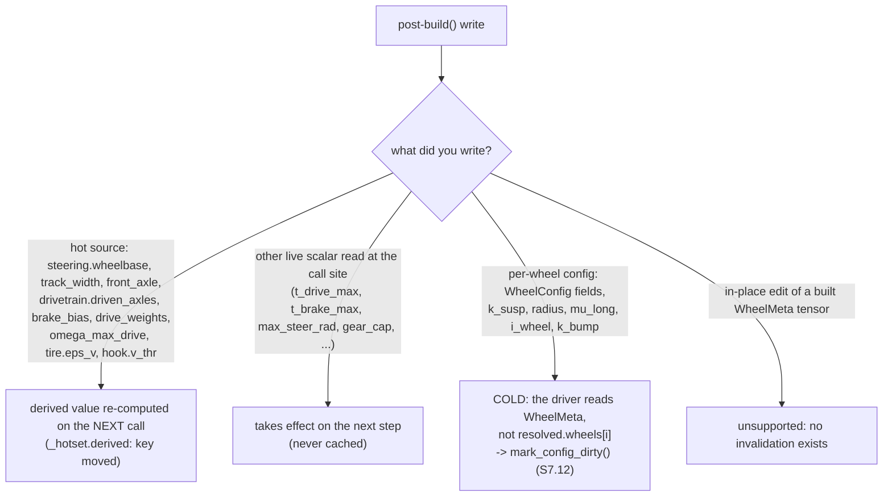

# Physics contracts

The SDK's promises about ambiguous physical conventions. These contracts are
enforced by `genesis_vehicle.dynamics` (pure-Python, unit-tested in
`tests/test_dynamics.py`) and consumed by `_pipeline.compute_wheel_step`
(this sentence said `core.py` until v1.7.0; the step math lives in
`_pipeline.py`).

| abbr | meaning |
|---|---|
| `N` | suspension normal force (N) |
| `kappa` | longitudinal slip ratio |
| `rest_d` | suspension rest length; `compression = max(rest_d - distance, 0)` |
| `no_hit_value` | Genesis `Raycaster` option: the distance a ray reports when it hit nothing (defaults to `max_range`) |
| `max_range` | the raycaster's maximum ray length (m); `raycaster_max_range`, default 20.0 |
| RAW / CORRECTED distance | straight off `sensor.read().distances` / after `read_distances` subtracts the high-cast offset |
| `n_envs` / L3 | the parallel-scenario batching axis |
| `dual_scene` / `single_scene` | the two `raycast_mode` values: separate static-BVH raycast scene / one shared scene |
| BVH | Bounding Volume Hierarchy (the acceleration structure rays are cast against) |
| AABB | Axis-Aligned Bounding Box |
| VJS | `WheelJointInternalSync` — the legacy wheel-visual writer that drives solver joints |
| PD | proportional-derivative controller (the VJS `control_dofs_position` path) |
| RL | reinforcement learning (the partial-reset rollout pattern) |
| ISO 8855 | the vehicle-axis standard this SDK follows: `+X` forward, `+Y` left, `+Z` up |
| M | `contact_samples` — rays per wheel in a swept-envelope fan; 1 is the point contact |
| `s_j` / `c_j` | sample `j`'s longitudinal offset from the wheel centre / its swept-circle height penalty `r - sqrt(r^2 - s_j^2)` |
| `d_eff` | the one distance per wheel a fan reduces to, `min_j(d_j + c_j)` |
| `r` / `h` | wheel radius / obstacle (step) height, metres |
| RR | rolling resistance (`RollingResistance`), §7.15 |
| `cr` | rolling-resistance coefficient (`WheelConfig.rolling_resistance_cr`) |
| ω, ω′ (`omega`, `omega'`) | wheel spin rate before / after this step's pre-tire resisting torque (ω′ is the v1.7.0 name; since v1.8.0 it is `omega_r`) |
| `omega_r`, `omega_d`, `omega_t`, `omega_e` | v1.8.0: ω after the capped resisting torque / after the drive torque / after the brake projection / `omega_t` clipped to ±`omega_max` |
| `B_rem` | brake capacity left on a wheel the brake stopped this step (N·m) |
| D / Y / Z, `s` | v1.8.0 held-wheel deadbeat / lateral deadbeat / their rigid-body scale `s = min(1, I_cg / sum_i (N_i/g)·rho_i^2)` (§7.16) |
| `I_cg`, `rho_i` | composite yaw inertia about the centre of mass (kg·m²) / horizontal distance from it to wheel i's ray origin (m) |
| G | explicit per-step lateral tyre gain on a wheel's mass share, `B_y·C_y·μ·g·DT / max(|v_long|, eps_v)` |
| `g` | 9.81 m/s², `dynamics.DEADBEAT_G` |
| SFL | `StaticFrictionLock` (§7.17) |
| `brake_thr` | REMOVED in v2.0.4: through 2.0.3, the brake level `StaticFrictionLock` had to EXCEED to engage (0.3 in the `"control"` profile) |
| `brake_rem` | v2.0.4 `PipelineContext` field: `B_rem` per wheel, read-only for hooks; the lock engages on `brake_rem > 0` (§7.22) |
| `k_eff` / β / f | v2.0.4: the lock's capped per-wheel stiffness / its planar rigid-body factor / its cap factor `min(1.0, 1.5/β)` (§7.22) |
| MPPI | Model Predictive Path Integral (a sampling-based controller that copies hook state between rollouts) |
| ζ / θ | damping ratio / slope angle |
| MPC / NMPC / LMPC | Model Predictive Control / its nonlinear (do_mpc + IPOPT) and linear (OSQP) implementations in `PathFollower` (§7.18) |
| U1 | the `ValueError` a default (MPC) `PathFollower` raises without `mpc_params` (§7.18) |
| K-turn / R-KTURN | (v2.0.3, opt-in) the `PathFollower`'s own multi-point turn with reverse legs / its `regime` value (§7.21) |
| back / vmin | back-travel after the first \|v\| < 0.05 m/s / minimum speed along the travel direction after it |
| HJW | the `GeneVehicle_HJW` demo car (outside this repo; ρ²/k² 3.9) |
| k² | `I_cg / m`, the squared yaw radius of gyration |
| `B_y`, `C_y` / `eps_v` | Pacejka lateral stiffness and shape factors / the tyre's low-speed floor on \|v_long\| (0.5 m/s) |
| `T_resist` / `T_rr` | axle resisting torque a pre-tire hook sets (N·m, sign of ω) / its capped value `cap_resist_torque(T_resist, ω)` |
| `M_eff` | effective coast mass, `M + sum(I_wheel / r^2)` |
| k | `cr * N * r^2 * DT / (tanh_scale * I_wheel)`, the explicit RR gain in the linear region of the `tanh` |

## 7.1 Brake torque is a positive command magnitude

`brake` (user input) is always in `[0, 1]`; the drivetrain turns it into a
per-wheel MAGNITUDE `T_brake >= 0`. **Since v1.8.0** the pipeline applies it to
the wheel spin BEFORE the tyre, after the resisting and drive torques, as a
Coulomb projection toward zero (`dynamics.brake_projection`):

```
omega_d   = omega_r + DT * T_drive / I_wheel           # omega_r: after RR, §7.15
stop_T    = |omega_d| * I_wheel / DT
held      = (T_brake > 0) and (T_brake >= stop_T)
omega_t   = 0                                if held
          = omega_d - sign(omega_d) * T_brake * DT / I_wheel   otherwise
B_rem     = T_brake - stop_T                 if held, else 0
```

- The FULL magnitude acts down to standstill (no `tanh`), and `omega_t` never
  has the opposite sign of `omega_d` (up to float rounding of the subtraction).
- A held wheel's leftover capacity `B_rem` widens the overshoot clamp both
  ways by `B_rem / R` (§7.7) and, in the ω update, resists spin-up by the same
  projection: `|omega_new| <- max(|omega_new| - B_rem * DT / I_wheel, 0)`.
- A zero brake never holds. That `T_brake > 0` term has no FORWARD effect (at
  `T_brake = 0`, `omega_d = 0` both branches give 0); it keeps the gradient
  `d omega_t / d omega_d = 1`, which `DifferentiablePlant` needs for throttle
  authority at standstill (`test_n22_*`).
- Enforced: brake + drive + resisting torque never reverse ω in one step
  (`test_n10_brake_drive_and_rr_never_reverse_omega`, random grid). Not
  bounded by it: the tyre friction torque, the `LowSpeedRegularizer` ω pull,
  a hook's `ctx.omega_override` (through 2.0.3 `StaticFrictionLock` set one on
  every engaged wheel; since v2.0.4 no SDK hook does).
- **A held WHEEL is not a vehicle at rest (corrected in v2.0.2).** This
  section and the docs that cite it said the brake "holds a stopped wheel" and,
  in places, that braked stops "hold" on a slope, without saying that the
  vehicle comes to rest only when `StaticFrictionLock` takes over, which needs
  `brake > brake_thr` (strict; 0.3 in the `"control"` profile, §7.17). That
  was incomplete. At brake ≤ `brake_thr` on a slope the wheels stop (ω exactly
  0) and never reverse, but the chassis slides on the tyre's slip: reference
  car, 5° downhill, brake 0.3 — 0.0250 m/s steady, no rest in 30 s (3°: 0.015
  m/s), with 750 N·m of brake against 407 N·m of gravity demand; brake 0.31
  stops in 2.2 s (impl-review probe, CPU/WSL2, genesis-world 1.4.5, dt 0.025 ×
  4, plane μ 1.0; identical on 2.0.1; CHANGELOG 2.0.2 §7). The measured slope
  holds of v1.8.0 were all at brake 1.0. A fix is planned for a later release.
  **Correction (v2.0.4): the mechanism in this bullet was wrong, and the fix is
  in 2.0.4.** The chassis does not "slide on the tyre's slip": on a held wheel
  the held-wheel deadbeat D (§7.16) limits `F_long` to
  `s·(N/g)·|v_long|/DT`, a damper with zero force at zero speed, so with no
  position hold the vehicle creeps at `v* = g·tan θ·DT/s`, s at the slope's
  wheel loads (5°: 0.02497 m/s
  predicted, 0.024974 measured; halving DT halves it). Since v2.0.4
  `StaticFrictionLock` engages on every wheel the brake holds (`B_rem > 0`) at
  any pedal (§7.22): reference car, 5° downhill, brake 0.3 now rests (4e-6
  m/s; 2.0.3 0.02497 m/s; impl-review, same conditions, CHANGELOG 2.0.4 §7). A
  held WHEEL is still not, by itself, a vehicle at rest: the vehicle rests
  where the lock takes over, and only if the brakes can hold the load.

**What this section said through v1.7.0, and why it no longer holds.** It gave
`T_brake_eff = T_brake * tanh(omega / smoothing_scale)` inside
`domega = (T_drive - T_brake_eff - R * F_long) / I_wheel`, capped at
`|omega| * I_wheel / DT` (`brake_torque_signed`), and since v1.7.0 capped
together with the resisting torque. That brake tended to zero as ω → 0, so it
could not hold a wheel: the reference car under full brake crept down a 10°
slope at 0.907 m/s and ran away on 20° (CHANGELOG 1.8.0 §2.2). The section
said so ("the smooth brake cannot pin the wheel"), but presented
`StaticFrictionLock` as the remedy; the lock could not hold either, because its
force was limited by the same inertia term. `brake_torque_signed` stopped
being called by the pipeline in v1.8.0, was deprecated then (a
`DeprecationWarning` on every call), and **was removed in 2.0.0** (module,
package root and `__all__`). This paragraph said "removal in 2.0.0" through
1.8.0; that removal is now done.

Implementation: `genesis_vehicle.dynamics.brake_projection`, called from
`_pipeline.compute_wheel_step`.

## 7.2 Normal force is non-negative; air-mask wheels contribute nothing

Per-wheel suspension force uses the asymmetric damper (different coefficient
on compression vs extension) and is clamped non-negative — the ground cannot
pull a wheel down:

```
c_damp = c_compression if c_dot > 0 else c_extension
N_raw  = K_susp * compression + c_damp * c_dot
N      = max(N_raw, 0)
N      = 0 if the ray missed the ground (air_mask)
```

When `N = 0`, the per-wheel `F_long`, `F_lat` are also zero (no contact),
though `T_drive` and `T_brake` still update `omega` (the wheel spins freely
in the air).

Implementation: `genesis_vehicle.dynamics.suspension_normal_force`.

## 7.3 `WheelConfig.i_wheel` truth policy

```
1. WheelConfig.i_wheel set by the user            -> AUTHORITATIVE (used as-is)
2. URDF inertia (via parse_urdf, projected on the spin axis) -> default
3. Genesis-runtime metadata (projected on +Y)     -> fallback estimate
4. DEFAULT_I_WHEEL                                -> last-resort fallback
```

`i_wheel` is the moment about the **spin axis**, `a^T (R I R^T) a` — not the
largest principal moment. Since v1.2.8 both estimating paths project onto that
axis (`<inertial rpy>` honoured). Before then they took `max(ixx, iyy, izz)`,
which is the spin moment only for a disc-like wheel (length < √3·radius); a
wide, small-diameter road wheel got roughly **2× its true spin inertia** and
accelerated half as fast as its URDF describes.

For ray-wheel dynamics, the wheel spin inertia is often different from the
URDF hinge inertia (e.g. URDF wheel hinge is visual-only while real
ray-wheel inertia comes from a coarser estimate). In Real2Sim / parameter
fitting, **always set `WheelConfig.i_wheel` explicitly** to take this out of
the estimation pipeline.

## 7.4 Steering sign convention (ISO 8855)

`+steer` is right turn under all strategies (`Ackermann`,
`PartialAckermann`, `SkidSteer`). Unit-tested:

- **Ackermann right turn**: both front wheels turn positive; the right wheel
  (the inner wheel for a right turn) has the larger angle.
- **SkidSteer right turn**: the left side commands more torque than the
  right side (`left_cmd > right_cmd` via
  `left_cmd = throttle + steer_gain * steer`).

The legacy `+steer = LEFT` convention is **not** carried forward; skid-steer here is
`+steer = right` (ISO 8855), so any code ported from a `+steer = LEFT`
convention must flip the steer sign.

### URDF authoring recommendation — steer joint axis = `(0, 0, -1)`

For new URDFs, declare steer joint axes as `(0, 0, -1)` so the joint angle
follows the same sign convention as the user-facing `+steer = right`:

```xml
<joint name="front_left_steer_joint" type="revolute">
  ...
  <axis xyz="0 0 -1"/>   <!-- ISO 8855: +angle = CW from above = RIGHT turn -->
  ...
</joint>
```

Vehicle frame z is up, so +joint_angle around `(0, 0, -1)` is CW viewed
from above = right turn — matches `+steer`. Using `(0, 0, 1)` instead makes
+joint_angle = CCW = left turn, which is **opposite-handed** to the SDK's
user-facing convention.

`WheelJointInternalSync` does compensate either way (`visual_cmd = -phys * sign`), so
existing URDFs with `(0, 0, 1)` still render correctly. The recommendation
is only for NEW URDFs: declaring `(0, 0, -1)` keeps URDF joint values and
user-facing steer values in the same sign domain, which makes URDF-side
inspection / debugging less surprising.

Examples surveyed:
- the reference car URDF — `(0, 0, -1)` ✓ (matches recommendation)
- the 6-wheel truck URDF — `(0, 0, -1)` ✓ (fixed in v0.5.4)
- one externally authored URDF — `(0, 0, 1)` (SDK handles via WheelJointInternalSync sign flip)

## 7.5 Coupling order

`CouplingStrategy.apply(omega)` runs after the per-wheel omega integration
in the current step and before the next step. Drive torque distribution in
the same step uses **pre-coupling** omegas (one-step lag), matching the
reference implementation. Strategies must not assume they run inside the
per-wheel loop.

## 7.6 First-step protection

The wheel raycaster is not populated until the first `scene.step()`. To
avoid a NaN cascade, `VehiclePhysics.step()` skips force application on the
first call when all distances are zero, sets `_prev_init = True`, and runs
normally from the second step onward.

### An env that has not completed a step renders at the REST pose (v1.5.2)

`_stepped_once` is **per env** — an `(n_envs,)` bool tensor, cleared per index
by `reset(env_ids=...)`. Every closed-form visual path
(`VehiclePhysics.wheel_visual_transforms`,
`MultiVehicleKindPhysics.wheel_visual_transforms`) masks a row whose flag is
False back to the rest pose, and `wheels_grounded` reports all-False for it.

The contract is that such an env renders at REST, not in an air pose, and the
distinction is deliberate:

- `_stepped_once == False` means **"no distance data"**, not "the ray missed".
  An air pose would assert a MISS that was never measured. Rest is the only
  pose that asserts nothing.
- `reset` already zeroes `wheel_spin_angle` and `last_steer_per_wheel`, so the
  wheel ORIENTATION is already the rest orientation. Giving it an air POSITION
  would produce a hybrid — rest yaw and spin, extended suspension — that
  corresponds to no state the vehicle was ever in.

Before v1.5.2 the flag was a single Python `bool`, so a partial reset left it
`True` and those envs' freshly-zeroed `last_distances` were fed to
`_susp_visual_offset` as a CORRECTED `0.0` — a legitimate contact at exactly
`RAY_UP_OFFSET`, i.e. **maximum compression**. The reset wheels rendered
jammed into the chassis and `wheels_grounded` (had it existed) would have
called them grounded.

Known gap: `MultiVehicleKindPhysics.wheel_visual_reads` /
`wheel_visual_transforms_host` — the split device-read / host-compute pair —
still gate batch-wide and carry no per-row mask, so for one frame after a
partial reset they render those wheels fully compressed (measured device
`0.3000` vs host `0.4000`). It self-corrects on the next step.

**Reach, corrected in v1.6.2.** This gap used to be described as reachable only
from "user-written RL and host render harnesses" — because the two reset paths
that could trigger it were both below the public surface. That is no longer
true. v1.6.2 made `VehicleScene.reset()` actually reset the batched driver (it
reset nothing there through 1.6.1) and added
`MultiVehiclePhysics.reset(vehicle_ids=...)`, so **a top-level SDK API now
reaches it**: a partial reset followed by a host-capture render frame. The
shipped OSC server is still exempt — both its `reset` command handlers re-pose
with `set_pos` / `set_quat` and never call `physics.reset()` or
`VehicleScene.reset()` (`server/l3_runtime.py:550-553`,
`server/physics_server.py:862-880`, verified at v1.6.2). Closing the gap costs a
sixth device-to-host download plus a signature change on the host helper, for a
one-frame artefact; it stays separately ticketed.

## 7.7 Longitudinal friction-force overshoot clamp (v0.6.0)

The tire-friction analogue of §7.1. Explicit-Euler integration of the
slip-dependent friction torque `T_fric = R·F_long` is stiff near rolling
(its relaxation rate `R²·C_kappa/(I·|v_long|) → ∞` as `v_long → 0`); below
the stability limit the wheel oscillates across the rolling point
(forward force → reverse slip → backward force → …), seen as wheel
"trembling" and a stuck `kappa ≈ −1` drag on undriven wheels at launch.

Since v1.8.0 the bounds are fixed BEFORE the tyre, from `omega_t` (§7.1),
and the clamp interval always contains zero:

```
omega_target  = v_long / R
F_long_limit  = (omega_t - omega_target) * I_wheel / (DT * R)
[lo, hi]      = [min(0, F_long_limit) - B_rem/R,  max(0, F_long_limit) + B_rem/R]
F_long        = clamp(F_long_hooked, lo, hi)            # plus D on held wheels, §7.16
omega_new     = omega_t - DT * R * F_long / I_wheel     # then the B_rem projection, §7.1
```

The clamp binds **only near rolling** (small `omega_t − omega_target`), so it
removes the oscillation while leaving the high-slip saturated regime — driven-
wheel launch slip — untouched. The **clamped** `F_long` is what is applied to
both the wheel-ω update and the chassis force, so a custom `TireModel` or
parameter-fit sees a force that may be reduced from its raw output near
rolling. Where the clamp binds on the RAW tyre force, `F_lat` and `kappa` are
taken at the TRANSMITTED force (`TireModel.at_long_force`, v1.8.0 — the
friction ellipse of the force that reaches the road, not of the raw request).
The interval is exposed read-only to POST_TIRE hooks as `ctx.F_long_bounds`,
and since v2.0.4 the `B_rem` that widens it as `ctx.brake_rem` (a detached
copy, §7.22).

**What this section showed through v1.7.0, and why it changed.** The clamp
used `omega_nofric = omega' + DT·(T_drive - T_brake_eff)/I_wheel` with the
branch chosen by `omega_nofric > omega_target`, the tyre evaluated at the
ω′ (the pre-step ω less the resisting torque). The drive and brake torques therefore went THROUGH the clamp while
the tyre never saw the wheel speed they produced, and ω alternated step to step
under any throttle or brake (reference car, throttle 0.15: 798 alternations in
800 steps; CHANGELOG 1.7.0 §8, 1.8.0 §1). Since v1.8.0 neither torque enters the
clamp: both act on ω before the tyre.

Implementation: `_pipeline.compute_wheel_step`, sections (Q) and (D).
**This section said "inline in `core.py` step (D)" until v1.7.0. That was
stale:** the step math moved to `_pipeline.compute_wheel_step`, shared by
`VehiclePhysics`, `MultiVehicleKindPhysics` and `DifferentiablePlant`.

**The clamp runs AFTER every `POST_TIRE` hook**, so a hook's edit to `F_long` is
a request the clamp may still cut, to zero on a freely rolling wheel. That is
how `RollingResistance` had no effect through v1.6.10 (§7.15). Likewise a
hook's `F_lat` is a request the lateral deadbeat may cut (§7.16).

## 7.8 High-cast rays and over-compression (v1.1.16)

Wheel rays start `RAY_UP_OFFSET` (default 1.0 m) ABOVE the wheel
attachment point and the read layer (`read_distances`) subtracts the
offset from hits, so every consumer still sees attachment-relative
distances. In `single_scene` the offset is capped per vehicle (v1.5.0, see
below); `read_distances` takes the offset off the sensor, so it always
subtracts back exactly what the pattern added. Contract points:

- A ray MISS keeps its sentinel value; the offset is NOT subtracted from
  misses. **The sentinel is the sensor's own `no_hit_value`** (a Genesis
  `Raycaster` option, which `model_post_init` fills with `max_range` when left
  unset), read through `raycast.ray_miss_value` — it is NOT a fixed number, and
  the correction that follows is:

  > **Correction (v1.5.2).** This bullet used to read "keeps its sentinel value
  > (>= 19.9)". That was **wrong** for every raycaster not built at the default
  > `raycaster_max_range=20.0`: `19.9` is that default less a margin, so at
  > `max_range=10.0` a miss (10.0) fell UNDER the threshold, was taken for a
  > hit, and `read_distances` returned 9.0 — the high-cast offset subtracted
  > from a distance that measured nothing. Three separate copies of the
  > threshold (`raycast.py`, `core._susp_visual_offset`,
  > `visual._susp_visual_target`) encoded the same false claim.

- The MISS test is an **equality**, `d_raw == miss`, evaluated on the **RAW**
  distance before the offset is taken off, plus a `d_raw != 0.0` term. Both
  halves are load-bearing:
  - Equality is exact because Genesis writes the sentinel verbatim and its own
    test is likewise an equality (`distances != no_hit_value`); a value with no
    float32 representation (19.9, 0.1) still round-trips.
  - RAW, because with `no_hit_value = 0.0` a genuine hit at exactly the offset
    corrects to `0.0` and would collide with the sentinel.
  - `d_raw != 0.0` rejects the UNPOPULATED buffer (Genesis allocates it as
    zeros and only fills it inside `scene.step()`), which is otherwise
    indistinguishable from four rays hitting ground exactly `up_offset` above
    the attachment points. It is only meaningful on RAW values.

  The two predicates are public: `is_ray_hit(d_raw, miss)` for raw distances
  and `is_ray_hit_corrected(d, miss)` (`d != miss`, no zero term) for corrected
  ones — everything in `last_distances`. Carry the mask
  `read_distances(..., return_hit=True)` produces rather than re-deriving one
  downstream.

- **A CORRECTED distance of `0.0` is a HIT, not air**: ground exactly
  `RAY_UP_OFFSET` below the ray origin, i.e. exactly at the wheel attachment
  point — full compression. `is_ray_hit_corrected` deliberately omits the
  `!= 0.0` term for this reason. Both visual mirrors carried the term until
  v1.5.2 and rendered that contact as fully-extended air; three tests encoded
  the same mistake for several releases because the contract above never said
  what a corrected `0.0` meant.

- **`no_hit_value` below `max_range` is UNSUPPORTED and raises.** A sentinel
  inside the measurable range is indistinguishable from a very close hit, and
  the pipeline reads `compression = max(rest_d - distance, 0)` — with
  `no_hit_value = 0.0` that is maximum compression and the vehicle launches. A
  non-finite or non-positive sentinel raises too (`nan < max_range` is False,
  so `nan` used to pass the range test and then made the equality never fire).
  `raycast.check_miss_supported` enforces both, and is called wherever the
  sentinel is OBTAINED — the stamp (`set_sensor_miss_value`), the read
  (`ray_miss_value`, which `VehiclePhysics.__init__` goes through) and the
  `dual_scene` injection (`VehiclePhysics.set_ray_miss_value`) — not only where
  the SDK happens to stamp it. A hand-built `gs.sensors.Raycaster` passed
  straight to `VehiclePhysics` is never stamped, so a stamp-only guard would
  have covered nothing but the SDK's own path.
- A hit may therefore report a **negative** distance: the ground is above
  the attachment point (the chassis has sunk past its wheels). That is a
  VALID reading — compression maxes out and `N` pushes the vehicle back
  up. Do not "sanitize" negative distances back to air.
- Why: with origins AT the attachment points, a hard landing could sink
  the origins below the ground; the rays then missed, the air mask killed
  `N`, and the vehicle rested on its chassis collision box forever (a
  stable buried equilibrium — the v1.1.16 field report).
- **The RAW read is `(n_envs, n_wheels)` — EXCEPT with a swept-envelope fan,
  where it is rank 3.** Genesis returns `(n_wheels,)` at `n_envs == 1` and
  `(n_envs, n_wheels)` otherwise; with `wheel_contact="swept_envelope"` (§7.11)
  it returns `(n_wheels, M)` and `(n_envs, n_wheels, M)`, **M last**.

  > **Correction (v1.6.0).** This doc and `docs/index.md` used to describe the
  > raw read as `(n_envs, N_WHEELS)` with no qualification. That is now
  > incomplete: it is the M=1 case. What holds unconditionally is the
  > post-`read_distances` shape below — state that, not the raw one.

  `read_distances` normalises BOTH the `n_envs == 1` squeeze and the M axis, so
  **every downstream consumer sees `(n_envs, n_wheels)` in every mode**:
  `last_distances`, the pipeline, `wheels_grounded`, `distances_list()` and both
  visual mirrors. Use `read_distances`; do not index the raw buffer.

- **`single_scene` CAN self-hit, and the offset is capped so it does not**
  (v1.5.0). A vehicle is never a *visual* raycast target
  (`use_visual_raycasting` defaults to False), which is why `dual_scene` —
  whose raycast scene holds no vehicle collision geometry at all — is safe at
  the full offset. But a raycaster also casts against the rigid solver's
  COLLISION BVH, and in `single_scene` that BVH contains the vehicle's own
  chassis box: from v1.1.16 to v1.5.0 the elevated origin sat above the
  reference car's roof and every ray self-hit, reporting -0.80 m and launching
  the vehicle. `raycast.single_scene_up_offset` now caps the offset at the
  vehicle's own collision ceiling (`urdf.self_collision_ceiling`, from the
  URDF's rest-pose collision AABBs) — 0.28 m for the reference car. A ray with
  nothing of its own above it keeps the full 1.0 m.
- The capped offset buys proportionally less over-compression headroom, so a
  `single_scene` vehicle recovers from a deep bottom-out less readily than a
  `dual_scene` one. `dual_scene` is the default for this reason among others.
- Keep overhead raycast terrain (tunnel ceilings) more than the vehicle's
  effective offset above the wheel attachment points.

Related: `WheelJointInternalSync` is intended to be cosmetic but is not
perfectly physics-neutral (the control path's PD applies real joint
forces; the set path teleports wheel mass). Its suspension targets are
stroke-clamped and slew-rate-limited (`_SUSP_VIS_MAX_RATE`), bounding
the measured disturbance to < 1 cm extra compression on hard landings
(was 2-3 cm unclamped — enough to flip a marginal landing into the
buried state before the high-cast fix removed that failure mode).

Since v1.1.17 `VehicleScene` no longer uses VJS by default: rendered
scenes with `n_envs == 1` draw wheels via `InstancedWheelRenderer` —
closed-form poses streamed into instanced render nodes (Genesis's
external render-node channel — the debug-draw machinery — NOT the rigid
solver), verified physics-identical to headless to 1e-6 m at a slight
pose-streaming cost (~2–3 ms/step at 30 vehicles, CPU)
(`wheel_render_mode="internal_sync"` restores the old behavior; multi-env
and raw-`VehiclePhysics` use still fall back to VJS).

Since v1.1.25 the native viewer additionally commits the wheel buffers, the
`follow_entity` camera and the rigid node poses in ONE render-lock hold
(`visual.patch_viewer_atomic_update`, applied automatically at `build()`).
Before that, the async draw thread could pair state from adjacent steps and
a followed vehicle appeared to "tremble" fore/aft at speed — a pure draw
artifact; physics was never affected (see CHANGELOG 1.1.25).


## 7.9 URDF contracts for ray-wheels (auto-corrected since v1.1.22)

Ray-wheel physics makes three demands on a vehicle URDF. Every
SDK-authored vehicle satisfies them; an arbitrary URDF (e.g. one exported
for a normal rigid-body sim) usually does not, so
`VehicleScene.add_vehicle` ALWAYS runs `genesis_vehicle.urdf_prep` on
it (not a knob — the prepared file feeds the entity, the parse AND the
ray pattern, which must agree), writing a corrected temp copy next to the
original — the original file is never modified, and a URDF that already
complies is used as-is (no copy).

| contract | why | auto-correction |
|---|---|---|
| **Wheels must not collide** | ground contact IS the raycast + suspension force model; a colliding wheel is a SECOND support that fights it (vehicle jitters in place, or rides on its colliders while the suspension pushes several times its weight) | wheel colliders are removed. A collider that is the wheel's ONLY geometry is first promoted to a `<visual>`, so the wheel still RENDERS — the instanced wheel renderer draws visual geoms, and physics never touches them |
| **The suspension attach point IS the wheel centre** | the ray is cast down from `WheelConfig.position` (= the prismatic joint origin) and `rest_d = radius + rest_stroke` measures from there | a chain that hangs the wheel off a carrier (`body --susp--> carrier --spin(z=+h)--> wheel`) puts the attach `h` below the wheel centre — the hull then settles `h` too high with the wheels visibly floating (measured on a 14-wheel tracked-vehicle model: h = 0.433 m). The spin-joint offset is folded into the suspension origin, leaving every link's rest pose unchanged |
| **Moving links need a valid inertial** | links with no `<inertial>` have zero mass AND inertia; Genesis warns ("mass and inertia of moving bodies must be larger than mjMINVAL"), falls back to its legacy URDF parser, and the articulated chain goes degenerate — the hull stops responding to force properly | a small inertial is injected where one is missing |

The OSC server builds its own morph, so it prepares the URDF itself and
hands the SAME prepared path to `build_cfg()` and `add_vehicle()` (fixed in
v1.1.24 — before that the server passed the original path and its vehicles
floated). If you supply `morph=...` to `add_vehicle` yourself, prepare the
file first and build the morph from the prepared path; `add_vehicle` warns
when the two disagree.

**These three are not equally severe, and the SDK reports them differently.**
Contracts 1 and 2 are *convention gaps*, not URDF defects: a wheel collider
is mandatory in a normal rigid-body sim, and a prismatic joint's origin may
sit anywhere along its own axis (a gauge freedom — the child chain
compensates, so the kinematics are identical). Such a file is perfectly
valid; it just does not match what the ray-wheel model reads out of it. Both
corrections are therefore reported as an informational line. A link with no
`<inertial>`, by contrast, is a **genuine defect in any engine**, and the fix
injects a placeholder mass the author never chose — so it raises a
`logging.WARNING` naming the offending links. Fix that one at the source.

Wheel RENDERING is independent of all of this: the instanced renderer
harvests the wheel link's visual geoms (falling back to its colliders, and
finally to a cylinder synthesized from `radius`) and draws them at the
closed-form ray-wheel pose. The wheel link's own solver pose is never used
— its visuals are hidden and its body only contributes mass.

## 7.10 `wheels_grounded` is a read-layer diagnostic, not the air mask (v1.5.2)

`Vehicle.wheels_grounded` / `VehiclePhysics.wheels_grounded` /
`MultiVehiclePhysics.grounded_list()` answer **"did this wheel's ray find
ground on the last step?"** — a question about the SENSOR. They are

```
last_hit & _stepped_once.unsqueeze(1)
```

where `last_hit` is the mask the read layer produced alongside
`last_distances` (§7.8) and the per-env gate is §7.6's. The gate is not
decoration: on the injected `dual_scene` path only corrected distances exist,
and the corrected predicate cannot recognise the pre-first-step zero buffer by
itself.

**The physics air mask is a different quantity.** The pipeline decides air from
`compression <= 0` (§7.2) and never looks at the sentinel. The two agree
everywhere except inside the suspension's rest gap: a ray can hit ground that
is still farther away than `rest_d`, so `wheels_grounded` is True while the
wheel carries no normal force and contributes nothing. Use `wheels_grounded` to
answer "is the vehicle over terrain at all" (fall detection, spawn validation,
RL termination); use `last_N > 0` or `last_compression > 0` if what you mean is
"is this wheel loaded".

`all_wheels_grounded` is `wheels_grounded.all(dim=1)` — `(n_envs,)`, True where
EVERY wheel of that env found ground. It is the supported answer to "is this
vehicle actually on the terrain?", replacing the ad-hoc
`distances.max() < 19.9` that samples and user code were writing (and which
§7.8 shows was wrong at any non-default `max_range`).

## 7.11 Swept-envelope wheel contact is OPT-IN and can only RAISE the ground (v1.6.0)

`VehicleScene.add_vehicle(wheel_contact=...)` selects the wheel-ground contact
model. **`"point"` is the default and is the single-ray contact of every
earlier release.** What the tests prove about it, since v1.8.0, exactly:

- `test_witness_rollout_is_bit_identical_to_the_37b8b79_tree`: a 200-step
  rollout of the reference car (contact path = `"control"` minus
  `RollingResistance`, per_vehicle, spawned at its settled height with vx
  10 m/s and wheels rolling, steer 0 and 0.05, NO throttle or brake) is
  bit-identical across `37b8b79` (v1.5.0), 1.7.0 and 1.8.0. It proves the
  raycast, suspension, rolling-tyre force and force application are unchanged
  WHERE NO 1.8.0 MECHANISM ACTS (no axle torque, no brake, no friction-ellipse
  binding, no contact below the lateral-deadbeat binding speed). It proves
  nothing about driving, braking, low speed, saturation or the fan; at 5 m/s or
  with a spawn drop the landing load spike makes the lateral deadbeat bind
  (§7.16) and the rollouts differ.
- `test_point_contact_equals_a_degenerate_fan_bit_for_bit`: point vs
  `swept_envelope` M = 3 at the default span on the SAME tree. A change to
  shared code moves both and passes it.
- `test_contact_path_rollout_matches_its_1_8_0_capture`: the driving rollout
  (60 brake + 140 throttle-0.5 steps) against its 1.8.0 capture (final x
  6.018499851226807). A regression lock for later releases, not evidence that
  1.8.0 kept the old path — it did NOT: 1.8.0 moved the driving rollout
  (5.920469284057617 → 6.018499851226807 contact path, 5.224289894104004 →
  5.349795818328857 full profile; CHANGELOG 1.8.0 §9). It passes unchanged on
  v2.0.4 (the 2.0.4 suite; the reference car's lock spring is uncapped at dt
  0.025); that is a regression check of this rollout only, not evidence about
  the 2.0.4 lock.

**What this paragraph said through v1.7.0:** "`point` … is the single-ray
behaviour of every earlier release, bit-for-bit" on the driving rollout. That
held through 1.7.0 for the contact path; since 1.8.0 it holds only for the
witness above. Nothing below applies unless a caller opts in.

**The defect `"swept_envelope"` addresses.** A single zero-radius downward ray
reads ground height as a STEP FUNCTION. A wheel at road level on one step and
0.13 m into a kerb on the next takes the whole obstacle height as compression in
one `dt`; the damper sees a rate no tire can produce and dominates the spring
(measured on the reference car at a 0.130 m lip at 3.3 m/s: `dcompression =
0.130` in one 0.025 s step, raw rate `5.200 m/s`, peak `N` `85,120 N`).

**The model.** M rays per wheel, uniformly spaced along **body +X** over
`[-r*fan_span, +r*fan_span]` using EACH wheel's own radius, each penalised by
the height its tire surface stands off the wheel's lowest point:

```
s_j   = (2j/(M-1) - 1) * r * fan_span        j = 0 .. M-1
c_j   = r - sqrt(r^2 - s_j^2)                c(|s| = r) = r exactly
d_eff = min_j (d_j + c_j)                    a MISSING sample goes to +inf
```

A wheel of radius `r` therefore begins to climb a step of height `h` about
`sqrt(2*r*h)` before it — where a real tire touches it.

Contract points:

- **`c_0 = 0` exactly, so `d_eff <= d_center` always.** The envelope can only
  RAISE the ground it reports, never lower it; a sinking regression is
  structurally impossible rather than merely untested. Verified over 2000
  randomised profiles including 1784 mixed hit/miss cases: zero violations.
- **M must be 1 or ODD.** An even fan has no centre sample, loses the guarantee
  above, and reads even FLAT ground biased (`r=0.35`: `-0.020017 m` at M=4,
  `-0.350000 m` at M=2, against exactly `0.000000` for any odd M). Even counts
  raise.
- **M=3 at the default `fan_span=1.0` IS the point contact.** Its two off-centre
  samples sit at `|s| = r`, where `c = r`, so for any obstacle shorter than the
  wheel radius they can never win the minimum (measured: identical peak `N`).
  That is correct behaviour, not a bug — M=3 is legal and useful at
  `fan_span < 1` (at `0.6` the same three rays see the lip). The default M is 9
  because it is the smallest count that does useful work at the default span.
- **M is a DISCRETISATION count, not an accuracy dial.** The peak force does not
  converge monotonically in M — it oscillates as which sample wins the minimum
  changes (ratio vs the point contact on the harness above: M=9 → 1.703,
  M=15 → 1.906, M=31 → 2.039, M=101 → 1.959, i.e. M=101 BELOW M=31).
  Convergence needs M around 101; across M ∈ [9, 31] the peak still swings by
  roughly ±20%. Pick M for cost, read the result as "no longer a step function",
  and **do not compare two runs at different M**. "Low phase spread" and
  "accurate" are separate claims; conflating them is how a bogus acceptance bar
  got written during this work.
- **The approximation errs late, never early.** M samples of the continuous
  envelope can miss a contact, never invent one — the discretisation is
  conservative in the safe direction. The model's real limitation is that the
  rays are **vertical** and therefore blind to terrain SLOPE, not the size of
  `c_j`. An intermediate `s_j` winning the minimum with a smaller penalty than
  the outermost sample is the model working.
- **The M axis never escapes `read_distances`** (§7.8). The per-wheel hit mask is
  the OR over the fan, and `d_eff` is clamped just under the miss sentinel so
  "the mask says hit" and "the value is not the sentinel" cannot disagree.
- **`single_scene`'s self-collision ceiling is measured against EVERY fan ray**,
  not the wheel centre, and takes the minimum gap (`raycast.fan_ray_positions`).
  An outer fan origin can sit under a low overhang the wheel centre clears, and
  a centre-only cap would leave that one ray starting inside the body — the
  v1.1.16 "the ray hits its own roof, reads maximum compression, the vehicle
  launches" failure, reproduced one sample at a time. For the reference car both
  caps give the same answer (its chassis AABB covers every fan origin), so the
  tests use a synthetic variant with a low sill outboard of the front wheels:
  centre-only `0.28 m`, M=9 fan `0.12 m`, and the centre-only value would put
  the outer ray origins at `z=0.58`, inside the sill at `z=0.44`.
- **One kind, one M.** Every vehicle of a `MultiVehicleKindPhysics` kind must
  share one fan size; `multi_vehicle.check_fan_uniformity` enforces it once at
  construction. Mixed sizes would either fail deep inside the stacked read or,
  when the wheel counts line up, silently mix two contact models in one batch.
- **`DifferentiablePlant` does not model the envelope.** It snapshots
  `distances` and holds them frozen over the horizon, so a `swept_envelope`
  vehicle's kerb crossing is still PREDICTED as a point contact. The simulated
  vehicle gets the envelope; the controller's internal model does not. See
  `docs/path-following.md`.

Nothing else in the pipeline changes shape or behaviour: the cost is M raycasts
per wheel per step where there was 1, plus one `min` reduction.

## 7.12 A config rebuild CARRIES the vehicle's runtime state (v1.6.2)

`VehicleScene.mark_config_dirty()` followed by `step()` is the documented way to
make a post-`build()` cfg change take effect. It re-groups the vehicles into
kinds and **replaces the batched `MultiVehiclePhysics`** — `VehicleScene.step`
→ `_ensure_grouped()` → `_build_mvp()`. The contract below is what that
replacement promises.

| abbr | meaning |
|---|---|
| MVP | `MultiVehiclePhysics` — the batched multi-vehicle driver a `VehicleScene(solver="batched")` owns |
| K | vehicles of one kind in one scene (the L2 batch axis) |
| NK | flat batch rows, `n_envs * K`, env-major / vehicle-minor (`env * K + slot`) |
| SFL | `StaticFrictionLock` — the hold-at-rest stability hook |
| `comp_rate` | suspension compression RATE, `(compression - prev_compression)/dt`, the damper's input |
| `rest_d` | suspension rest length (§7.2) |
| PD | proportional-derivative controller (the `visual_susp_mode="control"` joint path) |

**Through 1.6.1 there was no carry.** A rebuild constructed a fresh driver and
dropped everything the old one held. Measured on the reference car
(CPU/WSL2, genesis-world 1.4.0, `dt` 0.02, `dual_scene`,
`car_4w_rwd_ackermann(stability="control")`, 60 steps at throttle 0.5 / steer
0.1, then `mark_config_dirty()` + one step): wheel `omega`
`[-17.4207, -16.7303, -17.3659, -14.2479]` → `[-8.5504, -8.1484, -6.2335,
-5.8315]`, a 51–60 % loss in one step, and the spin accumulator jumped by up to
2.08 rad. With the carry the same run continues to
`[-17.3417, -16.6906, -14.8659, -16.6363]` and the spin delta is `|omega|*dt`.

### What a rebuild preserves

The enforcing path is `VehicleScene._build_mvp` → `MultiVehiclePhysics.import_state`
→ `MultiVehicleKindPhysics.import_slot` → `VehiclePhysics.load_runtime_state`.
The old driver is snapshotted per vehicle BEFORE the new one is constructed, and
the snapshot is written back after it, matched by **flat vehicle slot** —
`add_vehicle` is build-time only, so old slot *i* is new slot *i* and only the
kind/row placement can move.

- Integrator state: `omega`, `prev_compression`, `_prev_init`, `_stepped_once`
  (per env since v1.5.2, §7.6), `wheel_spin_angle`, `last_steer_per_wheel`,
  and since v2.0.2 the engaged gear `_gear` (§7.20; a snapshot from before
  2.0.2 has no such key, so the row keeps +1).
- Ray state: `last_distances`, `last_hit`.
- Read-layer diagnostics carried in the same loop (one clone each, so a reader
  between the rebuild and the next step does not see zeros): `last_compression`,
  `last_N`, `last_F_long`, `last_F_lat`, `last_T_drive`, `last_T_brake`,
  `last_kappa`, `last_alpha`. The authoritative list is
  `core.RUNTIME_STATE_ATTRS` / `RUNTIME_STATE_ROW_ATTRS` / `RUNTIME_STATE_SCALARS`.
- The wheel REST pose (`core.REST_POSE_ATTRS`). This one is carried rather than
  recomputed because a rebuild re-captures it from a vehicle whose suspension
  has SAGGED: measured `_rest_wheel_pos_local` z `0.3000` → `0.14989`
  (Δ 0.150 m, a permanent visual reference error) plus a tilt on the rest
  quaternion. It is restored to `0.3000` with an identity quaternion. A snapshot
  whose source capture had FAILED holds `None` and is skipped, so it cannot
  overwrite the new instance's good capture.
- The composite planar mass properties the deadbeat scale is built from
  (`core.MASS_PROPS_ATTRS`, v1.8.0, §7.16). Read once on the driver's first
  step and carried, because a re-read mid-drive sees displaced suspension and
  turret links; the rebuilt driver re-derives `wheel_meta.yaw_inertia` from
  them with `rho^2` recomputed from the REBUILT wheel positions. A driver that
  never stepped carries `None` and reads them on its own first step.
- Visual accumulators, per vehicle: the per-entity `WheelJointInternalSync`
  spin angle and its slew origin, and this vehicle's column of the batched
  `KindVisualBatch` spin accumulator.

**The config is still fully re-resolved** — that is the point of the call.
`resolved`, `wheel_meta`, the hook slotting, `dt`, `base_idx_list`, the
suspension clamps and the ray-miss sentinel are all rebuilt from the current
cfg. Carrying state and re-resolving config are not in tension: re-resolving the
same config was measured bit-identical, which is why the tests compare with
`torch.equal` and not a tolerance.

### What a rebuild REFUSES

Both of these raise `ValueError` from the **config precheck**
(`VehicleScene._precheck_wheel_counts`), which runs off the grouped cfgs before
any replacement driver is constructed. That ordering is load-bearing:
constructing an MVP is not side-effect free even when the result is discarded —
`WheelJointInternalSync.__init__` writes `set_dofs_kp` / `set_dofs_kv` onto the
LIVE entity's suspension dofs (`visual.py:227-228`) — so on the refusal path
there is no such side effect at all.

- **A wheel-count change.** The raycast sensor's ray count is fixed at
  `build()` and is not rebuilt here, so a vehicle whose `cfg.wheels` shrank
  produces a driver that dies on its very next step
  (`RuntimeError: The size of tensor a (3) must match the size of tensor b (4)`).
- **A wheel-order / identity change.** Every per-wheel tensor is carried by
  COLUMN INDEX, so a reordered list would land `omega`, `prev_compression`,
  `wheel_spin_angle`, `last_steer_per_wheel`, the ray state and the rest pose on
  the wrong physical wheel — and the sensor's ray ORDER is fixed at `build()`
  anyway.

Two qualifications, because the guard does not do quite what "identity change"
suggests. It compares wheel **names**, so a pure RENAME with the order unchanged
also raises — fail-closed and intended, since a name is the only identity the
SDK has here. And it is **skipped entirely** when a name is missing on
EITHER side — any `wheel_names` entry in the carried snapshot, or any
`cfg.wheels[i].name` in the new config: an unnamed wheel list carries no
identity to compare, so a reorder of unnamed wheels is NOT blocked. Do not read this as "a reorder is always
blocked". `VehicleScene._check_rebuild_shapes` repeats both checks against the
BUILT kind's `wheel_meta` / `resolved.wheels` as a backstop; the error message
names which of the two fired.

### A FAILED rebuild

`VehicleScene.step` rolls `_grouped_version` back to its previous value and
**re-raises**. The dirty flag is therefore not consumed by a failure: the next
`step()` retries and reports the same error, instead of a broken configuration
being reported once and then silently accepted while the old driver keeps
running under a config the user believes took effect. The new driver is built
into a local and published to `self._mvp` only after validation, the state
import and the renderer rebind all succeed, so a failed rebuild leaves the
PREVIOUS driver installed and stepping.

**Residual side effect, not fixed in v1.6.2.** A failure that happens AFTER the
new driver was constructed — the authoritative shape check, `import_state`, or
the renderer rebind — leaves the new cfg's `set_dofs_kp` / `set_dofs_kv` values
written onto the live entity's suspension dofs (`visual.py:227-228`) while the
OLD driver continues to run. The physics driver is consistent; the visual
suspension joint's PD gains are the new cfg's. The precheck keeps every
user-reachable structural change out of this window, but a `resolve()` that
raised, for instance, does not.

### `DifferentiablePlant` / `PathFollower`

The plant's `_StateSource` caches the proto, the kind, the entities, the row
indices, `resolved`, `wheel_meta` and `dt`. Through 1.6.1 those all belonged to
the discarded driver after a rebuild — the plant kept predicting off a driver
that is never stepped again, and `docs/path-following.md` recommends exactly the
flow that triggers it.

- It **re-binds at the ENTRY** of `predict`, `jacobian` and `solve`, before
  their `_snapshot()`. Staleness is one int compare against
  `MultiVehiclePhysics.build_id` on the normal path.
- It is **not** re-bound from inside a solve. `_sync_hooks` only ASSERTS that
  `build_id` did not move and raises `RuntimeError` if it did: re-binding
  mid-Newton would mix an old snapshot with new indices and produce one
  silently wrong inverse. Consequently, **calling `mark_config_dirty()` from
  another thread (or from a hook) while a controller is solving is outside the
  contract** — you get that RuntimeError, not a defined result.
- A **structural** change (wheel count, K, `n_envs`, member count) raises
  `RuntimeError` naming `mark_config_dirty`: the unroll's tensors and the warm
  start are sized for the old shape. Build a new plant (and a new
  `PathFollower` / `FleetFollower` around it).
- On a re-bind the prediction hook copies are re-taken from the new driver, so
  a rebuild that changed the stability-hook set is followed.

### Partial reset and the visual writers

`MultiVehiclePhysics.reset(vehicle_ids=...)` (new in v1.6.2) is per-VEHICLE; it
expands each vehicle to its own kind's `env * K + slot` rows.
`MultiVehicleKindPhysics.reset(rows=...)` is the row-level primitive.

- **Per vehicle**: the physics state of those rows (since v2.0.2 including the
  engaged gear, set to +1 on exactly those rows), and the spin accumulators of
  **both** visual writers — the per-entity `WheelJointInternalSync` and the
  batched `KindVisualBatch` column. Through 1.6.2-pre the visual resets ran with
  no index at all, so resetting one row wiped every vehicle of the kind
  (measured at K=2 / `n_envs`=2: vehicle 0's batch angle
  `[0.4316, 0.3281, -2.7312, 2.6947]` → all zeros while only vehicle 1 was
  asked for).
- **Kind-wide, and deliberately left alone on a partial reset**: the batched
  writer's suspension SLEW ORIGIN (`KindVisualBatch._susp_set_prev` /
  `_susp_ctrl_prev`). "No origin" is the whole tensor being `None`, not a row
  value, so clearing it for one vehicle is not expressible — and dropping it
  would snap the suspension visual target of every OTHER vehicle of the kind,
  which under `visual_susp_mode="control"` is a real joint PD transient, not a
  cosmetic jump.

So: **a reset vehicle SLEWS its suspension visual on the batched path and SNAPS
on the per-entity fallback path** (where the slew origin belongs to that vehicle
alone and is dropped). A full reset snaps on either. Chassis POSE is never
touched by any reset — place vehicles with `Vehicle.set_pos` / `set_quat`.

### NOT preserved

- **Instance attribute patches on the driver.** The OSC server monkey-patches
  `vs.physics.step` on the instance (`server/physics_server.py:709-732`,
  `server/l3_runtime.py:417-440`); a rebuild installs a new object and the patch
  is gone. Unreachable today — the shipped server never calls
  `mark_config_dirty()` — but any user code that patches the driver instance
  must re-apply after a rebuild.
- **A post-build `set_aero_drag` on a HAND-WRITTEN `ChassisConfig(mass=None)`.**
  `resolve()` copies the chassis in that one branch, so the runtime setter wrote
  to an object the rebuild discards. Every bundled preset fills `mass`, so the
  branch does not fire on the supported path (measured).

### Changing suspension constants across a rebuild

- `k_susp`, `c_compression`, `c_extension` are **unconditionally clean**. The
  carried `prev_compression` feeds a purely kinematic rate
  (`comp_rate = (compression - prev_compression)/dt`), which does not depend on
  the old coefficients; the new ones simply multiply it.
- `radius` and `rest_stroke` shift `rest_d`, and `compression` is measured
  against `rest_d`. Carrying `prev_compression` across that shift produces ONE
  step of spurious `comp_rate ≈ Δrest_d/dt`. It is **bounded** by
  `wheel_meta.comp_rate_clamp` (30.0 in the car and tank presets and in `DEFAULT_COMP_RATE_CLAMP`) and
  self-corrects on the next step, when `prev_compression` is back in the new
  geometry. Recomputing from the raw distance instead would trade this for a
  worse defect (the rate would be measured against no history at all).
- **No test covers a constant change across a rebuild.** The suite exercises the
  carry itself and the structural refusals; the analysis above is reasoning from
  the formula, not a measurement.

### Known gap — `StaticFrictionLock` state survives every reset

`SFL`'s per-wheel state (`StaticFrictionLock.STATE_ATTRS`: `_d_long`, `_d_lat`,
`_was_active` and, since v1.8.0, `_s_eng`, `_rested`, `_rest`, `_v_prev_sq`;
declared in `StaticFrictionLock.__init__`) is allocated on the hook instance and
is therefore **kind-wide**: one tensor shared by all K vehicles of the kind. No
reset path touches it — not `VehiclePhysics.reset`, not
`MultiVehicleKindPhysics.reset(rows=)`, not
`MultiVehiclePhysics.reset(vehicle_ids=)`. A reset-then-reposition-then-brake
sequence can therefore reuse a stale anchor for a moment, pulling the vehicle
toward where it used to be held. Since v1.8.0 also: a stale `_rest = True`
(with the wheel still engaged — through 2.0.3 "the brake still above
`brake_thr`", since v2.0.4 the brake still holding the wheel, `B_rem > 0`, at
ANY pedal — and the contact below the engage speed) skips the creep test and
re-applies the hold at once on the stale anchor, and a stale `_v_prev_sq` can
trigger one early creep takeover. The anchor is velocity-integrated, so a
teleport does not displace it, and the force is bounded by μN per wheel.
Measured for v2.0.4 (SDK-level emulation of the OSC server's L2 / L3 reset
call shapes, reference car resting on 5° at brake 0.3, teleported +10 m with
the brake held, no state clear; implementation, CPU/WSL2, genesis-world 1.4.5,
dt 0.025 × 4, plane μ 1.0): at most 0.827 mm (to flat) / 2.056 mm (to the
opposite 5° slope) of displacement, at rest within 2 s; with a manual
`STATE_ATTRS` clear 0.298 / 1.498 mm. Not run through the live server. Clear every `STATE_ATTRS`
entry yourself after a reset that teleports a braked vehicle. Separately
ticketed; the fix needs the hooks to carry row-indexed reset. (This section
cited `strategies/stability.py:204-206` for the anchors through v1.7.0; that
line reference was stale.)

### Premise: `_kind_key` is immutable after build

`VehicleScene._rebind_wheel_renderer` matches render units to kinds
**positionally**, which is sound only because kind ORDER is derived from the
immutable vehicle list on both sides: `_ensure_grouped` buckets by
`veh._kind_key` (set once, in `add_vehicle`, which is build-time only) in
first-seen vehicle order, and `MultiVehiclePhysics` groups by cfg identity in
that same order. `InstancedWheelRenderer.rebind` validates K and the wheel count
per unit and raises without touching any unit if either moved — but K and *n*
alone would not notice two same-shaped kinds swapping places. If a future API
ever lets `_kind_key` change after build, the unit must carry a kind identity
instead.

Without the rebind the renderer stays bound to the DISCARDED kind, which is
never stepped again, and **the rendered wheels stop turning permanently** while
the physics keeps running (measured headless with one offscreen camera: the old
proto's spin frozen at `[0.3005, 0.3005, 0.5585, 0.5585]` while the live kind
reached `[0.3867, 0.3864, 0.6415, 0.6420]`).

## 7.13 What a post-`build()` config write reaches (v1.6.4)

Since v1.6.4 several quantities the step path needs are computed at BUILD time
instead of on every call (`_hotset.prime_derived`, from
`VehiclePhysics.__init__`). This section is the contract that hoist has to keep:
**which writes still take effect, on which call, and which need a rebuild.**

| abbr | meaning |
|---|---|
| hot source | a config field the step path must keep reading LIVE; a post-`build()` write to it takes effect on the next call |
| derived value | a value computed from hot sources + `wheel_meta` + device/dtype, cached until one of them moves (`_hotset.derived`) |
| cold config | config the driver reads ONCE at build; changing it needs `VehicleScene.mark_config_dirty()` (§7.12) |
| SFL | `StaticFrictionLock` |
| `v_thr` / `eps_v` | SFL's activation speed threshold (m/s) / `CoulombIsotropic`'s slip-magnitude floor |



### The hot set is declared, not implied

`_hotset.HOT_DEPENDENTS` maps `(role, source attribute) -> (derived slot, ...)`:

| role | source | derived slot(s) |
|---|---|---|
| `steering` | `wheelbase`, `track_width`, `front_axle` | `_geom` |
| `drivetrain` | `driven_axles` | `_driven`, `_drive_share` |
| `drivetrain` | `brake_bias` | `_brake_bias` |
| `drivetrain` | `drive_weights` | `_drive_weights` |
| `drivetrain` | `omega_max_drive` | `_omega_cap` |
| `tire` | `eps_v` | `_eps2` (`CoulombIsotropic` only — `PacejkaAnisotropic` reads `eps_v` live at the call site and squares nothing, so it has no derived slot) |
| `hook` (any `stability_hooks` entry) | `v_thr` | `_v_thr_sq` (`StaticFrictionLock`; a hook without the source simply has no slot) |

The table is DESCRIPTIVE of the call sites — it does not itself invalidate
anything. The enforcement is `_hotset.derived`, which re-runs the compute
whenever the key it was given moves, and the gates are
`tests/test_build_time_hoists.py` and `tests/test_tire_coulomb_eps.py`: each
derives the value first, THEN writes the source, then asserts the next call
moved. That order matters — a "snapshot at construction" implementation passes
any test that writes the source before the first call, and fails these.

Guaranteed, and by what:

- **A write to a hot source lands on the next call.** Guard: the source is in
  `derived(...)`'s `key`, compared by VALUE.
- **An in-place edit of a LIST source lands too** (`brake_bias[0] = 0.9`,
  `driven_axles[0] = 1`): list sources enter the key as tuples
  (`drivetrain._axles_key` / `_bias_key`), so a mutation is a different key.
- **A new `wheel_meta` object is never answered with the old one's value**:
  `ref` is compared by `is` and held weakly. It deliberately never reaches
  `==`, because `WheelMeta` is a dataclass and `==` on two different metas
  raises "Boolean value of Tensor … is ambiguous".
- **A copy never inherits a cache**: the cache is keyed by `id(owner)` in
  `_hotset._CACHES`, so `copy.copy` / `copy.deepcopy` (the plant's prediction
  hooks) start empty.

NOT guaranteed, stated plainly:

- **An in-place mutation of a built `WheelMeta` tensor is not seen by
  anything.** That is unchanged from every earlier release — the pipeline reads
  `wm.*`, never `resolved.wheels[i].*` — and no invalidation hook exists for
  it. Re-resolve through `mark_config_dirty()` (§7.12).
- **A `wheel_meta` or an owner that cannot be weakly referenced is not cached at
  all.** `wheel_meta` is a documented duck type
  (`strategies.steering._WheelMetaProto`), and a `SimpleNamespace`, a
  `namedtuple` and a `__slots__` class all satisfy it while refusing
  `weakref.ref`. Such callers get the pre-v1.6.4 behaviour — derive on every
  call — not a stale value.
- **Derived slots are not attributes.** They live in `_hotset._CACHES`, off the
  owner — so a config stays picklable, and so the generic attribute sweeps that
  walk a strategy's `__dict__` cannot see them (`control/plant._sync_hooks`
  here; the structural fusion predicate in the diagnostic workstream).
  Read one with `_hotset.derived_value(owner, slot)`; there is nothing to
  `getattr`.

### Deriving early never changes WHETHER a config is accepted

`prime_derived` catches and debug-logs any role that raises while pre-computing.
A bad config (an `Ackermann` whose `front_axle` matches no wheel, a
`brake_bias` of the wrong length) therefore still raises its `ConfigError` from
the step path, with the same message, exactly as before v1.6.4 — the hoist
moved WHEN a value is computed, not whether a build succeeds.

### `has_bump_stop` is a whole-batch branch, and it differs under NaN

`WheelMeta.has_bump_stop` is a build-time python bool so §7.2's bump-stop term
can be skipped without a per-step device→host sync. Since v1.6.4 it is
`bool((k_bump > 0.0).any())`, an OR over every element, where it was
`float(k_bump.max()) > 0.0`. Consequences, exactly:

- It is a branch for the WHOLE batch, not a per-row flag: one wheel with a bump
  stop makes every row take the branch. That is exact, because
  `dynamics.bump_stop_force` returns 0 wherever `k_bump == 0`.
- The two forms agree on every ordinary value **including `-0.0` and `±inf`**,
  but NOT under NaN. `torch.max` propagates NaN, so the old form evaluated
  `nan > 0.0` as False and disabled the bump stop for the whole vehicle as soon
  as ONE wheel carried a NaN rate — even with real bump stops on the others.
  The OR is True there. A NaN rate is a broken config, and silently disabling
  every wheel's bump stop is the worse answer. Pinned in
  `tests/test_bump_stop.py`.

### Per-wheel broadcasts go through a rank test

`_pipeline.pw` / `pw3` replace 16 `unsqueeze(0)` broadcasts of `WheelMeta`
fields in `_pipeline.compute_wheel_step` and `core.py`. They return
`t.unsqueeze(0)` at rank 1 and `t` unchanged at rank 2 (`pw`) / rank 3 (`pw3`).
Every `WheelMeta` field is rank 1 today, so this is value-identical; the rank
test exists so that a later per-row field cannot silently become `(1, B, n)`
and broadcast the wrong axis. **13 sites are NOT yet converted** — 4 in
`strategies/stability.py`, 8 in `tire_models/pacejka.py`, 1 in
`tire_models/coulomb.py` — so do not read the helpers as a completed
invariant: `WheelMeta` fields are per-wheel-only until every site uses them.

## 7.14 Simulation time is fixed at `build()` (v1.6.5)

| abbr | meaning |
|---|---|
| dt | simulation STEP duration (s) |
| substeps | solver iterations per step; internal interval is `dt / substeps` |
| L2 | per-entity batching axis (K vehicles in one scene) |
| L3 | `n_envs` batching axis (same-URDF fleet) |
| UE | Unreal Engine (the OSC client) |

`VehicleScene.sim_options` is the **authored** `SimOptions` object — the one the
scene was constructed with. **Writing to it after `build()` changes nothing**,
on genesis 1.4.5 — the supported backend since SDK v1.6.9, where
`test_sim_options_and_timing.py::test_post_build_sim_options_writes_are_inert`
passes on a real CPU scene — on 1.4.0, the supported backend for SDK
v1.6.6-v1.6.8 and the engine the measurement below was taken on, and on 1.3.3,
which is no longer supported but whose compatibility branches still run if
installed.

Why: `Simulator.__init__` snapshots `_dt` / `_substep_dt` / `_substeps` at
construction and copies them into each solver at build; `Simulator.dt` is a
read-only property. This is true of genesis 1.3.3 (`genesis/engine/simulator.py`,
`self._dt = options.dt`) and of 1.4.0 alike. The engine's own accessors
(`scene.sim.dt`, `scene.sim.substeps`, `scene.sim.set_gravity`) exist on both.

Measured (CPU/WSL2, genesis-world 1.4.0, `dt=0.02`, a box dropped from z = 5.0):

| write after `build()` | effect |
|---|---|
| `options.sim.dt = 0.2` | none — 10 steps still advanced `sim.cur_t` to 0.2 (= 10 × 0.02) |
| `options.sim.gravity = (0,0,0)` | none — the box still fell, 5.0 → 4.793989658 m |
| `sim.set_gravity((0,0,0))` | **live** — Δz over the next 10 steps was −0.392398834 m, i.e. constant velocity |

So there is exactly one live knob, and the SDK exposes it as
`VehicleScene.set_gravity(gravity, envs_idx=None)`. To change `dt` or
`substeps` you must build a new scene. To READ what the engine is actually
integrating with, use `VehicleScene.effective_dt` and `VehicleScene.substeps`,
which read `scene.sim.*` — **not** the authored `VehicleScene(dt=, substeps=)`
arguments, which are never reconciled with the engine.

**When the authored and effective substeps can actually diverge — the
conditions, which an earlier draft of this section omitted.**
`VehicleScene` itself cannot reach the divergence: it always passes
`substeps=` explicitly (`_scene_kw`), and genesis 1.4.0 RAISES rather than
re-derives when an authored `substeps` conflicts with the solver `dt`
(`GenesisException: RigidSolver dt=... implies N substep(s) per step,
conflicting with the requested substeps=...`). The divergence is reachable
only when a caller supplies its **own** `sim_options` WITHOUT `substeps`
alongside a `rigid_options(dt=)` — then 1.4.0 derives
`substeps = round(SimOptions.dt / RigidOptions.dt)` and never tells the
caller. Harness for the number quoted below: a raw `gs.Scene`
(`SimOptions(dt=0.02)` + `RigidOptions(dt=0.005)` + `Plane` + `Box`),
genesis-world 1.4.0, CPU/WSL2 — **authored 1, effective 4**. The unqualified
phrasing ("genesis 1.4.0 can re-derive substeps") was too broad: read on its
own it suggests a default `VehicleScene(substeps=4)` might silently run at
something else, which it cannot. `VehicleScene.substeps` exists so that the
reachable case reads back honestly instead of echoing the argument; the same
conditions are on the property's docstring.

### Correction: the server's L2 `[Determinism]` line was false (v1.5.0 … v1.6.4)

`server/physics_server.py` printed
`[OK] [Determinism] 물리 해상도(sim_dt)가 표준 …로 설정되었습니다` immediately
after `vs.sim_options.dt = sim_dt`. That write never set anything. On genesis
1.3.3 it was silently inert; on 1.4.0 it raised `AttributeError` — because
`Scene.sim_options` was removed in favour of `Scene.options.sim` — and **killed
the L2 server on the first client connection**, for eight releases
(v1.5.0, 1.5.1, 1.5.2, 1.6.0, 1.6.1, 1.6.2, 1.6.3, 1.6.4). Both the
write and the claim are gone as of v1.6.5; the line now reports
`effective_dt` / `substeps` and says the values are fixed at build. The
accessor itself is branched once, in `_gs_compat.scene_sim_options`.

`server/l3_runtime.py` prints a near-identical line, but it performs **no
write** and says `고정` ("fixed") — that wording was, and is, true. The
correction above is scoped to L2.

**So is the fix. "Report the engine, not the argument" is applied to L2 only.**
`server/physics_server.py`'s line now reads `VehicleScene.effective_dt` /
`VehicleScene.substeps`; `server/l3_runtime.py:455-456` still prints
`sim_dt = ue_dt` — its own `--override_dt`/UE argument — and prints no substeps
at all. That is TRUE as written today, because the L3 scene is built with
exactly that `ue_dt` and nothing can change it afterwards (this section). It is
an asymmetry to tidy, not a falsehood: if the L3 build path ever stops passing
the argument straight through, the L3 line goes stale silently the way the L2
one did. Deferred, listed in the v1.6.5 CHANGELOG §8.

### `/Genesis/Config/Physics` is received and never consumed

`server/osc_manager.py` maps `/Genesis/Config/Physics/` (and the slash-less
twin) to a handler that stores UE's `gravity` / `dt` / `friction` / `viscosity`
/ `restitution` into `received_data['physics_settings']`. **Nothing reads that
dict** — grep finds only the writes inside `osc_manager.py`. A UE client that
sends runtime physics settings is silently ignored. Of those fields only
`gravity` could be honoured today (via `VehicleScene.set_gravity`); `dt` cannot
be, per this section. Deciding between consuming, rejecting loudly, and
removing the endpoint is a separate ticket — it is NOT fixed in v1.6.5.

## 7.15 Axle resisting torque is applied to ω BEFORE the tyre (v1.7.0)

**What was wrong through v1.6.10.** `RollingResistance` subtracted
`cr * N * tanh(v_long / scale)` from `F_long` in `apply_post_tire`. The
overshoot clamp (§7.7) runs after every hook and, on a freely rolling wheel,
cut that force back to zero; while driving, the force also entered the ω update
as `R * F_long`, the wheel spun up and the tyre returned it. The hook had no
effect. Reference car (`samples/urdf/car_4w.urdf`,
`car_4w_rwd_ackermann(stability="control")`, CPU/WSL2, genesis-world 1.4.5,
dt 0.025 x 4 substeps, plane μ 1.0, per_vehicle, dual_scene; 2 s window after
0.5 s of coasting from 5 m/s): 0.0073 m/s² with or without the hook, against a
closed form of 0.1478. Nothing in this document stated the RR model before
v1.7.0; `pipeline-and-hooks.md`, `concepts.md` and `api-reference.md` stated
the `F_long` subtraction as if it acted, and are corrected in place.

**The contract now** (v1.7.0; the ω order after `T_rr` changed in v1.8.0).
Per step, in `_pipeline.compute_wheel_step`:

```
ctx.T_resist = None                         # reset before either hook phase
for hook in post_tire_hooks: hook.apply_pre_tire(ctx)   # if the method exists
if ctx.T_resist is not None:
    T_res   = snapshot(ctx.T_resist)          # clone(); only the copy is used below
    T_rr    = cap_resist_torque(T_res, omega, DT, I_wheel)
            = sign(T_res) * min(|T_res|, |omega| * I_wheel / DT)
    omega_r = omega - T_rr * DT / I_wheel     # the v1.7.0 omega'
else:
    omega_r = omega
omega_d = omega_r + DT * T_drive / I_wheel    # v1.8.0
omega_t, B_rem = brake_projection(omega_d, T_brake)   # v1.8.0, §7.1
tyre(v_roll = R * clamp(omega_t, +-omega_max))        # v1.8.0 (through 1.7.0: R * omega')
ctx.omega = omega_t; post-tire hooks          # writing ctx.T_resist here raises
clamp + omega update from omega_t             # §7.7, §7.16
```

`RollingResistance` sets `T_resist += cr * N * r * tanh(omega * r / tanh_scale)`
in `apply_pre_tire` and does nothing post-tire. It keeps `slots = ("POST_TIRE",)`.

| claim | status | where |
|---|---|---|
| ~~With no `T_resist` set, the code path is the v1.6.10 one, operation for operation~~ | **true through v1.7.0, FALSE since v1.8.0**: the drive torque and the brake act on ω before the tyre whether or not `T_resist` is set, so no code path is the v1.6.10 one. What still holds: with no drive and no brake, `omega_t` equals the v1.7.0 ω′ | `test_n8_with_no_drive_and_no_brake_omega_t_is_the_1_7_0_omega_prime`; `test_zero_cr_rolling_resistance_is_value_identical_to_no_hook` |
| `T_rr` alone cannot reverse ω: `omega_r` keeps ω's sign or is zero, at any gain k | enforced by `cap_resist_torque`, for a `T_resist` of ω's sign, up to float rounding (a capped step can land a few ulp past zero) | `dynamics.cap_resist_torque`; `test_tiny_omega_with_huge_cr_cannot_flip_the_wheel` |
| Brake + resisting torque together cannot reverse ω in one step | enforced since v1.8.0 by the brake projection (§7.1), which cannot cross zero, applied after `T_rr`; drive included. Through v1.7.0 it was enforced by a second cap of the sum | `test_brake_plus_rr_never_reverses_omega` (192-cell grid), `test_n10_brake_drive_and_rr_never_reverse_omega` |
| ~~Capping the sum never makes braking weaker than the brake-only cap~~ | v1.7.0 only: there is no brake + resistance cap since v1.8.0. The brake now applies its full magnitude | `test_the_cap_never_weakens_braking` (kept as a test of `cap_resist_torque`) |
| `cr >= 0` and finite | enforced by `config.check_rolling_resistance_cr`, called from `config.resolve` and `core._build_wheel_meta_impl` (every driver build, `mark_config_dirty()` rebuild, `DifferentiablePlant`). NOT on a direct write to the `wheel_meta.rolling_resistance_cr` tensor. A custom hook adding its own `T_resist` must keep ω's sign itself | `test_rolling_resistance.py` |
| A write to `ctx.T_resist` in `apply_post_tire` raises `RuntimeError` | enforced for a rebinding always; for an in-place write through the tensor's version counter, which is SKIPPED for inference-mode tensors (no counter), so under `torch.inference_mode()` an in-place write is not detected. The physics uses the snapshot either way | `test_t_resist_written_after_the_tyre_raises`, `test_inference_mode_runs_and_an_in_place_post_write_cannot_change_the_physics` |
| On a freely rolling wheel the chassis gets `-T_rr / R` on the same step and ω ends at rolling | holds only with no drive and no brake and when the tyre request reaches the clamp limit; a weaker request passes less. Pinned for the reference car and tank at v = 2, 5, -2 m/s | `test_a_rolling_wheel_stays_rolling_and_the_chassis_gets_the_rr_force` |
| A free coast decelerates at `sum(cr * N) / M_eff` (+ aero) | measured, not enforced; only while `|omega| * r` is well above `tanh_scale` (0.5 m/s) AND chassis speed is at or above `LowSpeedRegularizer.v_kin_com` (0.5 m/s). Below either the deceleration is smaller. Measured on 1.7.0 (ratio to the closed form 1.0008 / 1.0007 / 1.0004 / 1.0004); NOT re-measured on 1.8.0 | CHANGELOG 1.7.0 §1.1: car 0.1473 vs 0.1472 at 5 m/s, tank 0.4779 vs 0.4778 |
| A free coast has no step-to-step ω alternation and no speed rise | measured, not enforced: 0 alternations (> 1e-4 rad/s), 0 rises (> 1e-5 m/s) over 20 s from 1.0 m/s on the reference car and tank, dt 0.025 x 4 substeps, on 1.7.0 and 1.8.0. The test pins 10 s at a 0.01 rad/s tolerance | CHANGELOG 1.7.0 §1.3; `test_coast_is_monotone_and_omega_does_not_alternate` |

**Hook fields.** In `apply_pre_tire`, `ctx.N`, `v_long`, `v_lat`, `omega` (the
pre-step ω), `air_mask`, `wheel_meta`, `dt` and (v1.8.0) `deadbeat_scale` are
valid; `F_long` / `F_lat` are `None`; `omega_override` and both `omega_pull_*`
fields have already been reset. In `apply_post_tire`, `ctx.omega` is `omega_t`
(v1.8.0: after the resisting torque, the drive torque and the brake
projection; through v1.7.0 it was ω′, after the resisting torque only), and
`PipelineResult.kappa` / `last_kappa` are the slip at `omega_e` (`omega_t` clipped to ±`omega_max`, the speed the tyre is evaluated at) — replaced by
`kappa_eq`, the slip of the TRANSMITTED force, wherever the clamp binds
(v1.8.0). Since v2.0.4 `ctx.brake_rem` (`B_rem`, §7.1) is `None` in
`apply_pre_tire` and set in `apply_post_tire` (§7.22). Both methods are looked
up with `getattr`, so a duck-typed hook lacking one is skipped for that phase.

**Not covered.**

* The cap bounds only the resisting torque. The brake projection bounds the
  brake. Neither bounds the tyre friction torque or a hook's ω pull; the drive
  torque acts within the step.
* At gain `k = cr * N * r^2 * DT / (tanh_scale * I_wheel) >= 1` the cap engages
  and `omega_r` is 0 for that step. **Not measured in a stable configuration**:
  the reference tank (k 0.92 at dt 0.025) reaches k > 1 only at dt 0.05, where
  its suspension is already past the bump-stop stability limit and v1.6.10
  diverges too.
* **This bullet said, through v1.7.0: "The drive and brake torques still go
  through the clamp the old way, and the same kind of step-to-step ω
  alternation under throttle or brake is v1.6.10 behaviour this section does
  not change."** True on 1.7.0 (throttle 0.15: 798 alternations in 800 steps on
  the reference car); FALSE since v1.8.0, which applies both torques before the
  tyre: the same scenario measures 0 (CHANGELOG 1.8.0 §1).
* `DifferentiablePlant` models the RR torque: it calls the same
  `compute_wheel_step`. **This bullet said its prediction "was independent of
  horizon parity within 0.3% at h 3 vs 4 on the reference car and tank at
  5 m/s". That was measured at throttle 0 only and was wrong as a general
  claim:** under throttle 0.3 the 1.7.0 plant gave d a / d throttle 1.230 at
  h 3 vs 1.847 at h 4 (car) and 2.577 vs 3.814 (tank), real explicit masses. On
  1.8.0: 1.847 vs 1.838 and 3.798 vs 3.790. The test
  (`test_plant_prediction_does_not_depend_on_horizon_parity`, 1% bound) now
  covers throttle 0.3 too.

## 7.16 Low-speed deadbeats D / Y and their rigid-body scale Z (v1.8.0)

**The defect.** Linearised at small slip angle, the tyre's lateral force on a
wheel's mass share `N/g` has the explicit per-step gain
`G = B_y·C_y·μ·g·DT / max(|v_long|, eps_v)`. For `G > 2` explicit integration
flips the sign of `v_lat` every step until the force saturates. Reference car
(B_y 8, C_y 1.3, μ 1.0, DT 0.025, eps_v 0.5): G = 5.1 below 0.5 m/s, 2 at
1.28 m/s. 1.7.0 had no lateral counterpart of the `F_long` clamp and alternated
on every low-speed manoeuvre with a lateral load (throttle 0.3 from rest: 99
`v_lat` flips in 100 steps). Pre-existing on every release measured; not caused
by v1.8.0. CHANGELOG 1.8.0 §5.1.

**The bounds** (in `_pipeline.compute_wheel_step`):

```
s     = min(1, I_cg / sum_i (N_i / g) * rho_i^2)        # Z, per batch row, this step's N
D:    |F_long| <= s * (N/g) * |v_long - R * omega_t| / DT   on wheels with B_rem > 0
Y:    |F_lat|  <= s * (N/g) * |v_lat| / DT                  on wheels NOT in ctx.hold_applied
SFL:  damper force <= s * (N/g) * |v| / DT                  (§7.17)
```

- **Why `s`.** With every wheel acting at once the contact velocities update
  as `(I - W·G)`, `W = J·M⁻¹·Jᵀ`. For loads in moment balance about the centre
  of mass, `M⁻¹·Jᵀ·G·J = s0·diag(1, 1, Σ(N_i/g)·ρ_i²/I_cg)`: with `s = 1` the
  yaw mode's factor is `1 - ρ²/k²`, which overshoots for `ρ²/k² > 2` (the HJW
  demo car: 3.9). `s` scales every bound so no PLANAR mode overshoots.
  Measured `s` at static load: HJW demo car 0.254, reference car 0.856,
  reference tank 0.935, `tests/data/low_yaw_inertia_car.urdf` 0.288.
  **Incomplete through v2.0.3, qualified in v2.0.4:** this bullet's "no planar
  mode overshoots" was stated without saying that it covers only the DAMPER
  side (modal damper number b ≤ 1, for moment-balanced loads). It does not
  bound `StaticFrictionLock`'s spring, whose yaw-mode spring number is
  about `c / s` for a per-wheel `c`: on the low-yaw car above (s 0.288) the
  lock cycled in yaw at about 0.27 rad/s under a full brake on 2.0.3 with every
  wheel's `c` below 1. The spring is bounded since v2.0.4 by the cap of §7.22.
- **D is a damper, so a held wheel alone does not stop a vehicle on a slope**
  (added v2.0.4). D bounds a held wheel's `F_long` by a force proportional to
  the contact slip speed, zero at zero speed. With nothing holding position, a
  braked vehicle on a slope therefore settles where D balances gravity, at
  `v* = g·tan θ·DT/s` with `s` at the slope's wheel loads (≈ `g·sin θ·DT/s`
  with `s` at the static flat load, 0.856 on the reference car — exact when
  s < 1 at both loads and every wheel load scales by cos θ; this is the
  arithmetic that gives the 0.02497 below) (planner measurement on 2.0.3, reference car, CPU/WSL2,
  genesis-world 1.4.5, DT 0.025 × 4, plane μ 1.0: 5° predicted 0.02497,
  measured 0.024974 m/s; 3° 0.0150 / 0.014998 m/s; halving DT halves it). What
  holds position is `StaticFrictionLock`'s spring after its creep test detects
  this equilibrium (§7.17, §7.22); through 2.0.3 it engaged only above brake
  0.3, so every lighter brake crept at `v*`.
- **Where Y binds.** Where the tyre's own explicit gain exceeds `s`: at static
  load only below `B_y·C_y·μ·g·DT·(N/N_static)/s` (reference car 2.98 m/s at
  DT 0.025, μ 1.0); for a low-yaw-inertia vehicle that `v*` is high (8.9 m/s
  derived for the test URDF above, about 10 m/s for the HJW demo car). **Under
  a wheel-load spike it binds AT SPEED too** (a landing, a washboard), removing
  the part of the spike force that would reverse the contact's lateral velocity
  within one step. **Do not read Y as inert above 2.98 m/s.**
- **Inputs.** `dynamics.YawInertia(i_cg, rho_sq)`. `VehiclePhysics` computes
  them once, on its first `step()`, from the entity's links
  (`_ensure_yaw_inertia`), into `WheelMeta.yaw_inertia`; a batched kind does it
  on its proto, so all K vehicles use `entities[0]`'s mass (mixed masses in one
  kind are NOT detected). A config rebuild carries them (§7.12).
  `compute_wheel_step(..., yaw_inertia=)` takes precedence over the wheel meta's
  value; `DifferentiablePlant` passes its own (from its mass properties) and
  never writes the live driver's wheel meta, so a plant built with explicit
  `mass=` / `izz=` / `com=` runs the same code with different Z inputs and can
  predict differently by design. No inputs at all (a direct pipeline caller) →
  `s = 1` and one `[genesis_vehicle:deadbeat-scale]` warning per process; a
  failed mass read (`ValueError`) → `s = 1` for that driver and one warning
  naming it; an entity without `links`, or an unrecognised link inertial API →
  `AttributeError`.
- **`g` is `dynamics.DEADBEAT_G` = 9.81**, not the scene's gravity. Under
  `|g| ≠ 9.81` every bound is `|g|/9.81` times the bound with the true mass
  share: tighter under weaker gravity, looser (unconservative) under stronger.
  The translational one-step factor `1 - s·|g|/9.81` stops removing the
  2-cycle at `|g| >= 2·9.81/s` (derived); the yaw mode stays deadbeat while
  `s < 1`. Measured at |g| 4.905 / 24.5 on the reference car: no 2-cycle (one
  0.01 rad/s ω alternation in one case at 24.5).

| claim | status | where |
|---|---|---|
| The low-speed lateral 2-cycle is gone | measured, not enforced: 0 / 0 / 0 flips on every lateral-kick case in the table of CHANGELOG 1.8.0 §5.1 on the reference car and tank, on the HJW demo car's settle and accel phases (turn phase 2 flips), and on `low_yaw_inertia_car.urdf` (which alternates with Z disabled) | `test_n25_reference_car_has_no_lateral_two_cycle`, `test_n26_*` |
| D and Y never exceed their bound | enforced by the clamp, on every wheel not in `ctx.hold_applied` | `test_n27_hold_applied_exempts_wheels_from_both_deadbeats` |
| `s` is in (0, 1] | enforced by `deadbeat_scale` for `i_cg > 0`; `yaw_inertia_from_mass_props` raises for `i_cg <= 0` or NaN | `test_deadbeat_scale_formula_and_the_inf_control`, `test_yaw_inertia_inputs_refuse_a_non_physical_rigid_body` |
| A plant never changes the simulator it predicts | enforced (the plant passes its inputs by keyword) | `test_n28_a_plant_with_explicit_masses_never_touches_the_driver` (both solvers, 40 steps bit-identical to a twin) |

**What Z does NOT cover:** pitch / roll coupling of the horizontal contact
forces through the contact height; loads not in moment balance (the
off-diagonal terms); with ONE wheel grounded it overestimates that wheel's
effective mass `m·I/(I + m·ρ²)` by up to 2×. Measured adequate only on the HJW
demo car, the reference car and tank, the low-yaw-inertia test URDF and (by
review) the Truck6w and AWD car.

**Measured costs** (CHANGELOG 1.8.0 §5.4, §5.5, with conditions):

- *Low-yaw-inertia flat cornering.* `low_yaw_inertia_car.urdf`, throttle 0.15,
  steer 0.1, per_vehicle, against a dt 0.003125 reference: 1.8.0's curvature
  error is LARGER than 1.7.0's at 3 / 5 / 8 / 12 m/s (0.3915 / 0.1850 / 0.0037
  / 0.0059 % vs 0.2446 / 0.0005 / 0.0011 / 0.0045 %), and its body slip angle
  is 15.2 / 17.1 / 5.9 % smaller than the reference at 3 / 5 / 8 m/s — a
  discretisation error 1.7.0 does not have (1.4 / 0.0 / 0.3 %).
- *Rough-ground cornering.* Reference car, 0.04 m washboard, 6.35 m/s: Y binds
  18–20 of 240 steps per run. Against the dt-refinement reference no ordering
  between 1.7.0, Y off and 1.8.0 is resolved (e ± SE 5.01 ± 1.72 / 2.38 ± 1.67
  / 0.99 ± 4.27 %), and Y makes the path 2.5× more sensitive to the launch
  speed. On 0.08 m bumps no dt-0.025 tree is within 67% of an unconverged
  reference. Nothing here shows Y closer to the reference.

## 7.17 `StaticFrictionLock` holds the point where the contact came to rest (v1.8.0; engage rule v2.0.4)

**Since v2.0.4** the lock ENGAGES per env, per wheel where the brake holds the
wheel this step (`ctx.brake_rem > 0`) and the planar contact speed
`sqrt(v_long² + v_lat²)` is below `min(v_thr, 0.5)`, at any pedal; it never
forces ω; it REPLACES the tyre force only after a creep equilibrium — the
held-wheel deadbeat binds on the raw tyre force (`|ctx.F_long| >=
ctx.F_long_deadbeat`) and the planar speed did not fall this step (`v² >=
CREEP_RATIO · v_prev²`, `CREEP_RATIO` 0.96). This is how a stop is detected:
the deadbeat-limited brake balances the load at `v* = g·tan θ·DT/s` with `s`
at the slope's wheel loads (§7.16), ≈ `g·sin θ·DT/s` with `s` at the static
(flat) load (equal when s < 1 at both loads and every wheel load scales by
`cos θ`) — 0.050 m/s at 10°, 0.098 m/s
at 20° on the reference car (s 0.856; derived). Full contract of the
2.0.4 rule, the spring cap and what is not covered: §7.22.

**What this paragraph said through v2.0.3, and why it changed.** "ENGAGES per
env, per wheel when `brake > brake_thr` and planar contact speed `< v_thr`. From
the first engaged step the wheel's ω is forced to 0. The lock replaces the tyre
force only after the contact is at REST: planar contact speed
`< StaticFrictionLock.REST_SPEED` (0.05 m/s), or a creep equilibrium." That was
the 2.0.3 code; it had two defects, both removed in v2.0.4: at a pedal ≤ 0.3 the
lock never engaged, so a braked vehicle crept down any slope at `v*`; above 0.3
the forced ω = 0 slid a vehicle whose brake could NOT hold it on locked wheels
(reference car 10°, brake 0.31: 0.0404 m/s, ω 0) and held wheels the drive
should have turned (§7.22). `brake_thr` and `REST_SPEED` are removed.

Before rest the anchor follows the contact and the brake (§7.1, D) does the
stopping. The takeover step anchors at the END of the step, so only the damper
acts on it. The first step after engagement on which `s_eng·v_long <= 0` (the
contact stopped or reversed) re-anchors the longitudinal spring at the contact.
The damper is `max(k_damp, 2·sqrt(k_eff·N/g))` (at least critical for the
wheel's mass share; `k_damp` is a floor; `k_eff` is `k_spring` capped per wheel
since v2.0.4, §7.22 — through 2.0.3 it was `k_spring`) and its force is bounded by
`s·(N/g)·|v|/DT`. The hold force is projected onto the friction ellipse and
then limited to `ctx.F_long_bounds`, what the wheel can transmit this step
including the brake capacity left; where limited, the anchor moves so the
spring asks for exactly the limit. Wheels whose force the lock replaced are
ORed into `ctx.hold_applied` and are exempt from D and Y.

| claim | status | where |
|---|---|---|
| No back-slide after a stop: back-travel ≤ 2 mm and vmin ≥ -0.01 m/s after the first \|v\| < 0.05 m/s | measured on the 14-row matrix of CHANGELOG 1.8.0 §6.2 (car and tank; brake 0.5 / 1.0; both pedals; from reverse; 10° downhill), CPU, dt 0.025 x 4. **One accepted exception:** car throttle 1.0 + brake 1.0 reaches -0.01036 m/s for one step with zero back-travel. Car 20° downhill: -0.0208 m/s (from 3 m/s, 0 mm) and -0.0258 m/s (from rest, 0.81 mm), reported | `test_n17_no_back_travel_or_reverse_speed_after_a_stop` (floor -0.0104 on the exception row) |
| The lock holds where the contact came to rest | measured (tank brake 1.0 from ±5 m/s: back-travel from the furthest point ≤ 0.5 mm; with A disabled 0.98 mm) | `test_n20_the_lock_holds_where_the_tank_came_to_rest` |
| A downhill stop is taken over and held | measured at **brake 1.0**: car 10° / 20° from 3 m/s stop in 0.95 / 1.575 s, hold ≤ 6e-6 m/s. Through 2.0.3 **only above `brake_thr`** (this row did not say so through v2.0.1). Since v2.0.4 at any pedal whose brake can hold the load: the 420-row car slope matrix of CHANGELOG 2.0.4 §7.2 (REST 276 / 276, signed and gear inputs; implementation) | `test_n12_*`, `test_n18_*`, `tests/test_light_brake_hold.py` |
| ~~"The vehicle truly stops when external force ≤ μ·N"~~ | **wrong since v0.5.7**: the hold is also limited by what the wheel can transmit — by the brake capacity since v1.8.0 (the `tank_skid_belt` preset, 75 kN of brake, does not hold 10°: 99 kN slope load) | SFL docstring, corrected in place |
| ~~The explicit spring is stable: `c < 4 - 2s` suffices~~ | **wrong** (corrected in v2.0.4). The per-mode condition `c + 2b < 4`, `0 < b < 2` is right, but this row applied it to each wheel as an independent mass share. In the planar YAW mode the damper bound puts modal b at 1 and the spring number is about `c / s`, set by mass and yaw inertia, not by the wheel loads: `tests/data/low_yaw_inertia_car.urdf` (s 0.288, every wheel's `c` 0.93-0.95) cycled in yaw at about 0.27 rad/s under a full brake on 2.0.3 (impl-review, CPU/WSL2, genesis-world 1.4.5, DT 0.025 × 4, plane μ 1.0). Since v2.0.4 the spring is capped (§7.22); that bounds λ(K) of the planar model only and is NOT a stability guarantee | `StaticFrictionLock` docstring (corrected) |

**State.** `StaticFrictionLock.STATE_ATTRS` lists every per-wheel tensor
(`_d_long`, `_d_lat`, `_was_active`, `_s_eng`, `_rested`, `_rest`,
`_v_prev_sq`). Code that copies the lock's state between hooks by name (MPPI
rollouts) must copy all of them; a hard-coded three-name list is silently wrong
since v1.8.0. The state survives every reset (§7.12 known gap). Not covered:
the A6 thresholds were chosen on the reference car, tank and HJW demo car only;
on a low-yaw-inertia vehicle the hold keeps a sub-mm/s yaw jitter (HJW demo car
brake phase: 526 / 792 flips, final speed 0.0004 m/s; 1.7.0 612 / 792,
0.0024 m/s). Through v2.0.3 this paragraph also said "a light brake on a
shallow slope still creeps (car 3°, brake 0.1: 0.0173 m/s)" — the creep of
§7.16 below brake 0.3; since v2.0.4 the reference car on 3° at brake 0.1 rests
(an EITHER row of the acceptance matrix, reported, not gated: the brake torque
is about 1.02 × the slope's demand there — ρ 1.023, derived in the release
plan, not measured). The HJW yaw-jitter figures are v1.8.0
measurements; on v2.0.4 the HJW demo car (now capped by the rigid-body term,
§7.22) rested in impl-review's 25 s braked holds at DT 0.025 × 4 substeps.

**Superseded in v2.0.4 — kept as the 2.0.3 record; its mechanism sentence
was wrong.** The paragraph below explains the creep as the chassis settling "at
the slip speed where the tyre force equals gravity". The measured mechanism is
the held-wheel deadbeat D acting as a damper (§7.16): `v* = g·tan θ·DT/s`
(s at the slope's wheel loads). Since
v2.0.4 the lock engages at any pedal on a brake-held wheel and the 5° / brake
0.3 row rests (§7.22).

**(2.0.3 record) At brake ≤ `brake_thr` the lock does not engage, so a braked
vehicle on a slope does not come to rest (corrected in v2.0.2).** The sentence above
presented the slope creep as an effect of a LIGHT brake; that was incomplete.
The lock's engage test is strict (`brake > brake_thr`, 0.3 in `"control"`), so
at brake 0.3 nothing takes over the tyre force: the brake holds every wheel at
ω = 0 and the chassis settles at the slip speed where the tyre force equals
gravity. Reference car, 5° downhill, brake 0.3: 0.0250 m/s steady, never at
rest in 30 s (3°: 0.015 m/s), although the brake torque (750 N·m) is 1.84× the
gravity demand (407 N·m) — not a weak brake; brake 0.31 stops in 2.23 s and
holds at about 1e-6 m/s (that row measured with signed inputs only, on 2.0.2
and on 2.0.1). Where the capacity really is short the wheels roll
instead (10° at brake 0.3: 750 < 811 N·m, 1.664 m/s; 5° at brake 0.1: 250 <
407 N·m, accelerating). impl-review probe, CPU/WSL2, genesis-world 1.4.5, dt
0.025 × 4, plane μ 1.0; every row except brake 0.31 identical on 2.0.1, on
2.0.2 signed inputs and in 2.0.2 gear mode (CHANGELOG 2.0.2 §7). The gear-mode `PathFollower`'s terminal, `SHIFT` and `GUARD` stops
command brake 1. The fix — the engage condition, a physics change that breaks
legacy bit-identity — is planned as its own later release.

## 7.18 `PathFollower`'s MPC layer: what the constructor and the regime selection enforce (v2.0.0)

Not a physics contract — a control-layer one, kept here because downstream
code and tests build on it the same way. Guide: `path-following.md` §5.

**Enforced (code path named):**

- **Construction order**, each check raising before any side effect
  (`PathFollower.__init__` → `_check_mpc_args`): path length ≥ 2; plant
  present; `mpc_model` ∈ `PathFollower.MPC_MODELS` = `("bicycle", "off")`
  (`"pacejka"` raises `ValueError`; `mpc_feedforward=` / `mpc_correction=` are
  `TypeError`, not accepted-and-ignored); with `"off"`, any MPC-only argument
  (`mpc_params`, `mpc_impl`, `on_solve_failure`, `mpc_gains`, `mpc_v_floor`,
  `dt_ctrl`, and since v2.0.1 `mpc_align_gate`, `mpc_stall_timeout` — even as
  `None`) raises `ValueError` — told apart from "not given" by the `_Unset`
  sentinel, so an explicit default value also raises; a live vehicle or
  `DifferentiablePlant` whose resolved steering is not `Ackermann` (or a
  subclass) on exactly two axles raises `ValueError` naming
  `mpc_model="off"` (axles counted from `WheelConfig.axle_index`; an unknown
  axle makes the count unknown and fails); `mpc_params is None` raises U1 —
  for every plant type; `mpc_impl` ∈ {`"nonlinear"`, `"linear"`},
  `on_solve_failure` ∈ {`"pd"`, `"hold"`}; (v2.0.1) `mpc_align_gate` is `None`
  or two finite reals with `0 < theta_off < theta_on <= π` and
  `mpc_stall_timeout` is `None` or a finite real > 0 (`ValueError`; `bool`
  rejected); missing optional packages raise
  `ImportError` (`require_mpc_deps`); the params file is loaded and validated
  (`load_mpc_params`: `FileNotFoundError` for a missing file; `ValueError` for
  schema ≠ `genesis_vehicle.mpc_params/1`, missing keys, or a JSON `steering`
  that is not a two-axle Ackermann). Only after these does the 1.x plant
  coercion (`_as_plant`, `TypeError`) and the waypoint parsing run — so under
  the default `mpc_model` a call without params reports U1 even when the plant
  OBJECT or a waypoint's SHAPE is also wrong; the path-length, plant-missing,
  `mpc_model`-value and two-axle checks still come before U1. `tests/test_path_follower_mpc_api.py` pins the order.
  (v2.0.1) After those, in `_init_mpc`: `ValueError` unless the params'
  `wheelbase > 0` and the solver's steering limit `steer_cap · max_steer_rad`
  lies in (0, π/2) — R_min scales the §7.19 budgets.
- **Regime selection** (`PathFollower.plan`): the path state machine runs every
  step; DONE / cusp brake → a fixed command (`CMD`); `"off"` → the 1.x law
  (`R-OFF`); a reverse block → the 1.x law (`R-REV`), with no solver call; a
  forward block → the MPC, re-solved every 0.1 s; a solve that is not
  applicable under `"pd"` → the 1.x law (`R-FAIL`, mode `PD-FALLBACK`) until the
  next applicable solve; (v2.0.1) a forward step held by the heading gate →
  the 1.x law (`R-ALIGN`, `PD-ALIGN`), after a watchdog fire → the 1.x law
  (`R-STALL`, `PD-STALL`), a terminal stop → `CMD` with `(0, 0, 1)` (§7.19);
  (v2.0.2, gear mode) a `SHIFT` / `GUARD` step → `CMD` with `(0, 0, 1)`, no
  solve (§7.20); (v2.0.3, only with `mpc_kturn` given) a K-turn call →
  `R-KTURN`, no solve, no gate, watchdog or budget (§7.21).
  Which solves are applicable is the classification in
  `control/mpc/law.py` (`classify_solve`, `_MPCLaw.step`), the tables of
  `path-following.md` §5.5. `tests/test_path_follower_mpc_regimes.py`,
  `test_mpc_status_classes.py`.
- **Missing `yaw_rate` / `v_lat` on an MPC step** raise `TypeError` after the
  follower's path state is restored and before the clock or the MPC moves.
- **`FleetFollower` rejects MPC members** with `TypeError` before modifying any
  follower.
- **Feasibility** of a capped solve = largest violation ≤ 1e-4 in the solver's
  own scaled space; a non-finite iterate counts as infinitely violated
  (`NonlinearMPC.max_violation`; `LinearMPC` on `l <= A x <= u`).
- **The optional packages are not imported** by `import genesis_vehicle`,
  `genesis_vehicle.control` or `genesis_vehicle.control.mpc`
  (`tests/test_mpc_deps.py`, a fresh subprocess).

**Identity of `mpc_model="off"` to 1.8.0 — enforcement scope.** Since v2.0.1
the claim itself is narrower: for the same sequence of inputs, identical on
every step before the first `GOAL-MISSED` step, except at block-end steps where
1.x planned the next block's speed sign (§7.19); in closed loop such a step
changes the run from there on. This paragraph said "bit-identity" without that
qualification through 2.0.0, which was true then. Enforced on every tree only
for the 38 synthetic runs of `tests/test_pd_golden.py` (19 scenarios ×
{synthetic sweep table, fake coupled plant}, 8928 steps, captured on the 1.8.0
tree, compared with `==`): since v2.0.1, 34 on every step and 4 (`square`,
`square_tuned` × table / coupled — runs in which 1.x missed the goal and drove
away) up to their `GOAL-MISSED` step (665 / 644 / 684 / 657), stopped from
there on. Measured ONCE for the 2.0.0 release,
not re-run by the suite: a 300-path law-level fuzz (~148k steps), the
`path_follow_demo` / `path_follow_reverse_demo` command sequences (sweep and
jacobian) and `fleet_follow_demo --plant both --k 4` — all identical. Not
identical by construction: `extract_state` returns two more keys.

**Field parity — enforcement scope.** `tests/test_mpc_field_replay.py` replays a
200-step synthetic fixture of the field controller and compares exactly, **only
on its capture platform** (linux-x86_64, casadi 3.8.2, do_mpc 5.1.2, Intel Core
Ultra 9 285H); elsewhere it skips. The 538-step Genesis closed-loop parity
(max difference 0.0) was measured once for the release and needs the field
folder. Neither exercises a non-converged solve. (v2.0.1) With the default
heading gate and watchdog, parity holds only on runs where neither they nor
a budget, the goal-passed stop or the block-end sign fires — under `"hold"`
too, whose field parity needs `mpc_align_gate=None, mpc_stall_timeout=None`.
The 538-step replay was re-run with the 2.0.1 defaults (max difference 0.0,
`handover` {0, 0}), and `tests/test_mpc_field_replay.py` asserts `handover`
{0, 0} on its `PathFollower` replay.

**Not enforced by anything:**

- that a sweep table and a params file describe the same vehicle (a CSV
  carries no vehicle data; a mismatched pair is accepted silently);
- the steering type or axle count through a `SweepTable` (only the params
  JSON's own `steering` field is checked);
- that the params JSON describes the live vehicle beyond mass, wheelbase and
  the per-axle tyre coefficients — and a mismatch there only WARNS;
- that the prediction model matches the plant: it is a linear-tyre bicycle
  model, not the ray-wheel pipeline (no load transfer, slope, terrain, wheel
  spin or tyre saturation);
- any real-time bound: the NMPC overran 25 ms on 5.0-24.1 % of control steps
  on the measured machine depending on the session and harness
  (`path-following.md` §5.6);
- **progress from a misaligned start, and the 2.0.0 stall's mechanism —
  corrected in v2.0.1.** On 2.0.0, with the reference car spawned at (30, 0)
  facing +X at the start of the path (30, 0) → (10, -8) → (-10, -8) →
  (-30, 0) at 2 m/s, the MPC follower never moved in 1600 steps (40 s), every
  one of 400 solves converged, no warning, no fallback; the unmodified field
  follower did the same (impl-review, CPU/WSL2, genesis-world 1.4.5,
  2026-11-21). This bullet said the mechanism was not established and that the
  forward-only model and its ±π/2 horizon yaw bound were suspected, with root
  cause and fix planned for 2.1.0. **The yaw-bound suspicion was wrong**: it
  is measured inactive (21 start conditions, identical output at π/2 and
  3.1 rad); the forward-only speed bound `v_cg_x >= 0`
  (`control/mpc/alpasim_nonlinear.py:156`) is measured active and makes
  standing still the converged solution (Genesis-free constant-state probe;
  CHANGELOG 2.0.1 §1). The fix is §7.19 (heading gate and watchdog, default
  on), which does NOT make progress enforced: the MPC problem is unchanged,
  and with `mpc_align_gate=None, mpc_stall_timeout=None` the follower stands
  still on that start as on 2.0.0;
- thread safety (casadi's NumPy mode, the OpenBLAS thread count and warning
  filters are process-global).

## 7.19 `PathFollower` heading gate, watchdog, budgets and terminal stops (v2.0.1)

A control-layer contract, like §7.18. Guide: `path-following.md` §5.8;
measurements and conditions: CHANGELOG 2.0.1.

| abbr | meaning |
|---|---|
| e_psi | wrap(per-waypoint path yaw at the projection − chassis yaw), rad (`_heading_error`) |
| R_min | `wheelbase / tan(steer_cap · max_steer_rad)` from the solver's own parameters; 7.397 m for the reference car |
| s_hw | the furthest path-projection arc length (along the active block) over the earlier R-STALL entries of the block (`_stall_s_hw`) |
| h | interval between two `plan()` calls (s) |
| PD | the 1.x path law |
| R-MPC / R-REV / R-FAIL / R-ALIGN / R-STALL / CMD | `PathFollower.regime`: MPC on a forward block / PD on a reverse block / PD after a failed solve / PD while the heading gate holds / PD after the watchdog fired / a fixed command (DONE, cusp brake, terminal stop) — `path-following.md` §5.3 |
| R-KTURN | (v2.0.3, only with `mpc_kturn` given) a K-turn call: no solve, no gate, watchdog or budget charge; `GOAL-MISSED` not evaluated (§7.21) |
| `GOAL-MISSED` / `MPC-ABORT` | terminal `last_mode` values: the goal-passed stop / a budget exceeded |

**Enforced (code path named):**

- **Goal-passed stop, every mode** (`_plan_pd` → `_goal_passed`; also under
  the MPC layer, because `_plan_pd` runs on every step): `GOAL-MISSED`,
  `stop_reason == "goal_passed"`, command `(0, 0, 1)`, exactly when the active
  block is the final one, the projection is on its last segment, the position
  is beyond the goal's segment-normal plane, at least `arrival_goal + 0.1` m
  from the goal, and the distance to the goal grew by more than 1e-3 m on each
  of the last two `plan()` calls. No kwarg turns it off. Since v2.0.3 it is not
  evaluated on R-KTURN calls (which exist only with `mpc_kturn` given, §7.21):
  `_plan_pd` skips it while an episode is active and takes that call's goal
  distance back out of the history. A missing-`yaw_rate`
  `TypeError` restores its history (the snapshot in `_plan_mpc`), so a retried
  call cannot fire it one call early.
- **Block-end speed sign, every mode** (`_plan_pd`): at a non-final block's
  end the planned `v_target` carries the current block's direction sign.
- **Terminal state** (`_terminal`): `GOAL-MISSED` / `MPC-ABORT` persist until
  `set_path` or a `DONE` step; a `DONE` clears `stop_reason`; a terminal
  follower returns before the cusp state machine, so a `DONE` can clear only a
  final-block abort. `DONE` itself is recomputed every step (1.x).
  `PathFollower.TERMINAL_MODES` was `("DONE", "GOAL-MISSED", "MPC-ABORT")` in
  2.0.1; since v2.0.2 it also holds `"GEAR-ABORT"` (gear mode, §7.20), sticky
  the same way.
- **Heading gate** (`_handover_step`, `_enter_align`; only with
  `mpc_align_gate` not `None`): on forward, non-command steps outside R-STALL
  (and at the R-STALL exit), |e_psi| > `theta_on` → PD (`R-ALIGN`), released
  when |e_psi| < `theta_off` by `_reseed_block` (reference re-timed from the
  projection, `u_prev` reset; `_t_next` untouched). No solve on an R-ALIGN step.
- **Watchdog** (`_handover_step`; only with `mpc_stall_timeout` not `None`):
  on R-MPC / R-FAIL steps, a position within 0.25 m of the anchor for
  `mpc_stall_timeout` of `t` while farther than `arrival_goal` from the last
  waypoint → PD (`R-STALL`) until the position is 1.0 m from the entry point.
  The anchor resets on 0.25 m of movement, on `t` going backward, and on a
  forward jump of `t` by more than half the timeout.
- **Budgets, per forward block** (`_plan_mpc`, independent of `_handover_step`
  so the R-FAIL one is live with both kwargs `None`; reset on a block change
  and by `set_path` via `_reset_budgets`): the travel after R-ALIGN steps and
  after R-FAIL steps, each the distance between successive positions passed to
  `plan()`, aborts once it exceeds π·R_min (checked on the next R-ALIGN step /
  the next failed solve, so at most π·R_min plus one `plan()` interval's
  travel): `align_budget` / `fail_budget`. An R-STALL entry that is the 4th in
  a run aborts: `stall_budget`; a run starts at the block's first entry or at
  an entry whose projection is at least 3.0 m beyond s_hw (`_proj_s`, read at
  fires only). s_hw only grows and is at most the block length, so a block
  allows at most 3·(floor(L_block / 3.0 m) + 1) entries. A `DONE` step resets
  no budget; `_clear_handover` (CMD steps, R-REV, aborts, block release) does
  not reset s_hw (`tests/test_mpc_handover.py`).
- **R_min** is computed once at construction and raises `ValueError` unless
  finite and positive (§7.18), so an infinite budget cannot silently disable
  the R-ALIGN / R-FAIL budgets.

**Which kwarg turns off what.** `mpc_align_gate=None`: the gate and the
R-ALIGN budget. `mpc_stall_timeout=None`: the watchdog, the R-STALL run limit
and the `t`-jump rule. Never off: the R-FAIL budget (under `"pd"`),
`GOAL-MISSED`, the block-end speed sign. Hence no kwarg combination restores
2.0.0's `"pd"` behaviour exactly; both `None` equals 2.0.0 only on runs with no
`GOAL-MISSED`, no block-end sign step and no `fail_budget` abort.

**What the budgets bound, exactly.** MPC layer on, one forward block, between
two `set_path` calls: PD travel ≤ 2·(π·R_min + one `plan()` interval's travel) +
N_entries × (R-STALL episode travel) + braking, N_entries capped as above.

**Not enforced by anything:**

- **that the follower does not run away.** The 1.x PD can still drive away —
  with its projection pinned mid-path and receding, on the near side of the
  last segment and receding, or on a non-final forward block — and it can stay
  beyond the goal plane on the final block approaching slowly, or moving at
  about 2 m/s at a nearly constant distance so that the distance does not grow
  on two consecutive calls — either way `GOAL-MISSED` does not fire (seed 21;
  runs pinned near the path start and reverse-block run-aways were seen only in
  the planner's emulation on other seeds, not on the shipped code) — in `"off"`, on reverse blocks
  (R-REV, no MPC budget) and in PD phases before a budget is spent. Measured
  (`tests/test_pd_runaway_property.py`, kinematic bicycle, `"off"`, seed 21,
  120 paths per configuration, 120 s, pre-registered expectation): 2 / 2 / 3 /
  2 runs still driving at 120 s in the single-block clean / noisy and cusp
  clean / noisy configurations, 0 false stops;
- **a distance or time bound from `GOAL-MISSED`**: it counts `plan()` calls; a
  vehicle moving away slower than 1e-3 m per call (1e-3/h m/s) is not
  stopped, more than one `plan()` call per control step shortens the window,
  and travel before the goal plane is not limited;
- **the distance the MPC itself drives (R-MPC)** — no budget;
- **anything across `set_path`**: it resets every budget (impl-review: 40 m of
  R-ALIGN travel without an abort with `set_path` every 100 calls, budget
  23.24 m; measured on the pre-final 2.0.1 build, a path the final amendment
  did not touch);
- **R-STALL episode travel** (only its 1.0 m displacement), and **progress on
  the ground**: the run rule measures path-projection arc length, so stops on
  the inside of a tight curve, a coiled path, a vertex projection jump or a
  ≥ 3 m position outlier can start new runs without the vehicle getting
  anywhere (constructed by plan-review with a fake solver; not run on
  ray-wheel);
- **a time limit for a blocked vehicle**: noise-free, it stays in R-ALIGN
  indefinitely; with the watchdog on, a vehicle blocked in R-FAIL enters
  R-STALL and stays there (plan-review's fake-solver probe: it did not make
  the 1.0 m exit in the measured 100 s; noise of a few mm does not reach
  1.0 m);
  noise does fill the R-ALIGN budget (and the R-FAIL one with
  `mpc_stall_timeout=None`);
- **lateral room for the forward-only turn**: about 2·R_min (measured CTE max
  15.09 m on the stall course); a final block too short for the turn is not
  refused (C-v150 with a 5 m leg: 43.92 m of travel, CTE 23.95 m, then
  `align_budget`; 23.29 m of it in `PD-ALIGN`, 19.09 m under the MPC, 1.53 m
  braking) — unless `mpc_kturn` is given (v2.0.3, opt-in), where the block's
  first R-ALIGN entry can start a K-turn instead (§7.21; the forward alignment
  after a FALLBACK or at a later entry still needs the room);
- **that a stop is a real stall**: a vehicle the user holds still while the
  follower keeps being stepped hands over to `PD-STALL`, and holds long enough
  to fire the watchdog, the 2nd to 4th of a run each less than 3.0 m of new
  path progress, end on `stall_budget`;
- the thresholds (π/2, π/4, 2.0 s, 0.25 m, 1.0 m, 3.0 m, 3 entries, π·R_min,
  1e-3 m, 0.1 m) are chosen values, not derived; measured on CPU only, LMPC on
  two ray-wheel courses only.

## 7.20 Gear mode (opt-in, v2.0.2)

A vehicle-input contract (§7.20.1) and a control-layer one (§7.20.2). Guide:
`path-following.md` §5.9; measurements and conditions: CHANGELOG 2.0.2.

| abbr | meaning |
|---|---|
| g | gear: +1 forward, -1 reverse |
| v_xy | planar chassis speed `hypot(vel_x, vel_y)`, world frame (m/s) |
| `thr_eff` | the effective signed throttle the drivetrain sees on a gear row, `g * clamp(throttle, 0, 1)` |
| k_b | brake gain: modelled deceleration per unit brake (m/s² per unit brake) |
| `a_coast` | modelled acceleration at throttle 0, brake 0 (m/s²) |
| v_h | a sweep table's grid speed nearest 0, excluding 0, on the side used |
| `SHIFT` / `GUARD` / `GEAR-ABORT` | gear-mode `PathFollower` modes: brake for a gear change / brake while moving against the wanted gear / terminal, too many consecutive `SHIFT` / `GUARD` calls |

### 7.20.1 The vehicle

**Enforced (code path named).** The functions are in `gear.py`; both drivers
call them — `VehiclePhysics.step` and `MultiVehicleKindPhysics.step`, and
through them `MultiVehiclePhysics.step` and `VehicleScene.step`.

| guarantee | enforced by | scope |
|---|---|---|
| no input of a step carries a gear → the 2.0.1 gear-free code path | `encode_requests` returns `None`; the drivers then run their 2.0.1 lines in the 2.0.1 order | the four paths above. **Through 2.0.3 this row said "the 2.0.1 numbers"**, byte-identity measured on nine scenes against `tests/data/legacy_inputs_2_0_1.json`. Since v2.0.4 the physics of a braked wheel changed for every input (§7.22): the gear-free path is still the 2.0.1 path, but a scene with a brake no longer reproduces the 2.0.1 numbers; `tests/test_legacy_inputs_bit_identity.py` (platform-gated) now asserts the 2.0.4 capture `legacy_inputs_2_0_4.json`, and the 2.0.1 file is kept but no longer asserted |
| the gear is read off the caller's ORIGINAL input object, before `from_unified` | `getattr(inputs, "gear", None)` at the head of `VehiclePhysics.step`; the batched kind reads the input list directly | a custom `InputType.from_unified` that drops the field does not switch gear mode off |
| on a gear row the drivetrain sees `thr_eff`; hooks see it as `ctx.throttle`; `ctx.gear` holds the post-shift gear | `effective_throttle`, `with_throttle` (`dataclasses.replace`, the caller's object untouched) | `ctx.gear` is `None` on a step with no gear; set before the `PRE_LOOP` hooks |
| every wheel's `last_T_drive · g >= 0` on a gear row, g = the gear engaged AFTER this step's shift decision | `clamp_drive_to_gear`, after `update_gear`, before `compute_wheel_step` | custom drivetrains included — so a custom non-`PerSide` drivetrain's deliberate opposite-sign wheel torque is ZEROED in gear mode; driving in the gear's direction while rolling the other way (hill start) is allowed. `DifferentiablePlant`'s unroll is signed and not covered |
| the engaged gear changes only on a step where the CLAMPED throttle is exactly 0 and `v_xy < GEAR_SHIFT_MAX_SPEED` (0.5) | `update_gear`, right after the chassis state read | not evaluated on the first-step protection step (that step clamps to the gear engaged before it); a request that fails the test is deferred, re-evaluated every step it persists |
| gear given → a Python scalar gear other than ±1 (a `bool` too) and a negative Python scalar throttle raise `ValueError` | `validate_request`, from `Vehicle.set_inputs` and both drivers | a tensor gear is mapped by sign (0 → +1); a tensor throttle is clamped to [0, 1] — a negative element reads as 0, is not refused, and so permits a shift. With `gear=None` a negative throttle is the 2.0.1 reverse drive |
| a skid-steer vehicle (`PerSide` drivetrain or `SkidSteer` steering) refuses a gear: `ValueError`, no state written | `refuses_gear`, at `Vehicle.set_inputs` (off `cfg` before `build()`), `VehiclePhysics.step` (before any write), `MultiVehiclePhysics._precheck_gear_inputs` (before any kind steps), the head of `MultiVehicleKindPhysics.step`, `SkidSteerInputs.from_unified` (no gear field; raises instead of dropping), `PathFollower(command_mode="gear")` when the plant knows its source vehicle | a custom skid-steer drivetrain that does not subclass `PerSide` is NOT detected; `GearCommand.signed()` into a tank is not refused (a signed input); a `SweepTable` follower meets the refusal at the vehicle's first gear step; the tank's `gear` reads `None` |
| batched: a wrong-shape gear tensor (`ValueError`) and a steering input type that cannot carry `thr_eff` (`TypeError`) are refused before any kind steps | `_precheck_gear_inputs` (`check_request_shape`, `check_input_type`) | `solver="per_vehicle"`: `VehicleScene.step` steps vehicles one by one, so these two raise from that vehicle's `VehiclePhysics.step` after the vehicles before it were stepped (read in code). `check_input_type` probes `from_unified` with a stand-in object, not a `VehicleInputs`: a custom `from_unified` that type-checks its argument raises its own error there (impl-review N1) |
| `gear` is keyword-only | the dataclass fields and `set_inputs(..., *, gear=None)` | a positional fourth argument (a `GearCommand` splat) raises `TypeError` |
| the engaged gear is +1 after a reset of its rows, and carried across a config rebuild | `VehiclePhysics.reset` (both branches; reached by `MultiVehicleKindPhysics.reset(rows=)`, `MultiVehiclePhysics.reset(vehicle_ids=)`, `VehicleScene.reset()`), `RUNTIME_STATE_ROW_ATTRS` (§7.12) | the OSC server's L3 reset uses `set_pos` / `set_quat` and does not touch it (the server never sends a gear) |
| a step with no gear request leaves the stored gear as it was | `update_gear` runs only on gear steps; legacy rows of a mixed kind are `torch.where`-ed through | `gear` / `gear_list()` are meaningful only for a vehicle driven with gear inputs |

**Not enforced:** that a braked vehicle on a slope comes to rest — through
2.0.3 at brake ≤ `brake_thr` it crept with its wheels held (§7.1, §7.17); since
v2.0.4 the lock engages at any pedal where the brake holds a wheel, and whether
the vehicle rests is measured, not enforced (§7.22); that a vehicle driven
with `GearCommand.signed()` obeys the shift rule; anything about the friction
limit (the brake model below is linear only below it).

### 7.20.2 The gear-mode `PathFollower`

**Enforced (code path named):**

- **Default mode** (`_check_command_mode`): `command_mode=None` → `"gear"` with
  the MPC layer on, `"signed"` with `mpc_model="off"`. `"signed"` runs the
  2.0.1 finish unchanged (`finish` returns before `_finish_gear` is reached)
  and returns the 2.0.1 3-tuple; `tests/test_pd_golden.py` (unmodified) and
  `tests/test_mpc_field_replay.py` (pinned to `"signed"`, capture platform only)
  check it. Construction in gear mode, before any side effect: a skid-steer
  plant source → `ValueError`; no callable `accel_at` → `TypeError`; k_b from
  `brake_gain=` → callable `plant.brake_gain()` → the params' `brake_gain` key
  → derived from the params' `decel_brake_by_speed` → `ValueError`; a
  non-callable `brake_gain` attribute → `TypeError`; `brake_gain=` with
  `"signed"` → `ValueError`.
- **The command** (`_finish_gear`): `GearCommand` with throttle ∈ [0, 1], brake
  ∈ [0, 1], gear ±1 — the active block's sign (`_desired_gear`), except that a
  terminal step keeps the gear the follower believes engaged, and that (v2.0.3,
  only with `mpc_kturn` given) during a K-turn episode `_desired_gear` returns
  the episode's gear, so a reverse leg asks for reverse on a forward block
  (§7.21). `u_g = g·u < 0`
  never becomes throttle: it becomes `brake_for(a_target, a_coast, v, g, k_b)`
  at throttle 0. The PD KICK is suppressed while the vehicle moves against the
  gear by more than 0.05 m/s. `GearCommand` is not indexable (`TypeError`) and
  unpacks to exactly four values.
- **`SHIFT`** (`_shift_call`, in `_plan_pd` after the cusp state machine,
  before the projection advance): with `gear=` feedback, throttle 0 / brake 1 on
  every call whose engaged gear differs from the wanted one; without feedback,
  while the assumed gear differs, until the call after two consecutive slow
  calls (`hypot(v_long, v_lat) < 0.9 · GEAR_SHIFT_MAX_SPEED`; |v_long| when
  `v_lat` is not given). The construction-only motion rule (moving ≥ 0.5 m/s
  the wanted way → assumed engaged) runs on the first call that reaches this
  check; `resync_gear()` never re-enters it, so after `resync_gear()` the next
  driving call is always a `SHIFT` WITHOUT feedback; with `gear=` feedback a
  call whose feedback already equals the wanted gear drives (`_shift_call`
  returns `feedback != wanted`).
- **`GUARD`** (`_guard_call`, after `GOAL-MISSED`, before the lookahead): no
  feedback confirming the wanted gear and `g·v_long < −0.3` → latched throttle 0
  / brake 1, released on the call after two consecutive slow `GUARD` calls,
  after which the wanted gear is assumed engaged.
- `SHIFT` / `GUARD` calls are regime `CMD` with the MPC layer (no solve, no
  budget charged; inside a v2.0.3 K-turn episode regime `R-KTURN`, counted on
  the episode's leg or stop counter, §7.21) and restore the `GOAL-MISSED` history to its state before the
  call (`_gear_cmd_plan`).
- **`GEAR-ABORT`**: more than `SHIFT_MAX_CALLS` = 120 consecutive `SHIFT` /
  `GUARD` calls → terminal, `stop_reason == "shift_timeout"`, sticky until
  `set_path` (or a `DONE` on the final block, like `MPC-ABORT`). A driving call
  resets the count.
- **`set_path`** restarts the `SHIFT` / `GUARD` counters, releases the latch,
  clears a terminal mode, and keeps the assumed gear. **`resync_gear()`**
  forgets the assumed gear and clears the counters and the latch; it keeps a
  terminal mode; no effect in signed mode.

**The brake model is stage 2 only.** `control/brake.py` (`brake_for`,
`coast_for_brake`, `brake_gain_closed_form`, `brake_gain_from_params`) is
called from the gear finish and from construction; the MPC prediction model
keeps its throttle-based deceleration bound and `DifferentiablePlant`'s unroll
its constant constructor `brake`. `coast_for_brake` on a `SweepTable`
(`coast_hold_speeds`): equal to `accel_at(v, 0, pitch, roll)` for |v| ≥ v_h on
a sampled side; below v_h the flat coast held at v_h and faded by
`tanh(|v|/0.5)`, the slope term read at v_h or above and never faded; a table
side with no grid speed mirrors the flat part only; continuous at v_h, through
v = 0 only on flat ground. `SweepTable.accel_at` itself is unchanged (exact
forward map). A plant without `coast_hold_speeds` is passed through.

**Not enforced by anything:**

- **that the vehicle never drives against the block direction without
  feedback.** After an external reset of a moving vehicle (`vs.reset()`,
  `reset(env_ids)`; the velocity is untouched, the gear goes to +1) the
  follower keeps commanding throttle in the gear it assumes until the vehicle
  has stopped, moved back faster than 0.3 m/s and tripped `GUARD`. Measured on
  flat ground: 54 steps, 1.35 m of travel along the block direction while
  driven against it (report only; the gated quantity, travel AGAINST the block
  direction, was 0.0373 m). On flat or uphill ground about 68 steps was
  estimated beforehand — an estimate, not a bound; **on a downhill grade (in
  the block direction) that equals or exceeds the rolling resistance there is
  no time bound.** `gear=` feedback, or `resync_gear()` after the reset,
  removes it (measured: 0 mismatched steps with throttle).
- **a time bound on a `GUARD` ↔ drive cycle**: a driving call resets the
  `GEAR-ABORT` count and `GUARD` (a `CMD` regime) clears the stall watchdog.
- the two-slow-call rule's assumption that the vehicle shifted (the follower's
  `hypot(v_long, v_lat)` and the vehicle's `v_xy` agree for a base link without
  a morph offset — checked on the reference car only; without `v_lat` the
  follower uses |v_long|);
- that travel between an R-ALIGN step and a following `GUARD` step is charged to
  `align_budget` (it is not);
- the brake model outside reference car, plane μ 1.0, flat ground, 2-12 m/s,
  brake 0.1-1.0 (CHANGELOG 2.0.2 §5.4); the friction-limited regime; the
  conversion on a slope in closed loop; the fade shape on a table measured
  without `RollingResistance` or with another `tanh_scale`;
- that the gear-mode follower's path quality equals 2.0.1's: only the AC-6
  limits were gated, and two straight "behind" courses reach `DONE` 2.625 s /
  4.100 s later (accepted by the user);
- the thresholds 0.5 m/s, 0.45 m/s, 0.3 m/s, 120 calls, two slow calls, 0.05 m/s
  are chosen values, not derived; measured on CPU only; LMPC, GPU and
  closed-loop `n_envs > 1` were not measured in gear mode.

## 7.21 Opt-in K-turn of the gear-mode `PathFollower` (v2.0.3)

A control-layer contract, like §7.18-§7.20.2. Guide: `path-following.md`
§5.10; measurements and conditions: CHANGELOG 2.0.3. Nothing here touches the
vehicle, the pipeline or the OSC server; the vehicle rules of §7.20.1 enforce
themselves on every K-turn command.

| abbr | meaning |
|---|---|
| e | heading error at the decision, wrap(chassis yaw − path yaw at the projection) — `-_heading_error`, the opposite sign of e_psi |
| y' / s_rem / b / G | lateral offset from the projection segment (left +) / arc length to the block end / distance behind the block's first waypoint / `arrival_goal` on the final block, else `cusp_goal` (m) |
| R_min / r_plan | §7.19's R_min / the planner's arc radius `KTURN_KAPPA · R_min` = 1.2 · R_min |
| leg | one K-turn arc in one gear at full steering lock |
| hand-over | the stop, plan and settle calls before one leg |
| v_stop / dt_ctrl | the follower's standstill speed (default 0.05 m/s) / control period |
| d / g / phi / yaw0 | a leg's turn direction (yaw-rate sign, +1 counter-clockwise) / gear (+1 forward, −1 reverse) / planned rotation angle / chassis yaw at the leg's first settling call |
| x' | position along the path from the episode's start point (local frame) |
| callcap | the per-leg call limit `ceil(2 · cap / (1.0 · dt_ctrl)) + 120` |
| AC-5 | the 2.0.3 acceptance criterion for runs without gear feedback (threshold fixed before measuring) |
| F / R | forward / reverse leg in a leg sequence |

**Enforced (code path named).** `control/kturn.py` (parameters, trigger,
planner) and the K-turn methods of `control/path_follower.py` (`_kt_decide`,
`_kturn_step`, `_kt_cmd_call`, `_kt_leg_start`, `_kt_release`):

| guarantee | enforced by | scope |
|---|---|---|
| `mpc_kturn=None` (the default): no K-turn code runs; the 2.0.2 commands | every hook checks `self._kturn is not None` first (`_init_mpc`, `_reset_budgets`, `step`, `finish`, `_desired_gear`, the `CMD` branch and episode dispatch of `_plan_mpc`, `_abort`, `_enter_align`, `set_path`, `_plan_pd`) | measured per step on 51 Genesis runs (on the 2.0.3 tree) and the fixture `tests/data/kturn_off_2_0_2.json`; the always-present additions are `FollowerPlan.steer_cmd = None` and the zero `mpc_stats["kturn"]`. A claim about the FOLLOWER for the same inputs: since v2.0.4 the vehicle brakes differently at low speed (§7.22), so a closed loop no longer reproduces the 2.0.2 / 2.0.3 runs step for step (104 closed-loop runs on 2.0.4: terminal modes unchanged, `DONE` within 0.175 s; implementation, CHANGELOG 2.0.4 §7.2) |
| a `KTurnParams` needs gear mode and the heading gate | constructor, after `_check_command_mode`, before any attribute is set (`ValueError`); `_check_kturn` for the type; `mpc_kturn` in the MPC-only list (`ValueError` with `"off"`, even as `None`) | — |
| decided once per forward block, at its first R-ALIGN entry, after the `align_budget` check | `_enter_align` → `_kt_decide` (`_kt_block`), reset by `_reset_budgets` (`set_path`) | later entries of the block, and the rest of the block after a FALLBACK or release, are the 2.0.2 alignment; across `set_path` unbounded |
| no K-turn outside the domain: `abs(v_long) <= 4.5` m/s and remaining bend `<= 45°` | `kturn.trigger`, `kturn.remaining_bend` (sum of `abs(wrap(Δyaw))` over the segment headings from the projection segment to the block end) | heading jitter in the path adds to the bend and can disable it |
| fire iff `R_min (1 − cos e) − abs(y') > s_rem + b + G + 1.5`, or `R_min (1 − cos e) + abs(y') > L` with a `lateral_limit` L | `kturn.trigger` | the formula only — its accuracy is not enforced (it fires on `straight 10`, which 2.0.2 completes) |
| K-turn commands: throttle ∈ [0, 1], gear ±1 = the episode's gear, decelerations by brake | `_kt_cmd` (`(0, 0, 1)` on stop / plan / settle calls), the leg plan through `_finish_gear`; `_desired_gear` returns `_kt["gear"]` | the vehicle rules are the vehicle's (§7.20.1) |
| a leg commands throttle only on or after a call with `abs(v_long) <= v_stop` | the settle branch of `_kturn_step` (`leg["settled"]`), reached by every leg start through `_kt_leg_start`; reset by a `SHIFT` / `GUARD` inside the leg (`_kt_cmd_call`) | nothing about rolling back under throttle on a grade after that call |
| legs per episode ≤ `max_legs` (2..4), reverse legs ≤ `max_legs // 2`, across re-plans | `_kturn_step` passes `legs_left` / `rev_left` into every search; the planner skips levels with `n // 2 > rev_left`; release at `executed >= max_legs` | an episode can have zero reverse legs |
| a leg ends on its signed rotation (`d · wrap(yaw − yaw0) >= phi − 2°`) or its distance cap (`1.25 · r_plan · phi + 0.5`, reverse also `<= max_reverse`) | `_kturn_step` | distance = sum of displacements between successive `plan()` positions on settled driving and `SHIFT` / `GUARD` calls; a leg can exceed its cap by one call's travel plus the uncounted braking travel of mid-leg re-settle calls; a re-settle keeps `yaw0` and the distance |
| a call that takes a leg past `callcap = ceil(2 · cap / (1.0 · dt_ctrl)) + 120` calls without ending it → `MPC-ABORT` `kturn_budget` | `leg["callcap"]`, checked on driving calls (after the leg-end test, so a leg can END on call callcap + 1) and in `_kt_cmd_call` | settle calls are on the stop counter, not here |
| more than 120 counted stop calls in one hand-over → `kturn_budget` | `kt["n_stop"]`, incremented in the STOP-phase branch of `_kturn_step` (calls stamped `KTURN-STOP`; the last one, on which the stop ends, is stamped `KTURN-PLAN`), the settle branch (`KTURN-SETTLE`) and `_kt_cmd_call` outside a leg (`SHIFT` / `GUARD`); reset only at a leg end and episode start | not counted: the call that reaches standstill, and the further `KTURN-PLAN` calls of a multi-call search (≤ 19 per search, by the node cap) |
| `round(2.0 / dt_ctrl)` settled driving calls without 0.25 m of DISPLACEMENT → `kturn_blocked` | the leg anchor in `_kturn_step` | displacement, not progress: scraping along a wall or rolling back resets it, then only the leg call cap applies |
| ≤ 1000 planner nodes per call, ≤ 20000 per search (so ≤ 20 calls per search); an interrupted level is discarded whole, so a mirrored start gives the mirrored plan | `KTurnPlanner._search` / `_Search.advance` | node counts, not time; mirror symmetry excludes the exactly symmetric start (e = 0 and y' = 0) |
| every planned arc sample has x' ≤ s_rem at the start; with a `lateral_limit` L within L of the path window | `KTurnPlanner.region`, `remaining_ok`, `lateral_violated` | planned arcs only; the window is the path from `4 · r_plan + L` behind the start point to the block end |
| no plan before the first leg: FALLBACK without a `lateral_limit`, `kturn_infeasible` with one; a continued old plan that would leave L: `kturn_infeasible` | `_kturn_step` | — |
| `GOAL-MISSED` is not evaluated on R-KTURN calls, and the history is cleared at release and FALLBACK | `_plan_pd` (`_kt_gp_saved`), `_kt_release` | three calls are needed again after the release |
| `SHIFT` / `GUARD` keep an episode; `BRAKE_TRANS`, `DONE` and terminal modes end it; `set_path` cancels it | the `CMD` branch of `_plan_mpc`, `set_path` | `GEAR-ABORT` (more than 120 consecutive `SHIFT` / `GUARD`) still applies |
| release: MPC reference re-timed, watchdog anchored, gate re-armed | `_kt_release` (`_clear_handover`, `_reseed_block`, anchor) | — |

**Worst case at the defaults on the reference car** (R_min 7.397 m, r_plan
8.876 m, `max_reverse` 14.79 m, dt_ctrl 0.025 s): forward leg ≤ 35.36 m,
reverse leg ≤ 14.79 m (each plus the overruns above); reverse travel ≤ 29.59 m
per episode (two reverse legs, e.g. R F R F) and leg travel ≤ 120.86 m (the
worst reachable sequence F F R F, one reverse leg); ≤ 2950 calls on a forward
leg and ≤ 1305 on a reverse leg (callcap 2949 / 1304, + 1 because a leg can end
on the call past it), ≤ 120 counted stop calls and ≤ 19 further planning calls
per hand-over — ≤ 3 · 2950 + 1305 + 4 · 120 + 4 · 19 = 10711 calls per episode,
267.8 s at 40 Hz, including the call on which an abort fires. The no-progress
window is 80 settled driving calls, 2.0 s only if uninterrupted (`SHIFT` /
`GUARD` / re-settle calls neither advance nor reset it).

**Not enforced by anything:**

- **collision avoidance**: the K-turn does not know about obstacles; it assumes
  every planned arc's area is free;
- **stop and settle travel in distance** (call counts only);
- **anything across `set_path`** (each call resets the decisions);
- **the lateral excursion with `lateral_limit=None`** (only through the leg
  distance caps), and **the executed trajectory with a `lateral_limit`**;
- **that the legs follow their planned arcs**: legs are planned at r_plan and
  driven at full lock (measured 7.571-7.724 m against 8.876 m), so plans are
  discarded and re-planned and the choice can flip on sub-metre pose
  differences — the cause of the measured AC-5 FAIL (C-v150 L5 — a 150°
  vertex with a 5 m final leg — without feedback, CTE 16.007 m against 11.5 m; the LMPC run shows the same F F R F
  sequence with feedback, CTE 16.428 m, report only); closed-loop arc tracking is an open item;
- **that the follower reaches `DONE`** after a K-turn;
- **the trigger's accuracy** — a proxy fitted on one vehicle;
- **planning time** (measured median 2.80 ms, maximum 28.0 ms per call, one
  machine);
- **`DifferentiablePlant`'s prediction on a leg** (the follower calls only
  `throttle_for`; the plant keeps its pending acceleration);
- a tank built from a `SweepTable` alone is not refused at construction (the
  2.0.2 gap; a live tank is refused by the two-axle-Ackermann check);
- the chosen values (1.5 m, 4.5 m/s, 45°, 1.2, 1.0 m/s, 15°, 1.0 m, 2.0, 2°,
  2.0 s, 0.25 m, 120 calls, 1000 / 20000 nodes, `2.0 · R_min`) are chosen, not
  derived; measured on CPU, flat ground, μ 1.0, the reference car only — slopes,
  low μ, `single_scene`, `DifferentiablePlant` as stage 2, GPU, other vehicles,
  `n_envs > 1` and an external reset during a leg were not measured in Genesis.

## 7.22 `StaticFrictionLock`: pedal-free engagement, `brake_rem`, and the spring cap (v2.0.4)

A vehicle-physics contract for the `"control"` profile's lock (`raw` /
`research` profiles carry no lock and are not covered). Measurements and
conditions: CHANGELOG 2.0.4; the v1.8.0 rest-anchor mechanics (anchor, damper,
ellipse, transmit bound) are §7.17.

| abbr | meaning |
|---|---|
| SFL | `StaticFrictionLock` |
| B_rem | brake torque left on a wheel after `dynamics.brake_projection` (N·m, §7.1); `ctx.brake_rem` |
| T_d / T_b | per-wheel drive / brake torque (N·m) |
| H / U | `Σ max(T_b − abs(T_d), 0)` / `Σ max(abs(T_d) − T_b, 0)` over the wheels at rest |
| m_i | `WheelMeta.static_mass_share`, per-wheel static mass share (kg) |
| M / I_cg | vehicle mass (kg) / yaw inertia about the centre of mass (kg·m²) |
| N_static | a wheel's load at static equilibrium on level ground, `m_i·g` |
| D / s | the held-wheel one-step deadbeat on `F_long` / its rigid-body scale `min(1, I_cg / Σ (N_i/g)ρ_i²)` (§7.16) |
| n | the vehicle's wheel count |
| AC-2 | the 2.0.4 acceptance criterion "no counter-rotation on brake-dominated wheels" (CHANGELOG 2.0.4 §7.2) |
| β | `WheelMeta.static_rigid_factor.beta`, largest eigenvalue of `S v = β P v`, `S = Σ m_i J_iᵀJ_i` (planar contact Jacobians), `P = diag(M, M, I_cg)` |
| f | `min(SPRING_C_MAX, SPRING_C_RB / β)` = `min(1.0, 1.5 / β)` |
| k_eff | `min(k_spring, f · m_i / DT²)` per wheel (N/m) |
| c / b | spring number `k·DT²/m` / damper number `D·DT/m` of one mode |
| λ(K) | largest generalised eigenvalue of `K v = λ P v` |

### 7.22.1 Enforced (code path named)

| guarantee | enforced by | scope |
|---|---|---|
| a wheel engages iff `brake_rem > 0` and `v_long² + v_lat² < min(v_thr, 0.5)²` | `StaticFrictionLock.apply_post_tire`, `_v_thr_squared` / `_engage_speed` (`V_ENGAGE_MAX` 0.5) | the pedal is not read. A ctx without `brake_rem` (duck-typed) engages nothing. `v_thr` above 0.5 does not widen the window (`TankTuning`'s 5.0 acts as 0.5); a tensor `v_thr` is clamped |
| `brake_rem > 0` only where the brake holds the wheel this step (not conversely) | `dynamics.brake_projection` (`held = T_b > 0 and T_b ≥ abs(ω_d)·I/DT`, `B_rem = T_b − abs(ω_d)·I/DT` on held wheels, else 0) | a held wheel whose brake has no torque to spare (`T_b` exactly equal to the stopping torque) has `B_rem` = 0 and does NOT engage the lock; at standstill that is an exact drive == brake tie |
| the force is replaced only after the creep test (held-wheel deadbeat binds on the raw tyre force AND the planar speed did not fall this step) | `apply_post_tire` (`_rest`) | no rest-speed takeover (the 0.05 m/s `REST_SPEED` path was removed). Exceptions from state that survives a reset (§7.22.3, §7.12 known gap): a stale `_rest` re-applies the hold without a new creep test; a stale `_v_prev_sq` can trigger one early takeover |
| the lock never forces ω | `apply_post_tire` sets no `ctx.omega_override` | the pipeline feature stays for user hooks |
| `ctx.brake_rem` is `None` in `apply_pre_tire` and a detached copy of `B_rem` in `apply_post_tire` | `_pipeline.compute_wheel_step` (reset with the other per-step fields; set with `F_long_bounds`) | N·m, ≥ 0, pre-coupling, NOT masked for airborne wheels; not observable on the first-step protection step (no hook is called); writes are not detected — the pipeline keeps its own tensor, but a LATER hook in the list (the lock included) sees a written value |
| `brake_thr` and `REST_SPEED` are gone | constructor (`TypeError` for `brake_thr=`, any positional argument, any unknown keyword), raising properties on the instance and, through a metaclass, on the class (`AttributeError` on read / write / delete) | a ≤ 2.0.3 pickled hook unpickles; reading its `brake_thr` raises |
| per wheel `k_eff_i ≤ SPRING_C_MAX · m_i / DT²`; and `λ(K_eff)·DT² ≤ SPRING_C_RB` for the PLANAR (x, y, yaw) model, for any subset of grounded wheels and any steer angle | by construction of `k_eff` in `StaticFrictionLock._compute_k_eff` (no eigenvalue is computed at run time); three `AssertionError`s: β not finite or < 1 − 1e-6, a cap not positive and finite, a `k_eff` not positive | only where BOTH `static_mass_share` and `static_rigid_factor` exist; β ≤ 1.5 → `f` is `SPRING_C_MAX` itself, bit-for-bit the per-wheel cap; no wheel capped → `k_eff` is the `k_spring` object and the lock computes the 2.0.3 expression; to float32 rounding of the stored share (about 1e-7 relative). Verified over every wheel subset and steer in [−0.6, 0.6] rad on five fixtures (`tests/test_sfl_rigid_bound.py`) |
| `m_i` and β are computed once per driver, on its first step, from the build-time link masses | `VehiclePhysics._ensure_static_mass_share` (top of `step`, also when `yaw_inertia` was preset; on a batched kind's proto in `MultiVehicleKindPhysics.step`), `dynamics.static_mass_shares`, `dynamics.rigid_share_factor`; `DifferentiablePlant` triggers it at bind | β never reads `wheel_meta.yaw_inertia`; a batched kind uses `entities[0]`; runtime `set_mass` / per-env masses are not reflected; `DT` is `ctx.dt` only |
| the listed failure paths are logged once and do not raise: `AttributeError` or `ValueError` from the share read and solve, and `ValueError` from β (any other exception type propagates) | `_ensure_static_mass_share`: share `ValueError` / `AttributeError` → share `None` → UNCAPPED, one `[genesis_vehicle:sfl-cap]` line; equal-share fallback (a share ≤ 5 % of `M/n` or non-finite) → one line; β `ValueError` → β `None`, per-wheel cap only, one line | `rigid_share_factor` raises for β < 1 − 1e-6, but shares summing to LESS than the mass are not detected in general (a probe at shares × 0.5 on the low-yaw car gave β 1.734 and no error; no SDK path produces such shares) |
| one cap report per process per (wheel meta, `k_spring`, DT), naming the binding term | `_compute_k_eff` + the module registry (`register_sfl_cap_name`) | a plant's prediction copies share the wheel meta and do not re-print |

### 7.22.2 Brake does not override drive (a user decision)

Per wheel, the brake holds the wheel while `T_b` exceeds that wheel's drive
demand; where `abs(T_d) > T_b`, `B_rem = 0` and the wheel turns; the lock does
not engage there. Whether the VEHICLE moves follows from H vs U. Through 2.0.3
the forced ω = 0 held every engaged wheel whatever the drive. `tank_skid_belt`
(preset torques, `PerSide` drivetrain): every wheel of a side gets the WHOLE
side torque, `abs(T_d) = t_drive_max·abs(gear_cap·throttle ± steer)` =
`30000·abs(0.3·throttle ± steer)` N·m, while the brake is split over all n
wheels, `T_b = t_brake_max·brake/n` = `30000·brake/n` N·m
(`strategies/drivetrain.py`). So at brake 1.0 and standstill a wheel turns when
`abs(steer) > 1/n` or `throttle > 1/(0.3·n)`. On the 10-wheel reference tank
(`tests/data/tank_ref.urdf`): `T_b = 3000·brake`, thresholds steer 0.1 /
throttle 0.333 (a 6-wheel tank: 5000 N·m, steer 0.15 holds; a 14-wheel tank:
2143 N·m, steer 0.08 pivots — derived). Measured on the 10-wheel reference
tank: brake 1.0 + steer 1.0: −409.3° of yaw
in 5 s (2.0.3: −0.09°); brake 1.0 + throttle 0.5: 3.614 m (2.0.3: 0.122 m)
(impl-review, CPU/WSL2, genesis-world 1.4.5, DT 0.025 × 4, plane μ 1.0, 60
braked settle steps). Server mapping `maxTorque` / `maxBrake` move the
boundary. "No counter-rotation" (AC-2) is a measurement on
brake-dominated wheels and excludes exact ties, where the wheel is free.

### 7.22.3 Not enforced / not covered

- **Stability.** The cap bounds λ(K) of the planar model only. A mode is
  linearly stable iff `c + 2b < 4` and `0 < b < 2`; the deadbeat scale gives
  b = 1 only for planar modes under moment-balanced loads, and then
  `C_RB` = 1.5 means `1 − λ·DT² ≥ −0.5` (oscillation amplitude per step ≤ 0.5
  on the oscillating side). `C_RB` = 1.5 is the user's constant, not derived
  (any value in about 1.17-2 leaves the reference vehicles unchanged; one
  constant, 1, is planned for 2.1.0 — a plan, not a commitment). NOT covered:
  roll / pitch-coupled modes (a light 10-wheel tank's roll-coupled damper mode
  has modal b 1.257 and a linear 6-DOF spectral radius 1.31 before and after
  v2.0.4 — a linear computation, not a measurement; measured holds on that
  vehicle keep a peak speed up to 4.13e-2 m/s at ≤ 0.193 mm net over 30 s and
  are not called rest); loads not in moment balance; a wheel-load sum away from
  M·g (landing, bump stop: the translational damper number `s·ΣN/(g·M)`
  exceeds 1; pre-existing); a caller-supplied `wheel_meta.yaw_inertia` whose
  I_cg differs from the entity's (β uses the entity's, the damper the
  caller's; a preset `YawInertia(inf, ...)` on `low_yaw_inertia_car.urdf`
  still cycles at 0.260 rad/s at flat brake 0.3 — implementation, not gated);
  mixed-mass batched kinds; one wheel in contact.
- **A user-written `static_mass_share` after the first step keeps the OLD β**:
  set `static_rigid_factor` to `None` (per-wheel cap only) or to a
  `dynamics.rigid_share_factor` of the new shares. `load_runtime_state` does
  not refresh either (a `mark_config_dirty()` rebuild builds a new wheel meta
  and recomputes both).
- **Hold offset.** A capped wheel holds with deflection
  `F/k_eff ≤ μN/k_eff = μ·g·DT²/f · (N/N_static)`: 6.1 / 10.9 / 15.7 mm at
  DT 0.025 / 1/30 / 0.04 where f = 1 and μ = 1; 14.2 mm at 0.025 on the low-yaw
  car (f 0.4324). Its 36.3 mm at 0.04 is a formula value only: that URDF
  diverges at DT ≥ 0.03 with no hooks and no brake on 2.0.3 as well
  (pre-existing, independent of the lock, cause not established). The bound
  covers spring deflection per unit of static load, not total post-rest travel
  (an ungated 3° / brake 0.1 row on the low-yaw car drifted 22.1 mm after first
  coming to rest).
- **That a braked vehicle rests.** Measured, not enforced: on the reference
  car (420-row slope matrix), tank, truck demo URDF, server generic car, a
  266 kg light car (DT 0.025 / 1/30 / 0.04) and the low-yaw car (DT 0.02 /
  0.025); CPU, plane μ 1.0, gravity-tilt slopes. Nothing about GPU, μ ≠ 1,
  inclined meshes, `swept_envelope`, brake 0, an external push.
- **Reset.** The lock's state survives every reset (§7.12 known gap); since
  v2.0.4 the stale-anchor path is reachable at any pedal. No engage / release
  hysteresis. `_rest` can latch on an airborne braked wheel (no force there;
  a 1 m drop at brake 1.0 lands identically to 2.0.3).

### 7.22.4 Measured anchors (with conditions)

CPU/WSL2, genesis-world 1.4.5, `per_vehicle`, `dual_scene`, plane μ 1.0, DT
0.025 × 4, gravity-tilt slopes, `"control"`:

- reference car, 5° downhill, brake 0.3, 50 s: rests, 4e-6 m/s, 0.004 mm over
  [20, 50] s (2.0.3: creeps 0.02497 m/s); brake 0.1 rolls identically on both
  trees (impl-review);
- `tests/data/low_yaw_inertia_car.urdf` (β 3.468797, k_eff 231 780.64 /
  228 321.22 N/m): 10 REST rows rest with yaw rate ≤ 3.6e-7 rad/s over
  [20, 50] s (implementation; impl-review 1.79e-7 .. 3.2e-7 on 6 rows); the
  2.0.4 draft without the rigid-body term cycled at 0.229 rad/s (flat, brake
  0.3) — never shipped; at brake 1.0 the cycle (about 0.27 rad/s) exists on
  2.0.3;
- reference car at DT 1/30 / 0.04: capped (301 501 / 297 001 and 209 375 /
  206 250 N/m), the 6 REST rows rest (implementation; DT 0.04 re-run by
  impl-review).
